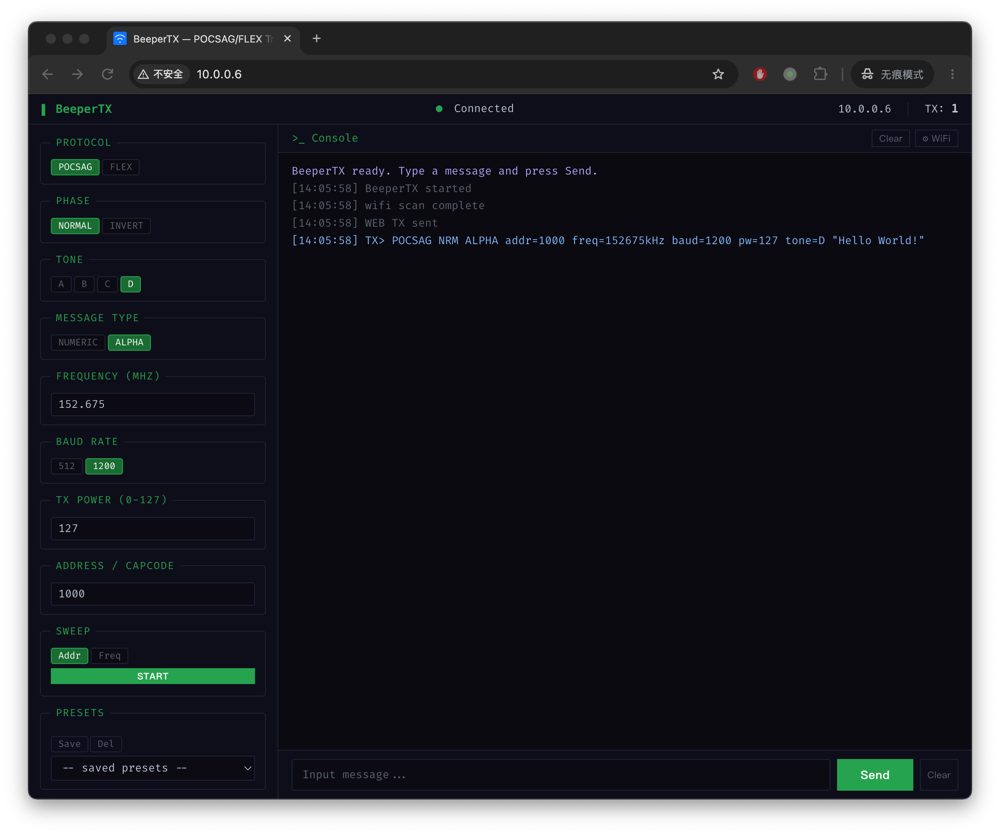

# BeeperTX — ESP32-S3 + Si4463 POCSAG / FLEX 寻呼发射机

基于 ESP32-S3 + Si4463 的双协议寻呼发射机，支持 POCSAG 和 FLEX 两种编码，
通过 GB2312 汉字字符集 + 控制字符实现中英文混排消息传输。

---

提供 **Web 控制面板**、**串口命令行** 和 **WiFi 配网** 三种交互方式，
所有控制接口共享同一套 API 命令集。




## 功能特性

- **双协议寻呼编码**: POCSAG（512 / 1200 bps）与 FLEX（1600 / 2400 / 3200 bps），
  发射时按配置自动路由到对应编码器，支持数字、字母与中文消息
- **中英文混排**: UTF-8 消息自动转 GB2312，借助 `\x0E`(SO) / `\x0F`(SI) 控制字符
  在中英文模式间切换，一条消息内中英文任意混排
- **宽频覆盖**: 119–1050 MHz，6 个频段自动选择（OUTDIV / CLKGEN_BAND），
  频率、功率、码率均可动态配置，无需重新编译
- **直接调制 (Direct TX)**: GPIO0 bit-bang 直接 FSK 调制（非 FIFO），
  由独立 txTask 独占 Core 1 发射，时序精确
- **异步发射架构**: Core 0 预编码 → FreeRTOS 队列 → txTask（Core 1）位敲击，
  不阻塞 AsyncWebServer 事件循环，发射期间 Web/串口保持响应
- **追码 / 追频 (Sweeper)**: 地址扫描（POCSAG 单前导码批量、FLEX 一次 ERS 多帧）
  与频率扫描，非阻塞状态机，WebUI / 串口 / REST API 均可控制
- **批量编码加速**: POCSAG 单前导码跨 SYNC 连续多 Batch；FLEX 一次 ERS 连续多帧、
  帧内多地址多消息（约 23x 提速）
- **三种交互方式**: Web 控制面板（SPA）、串口命令行、WiFi 配网，
  所有接口共享同一套 API 命令集
- **配置持久化**: `SAVE` 将发射配置写入 NVS（magic+version 校验），重启自动恢复
- **发射日志**: 环形缓冲实时记录，Web / 串口均可查询
- **FLEX Mail Drop**: 可选置位 Mail Drop 标志（WebUI 勾选）
- **预设管理**: WebUI 使用 LocalStorage 保存 / 加载发射配置预设

## 硬件连接

### 引脚映射

| ESP32-S3 | → | Si4463 | 功能 |
|:---|---:|:---|---:|
| **GPIO16** | → | **GPIO0** | **TX 数据线 (Direct Mode)** |
| GPIO5 | → | SDN | 关断控制 |
| GPIO10 | → | nSEL | SPI 片选 |
| GPIO11 | → | SDI | SPI MOSI |
| GPIO12 | → | SCLK | SPI 时钟 |
| GPIO13 | ← | SDO | SPI MISO |
| GPIO4 | ← | nIRQ | 中断输出 (低有效, 可选: 固件 `PIN_NIRQ=-1` 轮询模式, 不接亦可) |
| 3V3 | → | VDD | 电源 (3.3V) |
| GND | → | GND | 共地 |

> 注: GPIO4 → nIRQ 为可选连接。当前固件在 ESP32 上使用**轮询模式**
> (`PIN_NIRQ = -1`, 见 `src/main.cpp`), 不依赖中断引脚; 接了不会冲突。

### RF 天线开关 (可选)

仅在使用单天线半双工设计（射频开关切换收发）时才需要以下接线；
使用收发分体天线或无开关的模块（如本项目的直连天线）可跳过此节。

**此功能不需要 ESP32 引脚参与。** 固件通过 SPI `GPIO_PIN_CFG` 命令
（`Si446x_configRFswitch()`, 见 `src/main.cpp`）将 **Si4463 芯片的 GPIO2/GPIO3**
配置为状态输出，直接驱动外部 RF 开关：

| Si4463 引脚 | 模式 | TX 时 | RX 时 |
|-------------|------|-------|-------|
| GPIO2 | TX_STATE (0x21) | HIGH | LOW |
| GPIO3 | RX_STATE (0x20) | LOW | HIGH |

> Si4463 芯片侧引脚分配: GPIO0 = Direct TX 数据输入（见引脚映射）,
> GPIO1 = TX_DATA_CLK（外部数据源同步用, 本项目未使用）,
> GPIO2/GPIO3 = 上述 RF 开关状态输出。这些引脚**不接 ESP32**,
> 若未连接任何 RF 开关则全部悬空即可。

### 频率范围

119–1050 MHz (6 个频段，自动选择 OUTDIV / CLKGEN_BAND)。
通过 Web 面板或 API 命令动态配置（默认 152675 kHz）。

---

> [!WARNING]
> **无线电法规与使用注意事项**
>
> 本设备是射频发射机，**请务必遵守当地无线电管理部门的法律法规**：
>
> - **频率授权**: 本设备支持 119–1050 MHz 全频段发射。该范围内的多数频率（如寻呼频段、
>   航空、应急通信等）为**授权频段**，未经许可发射属于违法行为。
>   发射前请确认目标频率已获得当地无线电管理部门（中国大陆: 工信部无线电管理局 /
>   各地无线电管理机构; 其他地区: FCC、ETSI、OFCOM 等）的授权或许可证。
> - **功率限制**: 注意当地法规对发射功率、占空比和谐波辐射的限制，超过限值可能干扰
>   其他合法业务并面临处罚。
> - **用途限制**: 本项目仅供**学习、研究和实验**使用，请勿用于未经授权的商业寻呼业务
>   或其他非法用途。
> - **天线与辐射**: 合理选择天线并注意射频辐射安全，避免长时间近距离接触工作中的天线。
> - **责任承担**: 使用本设备产生的任何法律后果由使用者自行承担，项目作者不对
>   违规使用行为负责。

## 项目架构

```
src/main.cpp                         组装层: 硬件初始化和组件编排
├── src/Controller/                  控制层: API 调度 + Transmitter + Web + 串口
│   ├── API.h / .cpp                 (命令调度: CmdRequest → CmdResponse 统一分发)
│   ├── Transmitter.h / .cpp         (Direct TX 控制 + 预编码 + 异步发射调度)
│   ├── Sweeper.h / .cpp             (追码/追频: 非阻塞状态机, loop() 驱动)
│   ├── TxQueue.h / .cpp             (FreeRTOS 发射队列: core0 预编码 → txTask)
│   ├── ConfigStore.h / .cpp         (NVS 配置持久化, magic+version 校验)
│   ├── LogRingBuffer.h / .cpp       (环形发射日志)
│   ├── ProtocolTypes.h              (协议枚举单一来源: POCSAG/FLEX/PHASE/TONE/MSG)
│   ├── WebServer.h / .cpp           (REST API + LittleFS 静态文件)
│   └── SerialConsole.h / .cpp       (串口命令行: 行解析 + 命令分发)
├── src/WiFiManager/                 WiFi 管理: AP 配网 / STA 连接 / NVS 持久化
│   └── WiFiManager.h / .cpp
├── lib/Pocsag/                      编码层: POCSAG 协议 (含 GB2312 中文)
│   └── Pocsag.h / Pocsag.cpp
├── lib/Flex/                        编码层: FLEX 协议
│   ├── flex.h              (C 单头文件编码库)
│   └── FlexEncoder.h / .cpp (C++ 封装)
├── lib/si4463/                      Si4463 SPI 射频芯片驱动
│   ├── Si446x.h / .cpp (Zak Kemble 移植版, ESP32-S3 适配, 跨核 SPI 互斥)
│   └── radio_config.h   (WDS 3.2.11.0 生成)
├── lib/Charset/                     字符集: UTF-8 → GB2312 转换
│   └── Charset.h / .cpp
├── data/                            Web 前端资源 (LittleFS)
│   ├── index.html                   (SPA 控制面板)
│   ├── css/style.css
│   ├── css/terminal.min.css
│   └── js/
│       ├── main.js                  (应用入口 + 状态轮询)
│       ├── api-client.js            (REST API 客户端)
│       ├── config-panel.js          (配置面板 + Sweeper 控件)
│       ├── terminal-view.js         (终端视图 + 消息发送)
│       └── wifi-modal.js            (WiFi 配网弹窗)
└── tools/                           验证工具 (不参与固件编译)
    ├── verify_pocsag_batch.py       (POCSAG 批量编码 BCH 校验 + 地址解码)
    ├── verify_flex_batch.py         (FLEX 批量编码帧结构校验)
    ├── verify_sweep_ui.js           (前端 Sweeper UI 状态机)
    ├── verify_sweeper_state.sh      (Sweeper 状态转换)
    ├── verify_logring.sh            (LogRingBuffer 边界行为)
    ├── verify_serial_sweep.sh       (串口 SWEEP 命令交互)
    └── *-test/                      (C++ harness, 如 sweeper-test 52 checks)
```

### 数据流

```
[Web UI / 串口 / WiFi]
  → CmdRequest (统一命令结构)
    → api_dispatch() 命令调度器
      → Transmitter::send(Config)          // 统一入口, 自动路由编码器
        → [POCSAG] PocsagEncoder::encode() + GB.get() GB2312
        → [FLEX]   FlexEncoder::encode()  + GB.get() GB2312
      → sendPocsagRaw() / sendFlexRaw()      // 深拷贝入队
  → txTask (core 1) 异步发射:
      → Transmitter::enterTx()               // Si446x_startDirectTX()
      → sendCodewords() / sendBytes()        // GPIO0 bit-banging
      → Transmitter::exitTx()                // Si446x_stopTX()
  → CmdResponse → 序列化返回
  → Si4463 直接 FSK 调制发射 (Direct TX Mode, 非 FIFO)
```

## WiFi 与 Web 控制面板

### WiFi 模式

设备启动时自动选择：

1. **有保存的凭据** → STA 模式连接路由器（10s 超时），hostname `BeeperTX.local`
2. **连接失败 / 无凭据** → AP 模式回退，SSID `BeeperTX`（开放网络），IP `192.168.4.1`

AP 模式下内置 Captive Portal DNS，手机连接后自动弹出配网页面。
凭据通过 NVS (Preferences) 持久化保存，配网成功后自动重启进入 STA 模式。

### Web 控制面板

浏览器访问 `http://BeeperTX.local/`（STA 模式）或 `http://192.168.4.1/`（AP 模式），
提供完整的设备控制功能：

- **配置面板**: 协议选择 (POCSAG/FLEX)、相位、铃音、消息类型、频率、码率、功率、地址、Mail Drop
  (FLEX 下自动隐藏 Phase/Tone, 显示 Mail Drop; 频率以 MHz 输入; 码率选项随编码切换)
- **消息发送**: 输入 UTF-8 消息文本，一键发射
- **追码/追频 (Sweeper)**: Addr/Freq 模式切换、START/STOP、实时进度 (当前值/总数/批次区间)
- **WiFi 配网**: 扫描附近网络、输入密码、连接并重启
- **实时状态**: 连接状态指示灯、IP 地址、累计发射次数
- **预设管理**: 保存/加载发射配置预设 (LocalStorage)

### REST API 端点

| 方法 | 路径 | 说明 |
|------|------|------|
| GET | `/api/ping` | 心跳检测 |
| GET | `/api/status` | 设备状态 (频率/功率/芯片信息/运行时间/发射次数) |
| GET | `/api/config` | 当前发射配置 |
| POST | `/api/config` | 设置发射配置 (JSON body) |
| POST | `/api/transmit` | 发射消息 |
| POST | `/api/reset` | 重启设备 |
| GET | `/api/wifi/status` | WiFi 状态 (不触发扫描) |
| GET | `/api/wifi/scan` | 扫描附近 WiFi 网络 |
| POST | `/api/wifi` | 设置 WiFi 凭据 (JSON: `{"ssid":"...","password":"..."}`) |
| GET | `/api/log` | 最近发射日志 |
| POST | `/api/sweep/start` | 启动追码/追频 (JSON: `{"mode":"addr"\|"freq"}`, 参数取当前配置) |
| POST | `/api/sweep/stop` | 停止扫描 (追频时延迟恢复起始频率) |
| GET | `/api/sweep/status` | 扫描状态 (running/mode/current/total/done/batchStart/batchEnd) |

## 串口控制台

串口波特率 **115200 bps**，使用任何串口终端（`pio device monitor`、`screen`、`minicom` 等）连接即可交互。

### 命令格式

所有命令遵循 `<CMD> [key=value ...]\r\n` 格式，不区分大小写，响应以 `OK` 或 `ERR` 开头。

| 命令 | 说明 | 示例 |
|------|------|------|
| `HELP` | 打印帮助 | `HELP` |
| `STATUS` | 设备状态（芯片/频率/功率/RSSI/运行时间） | `STATUS` |
| `CONFIG` | 当前发射配置 | `CONFIG` |
| `SET` | 修改发射配置 | `SET freq=152675 power=100` |
| `TX` | 发射消息（可选覆盖消息内容） | `TX` / `TX msg=测试消息` |
| `WIFI` | WiFi 状态 | `WIFI` |
| `WIFI` | 设置 WiFi 凭据并重启 | `WIFI ssid=MyWiFi pass=12345678` |
| `SCAN` | 扫描附近 WiFi 网络 | `SCAN` |
| `SWEEP` | 启动/查询追码追频 | `SWEEP addr` / `SWEEP freq` / `SWEEP status` |
| `STOP` | 停止扫描（`SWEEP stop` 别名） | `STOP` |
| `SAVE` | 将当前发射配置持久化到 NVS（重启后自动恢复） | `SAVE` |
| `RESET` | 重启设备 | `RESET` |
| `PING` | 心跳检测 | `PING` |

### 启动输出

```
==========================================
   BeeperTX — Si4463 POCSAG/FLEX TX
==========================================

=== BeeperTX Serial Commands ===

  HELP                  Show this help
  STATUS                Device status (chip, freq, power, IP)
  CONFIG                Current TX config
  SET key=value ...     Set TX parameters
     freq=<kHz>         Frequency (119000-1050000)
     pwr=<0-127>        TX power
     baud=<rate>        Baud rate (POCSAG: 512/1200, FLEX: 1600/2400/3200)
     addr=<n>           Pager address/capcode
     encoding=pocsag|flex
     phase=norm|inv     Phase (normal/inverted)
     tone=a|b|c|d       POCSAG tone
     msgType=num|alpha  Numeric / Alphanumeric
     msg=<text>         Message content (UTF-8)
  TX [msg=<text>]       Transmit once (optional msg override)
  SWEEP [START] addr|freq [encoding=pocsag|flex] [baud=<rate>]
       [phase=norm|inv] [tone=a..d] [msgType=num|alpha] [interval=<ms>]
  SWEEP [START] stop|status  Stop sweep / show progress
  STOP                   Alias for SWEEP stop
  WIFI                  Show WiFi status
  WIFI ssid=X pass=Y    Set WiFi credentials (connects immediately)
  SCAN                  Scan nearby WiFi networks
  SAVE                  Persist current TX config to NVS (survives reboot)
  RESET                 Reboot device
  PING                  Heartbeat
```

### 命令详解与交互示例

#### `SAVE` — 持久化配置

将当前发射配置写入 ESP32 NVS（命名空间 `beepertx`），重启后由 `api_init()` 自动恢复。

```
> SET freq=155000 baud=1200
OK SET
> SAVE
OK SAVE: config persisted to NVS
> RESET
...（重启）...
> CONFIG
freq=155000kHz baud=1200 ...
```

#### `PING` — 心跳检测

检查设备是否在线，返回系统运行毫秒数，可用于延迟估算。

```
> PING
OK PING uptime=54912
```

#### `STATUS` — 设备状态

读取 Si4463 芯片信息、当前频率、功率、RSSI、累计发射次数和运行时间。

```
> STATUS
OK STATUS part=0x4463 rom=6 rev=0 state=3 freq=152675kHz pwr=127 rssi=-120dBm uptime=123s tx=5
```

字段说明：

| 字段 | 含义 |
|------|------|
| `part` | Si4463 型号 (0x4463) |
| `rom` | ROM 版本 (3=B1, 6=C2) |
| `rev` | 芯片修订版本 |
| `state` | 射频状态机 (3=READY, 5=TX, 7=RX) |
| `freq` | 当前锁定频率 (kHz) |
| `pwr` | PA 功率 (0–127) |
| `rssi` | 当前 RSSI (dBm) |
| `uptime` | 系统运行时间 (秒) |
| `tx` | 累计发射次数 |

#### `CONFIG` — 查看发射配置

显示当前完整的发射参数。

```
> CONFIG
OK CONFIG encoding=pocsag phase=norm tone=D msgType=alpha freq=152675kHz pwr=127 baud=1200 addr=1000 msg="BeeperTX OK"
```

#### `SET` — 修改发射配置

支持一个或多个 `key=value` 参数，空格分隔。未指定的参数保持当前值不变。

支持的参数：

| 参数 | 值范围 | 示例 |
|------|--------|------|
| `freq` | 119000–1050000 (kHz) | `freq=153950` |
| `pwr` | 0–127 | `pwr=100` |
| `baud` | 512 / 1200 (POCSAG); 1600 / 2400 / 3200 (FLEX) | `baud=2400` |
| `addr` | POCSAG: 0–2097151, FLEX: CAPCODE | `addr=12345` |
| `encoding` | `pocsag` / `flex` | `encoding=flex` |
| `phase` | `norm` / `inv` | `phase=inv` |
| `tone` | `a` / `b` / `c` / `d` | `tone=c` |
| `msgType` | `num` / `alpha` | `msgType=num` |
| `msg` | UTF-8 文本（可含空格） | `msg=测试消息` |

**注意**: `SET` 会立即将频率和功率应用到 Si4463 硬件，其他参数缓存到内存。修改后的配置不会自动持久化，需执行 `SAVE` 写入 NVS。

```
> SET freq=153950 baud=2400 msg=Hello
OK SET
> CONFIG
OK CONFIG encoding=pocsag phase=norm tone=D msgType=alpha freq=153950kHz pwr=127 baud=2400 addr=1000 msg="Hello"
```

```
> SET encoding=flex msgType=num addr=2100001
OK SET
```

参数无效时返回错误码：

```
> SET freq=999999
ERR SET code=2 detail=-1
```

#### `TX` — 发射消息

无参数时使用当前配置的消息内容发射。可指定 `msg=` 临时覆盖消息（不影响已保存的配置）。

```
> TX
OK TX count=0
```

串口会输出发射日志（实际由 `api_loop()` 在后台调度）：

```
[LOG] TX> POCSAG NRM ALPHA addr=1000 freq=152675kHz baud=1200 pw=127 tone=D "BeeperTX OK"
TX[0][POCSAG] addr=1000 tone=D baud=1200 ALPHA NRM "BeeperTX OK"
. OK
```

```
> TX msg=中文测试
OK TX count=0
[LOG] TX> POCSAG NRM ALPHA addr=1000 freq=152675kHz baud=1200 pw=127 tone=D "中文测试"
...
```

#### `WIFI` — WiFi 状态/配网

**查询状态**（无参数）：

```
> WIFI
OK WIFI state=CONNECTED
```

状态值：`DISCONNECTED` (0)、`CONNECTING` (1)、`CONNECTED` (2)、`AP` (3)

**设置凭据**：

```
> WIFI ssid=MyWiFi pass=12345678
OK WIFI saved, connecting...
Device will reboot in STA mode if connection succeeds.
```

凭据保存到 NVS 后自动尝试连接，连接成功后设备会重启进入 STA 模式。

#### `SCAN` — 扫描 WiFi

触发后台 WiFi 扫描并立即返回缓存的扫描结果。结果以 JSON 数组格式显示。

```
> SCAN
OK SCAN [{"ssid":"MyWiFi","rssi":-45,"secure":true},{"ssid":"Neighbor","rssi":-78,"secure":true}]
```

#### `SWEEP` — 追码/追频

启动或查询追码 (地址扫描) / 追频 (频率扫描)，参数可覆盖当前配置。
详见 [追码/追频 (Sweeper)](#追码追频-sweeper)。

```
> SWEEP addr
OK SWEEP mode=addr start=1000

> SWEEP status
OK SWEEP running mode=addr batch=1000-1054 done=55/2096152

> SWEEP stop
OK STOP sweep stopped
```

`STOP` 是 `SWEEP stop` 的别名。追频时停止/结束会自动把频率恢复为起始值。

#### `RESET` — 重启设备

```
> RESET
OK RESET rebooting...
```

#### `HELP` — 帮助

```
> HELP
```
（输出前文完整的帮助文本）

### 错误响应格式

所有命令在失败时返回统一格式：

```
ERR <CMD> code=<N> detail=<M>
```

| code | 含义 |
|------|------|
| 0 | OK |
| 1 | 未知命令 |
| 2 | 参数非法（越界 / 不支持的码率等） |
| 3 | 设备忙（正在发射中） |
| 4 | 硬件异常（Si4463 无响应等） |
| 5 | 内存不足 |
| 6 | 发射被用户中止 |

## 命令系统 (API)

所有外部接口（Web / 串口 / 未来 MQTT 等）共享同一套命令定义：

```
传输层                    命令调度
┌──────────┐  序列化    ┌──────────┐
│ Web JSON │ ────────→  │          │
│ 串口文本 │ ────────→  │  CmdID   │ → api_dispatch()
│ MQTT TLV │ ────────→  │  枚举    │       ↓
└──────────┘            └──────────┘  CmdResponse
```

命令 ID 枚举 (`API.h`):

| 类别 | 命令 | ID | 说明 |
|------|------|----|------|
| 系统 | `CMD_PING` | 0x00 | 心跳检测 |
| 系统 | `CMD_GET_STATUS` | 0x01 | 读取设备状态 |
| 系统 | `CMD_GET_CONFIG` | 0x02 | 读取发射配置 |
| 系统 | `CMD_RESET` | 0x03 | 重启设备 |
| 配置 | `CMD_SET_CONFIG` | 0x10 | 设置发射配置 |
| 配置 | `CMD_SAVE_CONFIG` | 0x11 | 保存配置到 NVS (重启自动恢复) |
| 发射 | `CMD_TRANSMIT` | 0x20 | 发射消息 |
| 发射 | `CMD_ABORT` | 0x21 | 中止发射 |
| 查询 | `CMD_GET_LOG` | 0x30 | 读取发射日志 |
| WiFi | `CMD_SET_WIFI` | 0x40 | 设置 WiFi 凭据 |
| WiFi | `CMD_SCAN_WIFI` | 0x41 | 扫描 WiFi 网络 |
| WiFi | `CMD_GET_WIFI_STATUS` | 0x42 | 查询 WiFi 状态 |
| 扫描 | `CMD_SWEEP_START` | 0x50 | 启动追码/追频 |
| 扫描 | `CMD_SWEEP_STOP` | 0x51 | 停止扫描 |
| 扫描 | `CMD_SWEEP_STATUS` | 0x52 | 查询扫描状态 |

## 发射配置

通过 Web 面板、串口命令或 API 均可动态修改以下参数（无需重新编译）：

| 参数 | 范围 | 默认值 | 说明 |
|------|------|--------|------|
| encoding | POCSAG / FLEX | POCSAG | 编码协议 |
| freqKHz | 119000–1050000 | 152675 | 发射频率 (kHz) |
| txPower | 0–127 | 127 | PA 功率 (127=+20dBm) |
| phase | NORMAL / INVERTED | NORMAL | FSK 相位极性 (仅 POCSAG; FLEX 固定直发) |
| tone | A / B / C / D | D | POCSAG 铃音/功能码 (仅 POCSAG; FLEX 不适用) |
| baudRate | POCSAG: 512/1200, FLEX: 1600/2400/3200 | 1200 / 1600 | 码率 (bps, 按编码) |
| msgType | NUMERIC / ALPHANUMERIC | ALPHANUMERIC | 消息类型 |
| address | 0–2097151 (POCSAG) | 1000 | 寻呼地址 / CAPCODE |
| message | UTF-8, 最大 1023 字节 | "BeeperTX OK" | 消息内容 (超协议限制在 HTTP 响应前显式拒绝) |

## 追码/追频 (Sweeper)

非阻塞状态机模块，用于批量扫描寻呼地址（追码）或步进射频频率（追频）。
由 `main.cpp` 的 `loop()` 驱动，不持有忙等待；实际发射通过 txTask (core 1) 异步完成，
扫描期间不阻塞 Web/串口响应。

### 两种模式

| 模式 | 行为 |
|------|------|
| **追码 (addr)** | 从 `addrStart` 开始逐地址 +1。POCSAG 每批 55 地址、单前导码连续多 Batch；FLEX 每批 55 地址、一次 ERS 连续多帧，整批一次入队发射 |
| **追频 (freq)** | 从 `freqStartKHz` 开始按 `freqStepKHz` (默认 25kHz) 步进，每步完整发射当前地址 + 频率值消息；到达 `freqMaxKHz` (默认 999999kHz) 自动停止，并把频率恢复为起始值 |

### 参数

| 参数 | 默认值 | 说明 |
|------|--------|------|
| `mode` | — | `addr` / `freq`（必填） |
| `addrStart` / `addrEnd` | 当前地址 / 0x1FFFFF | 追码地址区间 |
| `freqStartKHz` / `freqStepKHz` / `freqMaxKHz` | 当前频率 / 25 / 999999 | 追频区间与步进 |
| `encoding` / `baud` / `phase` / `tone` / `msgType` | 当前配置 | 发射参数覆盖（-1 = 保持当前） |
| `interval` | 500 ms | 批次/频率点间隔（下限 50 ms） |

### WebUI

配置面板底部 Sweep 分组：`Addr`/`Freq` 模式切换 + `START` 按钮，
运行中显示状态行（模式、当前值、完成进度、当前批次区间）并可点击停止。
扫描运行期间 WebUI 暂停 `/api/status` 轮询以降低 AsyncTCP 回调负载，
结束后自动恢复。

### REST API

```
POST /api/sweep/start   body: {"mode":"addr"} 或 {"mode":"freq"}
                        → {"code":0,"mode":"addr","start":1000}
POST /api/sweep/stop    → 停止扫描（追频时延迟恢复起始频率）
GET  /api/sweep/status  → {"code":0,"running":true,"mode":1,"current":1054,
                           "total":2096152,"done":55,"batchStart":1000,"batchEnd":1054}
```

`mode`：0=IDLE，1=ADDR_SWEEP，2=FREQ_SWEEP。`batchStart`/`batchEnd` 为当前批次区间
（非批量时等于 `current`）。

### 串口命令

```
> SWEEP addr
OK SWEEP mode=addr start=1000

> SWEEP freq
OK SWEEP mode=freq start=152675kHz step=25kHz max=999999kHz

> SWEEP status
OK SWEEP running mode=addr batch=1000-1054 done=55/2096152

> SWEEP stop        # 或 STOP
OK STOP sweep stopped
```

`SWEEP` 支持 `[START]` 前缀（`SWEEP START addr` 等效 `SWEEP addr`），
可追加 `encoding=.. baud=.. phase=.. tone=.. msgType=.. interval=..` 覆盖参数。

## POCSAG 编码详解

### 协议帧结构

POCSAG (Post Office Code Standardisation Advisory Group) 每批由同步码字 + 16 帧组成:

```
前导码 (576 bits 交替 1/0)
  → 同步码字 0x7CD215D8
  → 帧 0: [地址码字 | 空闲码字 ...]
  → 帧 1: [消息码字 | 消息码字 ...]
  → ...
  → 帧 15: [空闲码字 ...]
```

### 码字结构 (32-bit)

```
地址码字:  0 | 18-bit 地址 | 2-bit 功能码 | 10-bit BCH | 偶校验
消息码字:  1 | 20-bit 消息片段 | 10-bit BCH | 偶校验
```

功能码定义:

| Func | 模式 | 说明 |
|------|------|------|
| 0 (00) | Numeric | 数字消息 (4-bit BCD) |
| 1 (01) | Tone-only | 仅提示音 |
| 2 (10) | Alphanumeric | 字母/英文 (CCITT No.5 ASCII) |
| 3 (11) | Tone-D | 中文字母 (GB2312, 也称 Tone-D) |

### Alphanumeric 字母编码 (func=2/3)

POCSAG 标准只定义了 7-bit ASCII 字母消息。中文寻呼机使用 GB2312-80 双字节字符集，
通过**功能位 3 (11)** 激活中文模式，并借助控制字符切换中英文:

| 控制字符 | 值 | 含义 |
|---------|----|------|
| `\x0E` (Shift Out / SO) | 14 | 切换到 GB2312 中文模式 (两字节配对) |
| `\x0F` (Shift In / SI) | 15 | 切回 ASCII 英文模式 (单字节) |
| `\x04` (EOT) | 4 | 消息结束 |

中文模式下，寻呼机将收到的每两个 7-bit 字符配成一对，
重组为 GB2312-80 编码的中文字符。

### 7-bit 位反转编码 (LSB-first)

根据 CCITT No.5 标准，每个字节在 POCSAG 中以 LSB-first 顺序传输:

```
输入: '1' = 0x31 = 0b00110001
输出: 7-bit 反转 = 0b1000110 (MSB → LSB 依次为 1,0,0,0,1,1,0)

输入: GB2312 0xB2 = 0b10110010
输出: 7-bit 反转 = 0b0100110 (bit7 丢弃, 仅传输 bit6..bit0)
```

### 中英混排编码流程

```
UTF-8 输入: "ABCD - 简体中文 -"
  ↓ GB.get() 转换为 GB2312
GB2312 字节: 41 42 43 44 20 2D 20 BC F2 CC E5 D6 D0 CE C4 20 2D

  ↓ deCodeAlpha() 处理 (寻呼机默认进入中文模式)
  ↓ 遍历每个字节:

[41] ASCII → 插入 \x0F 切英文 → 7-bit 反转编码
[42] ASCII → 7-bit 反转编码
...
[BC] GB2312 → 插入 \x0E 切中文 → 7-bit 反转编码
[F2] GB2312 → 7-bit 反转编码  ← 与 BC 配成 "简"
...

  ↓ 追加 \x04 (EOT) 结束符
  ↓ 20-bit 打包 → 消息码字 → POCSAG 基带
  ↓ 可选反相处理 (invert=true)
```

### 数字编码 (4-bit BCD, func=0)

POCSAG 数字消息使用 4-bit BCD (Binary Coded Decimal) 编码，由 `deCodeNumeric()` 处理。
与字母消息不同，数字消息使用功能码 func=0，且字符映射遵循 POCSAG 标准:

| 输入字符 | BCD 值 | 说明 |
|---------|--------|------|
| 0-9 | 0x0-0x9 | 数字 |
| 空格 | 0xA | SPACE |
| U | 0xB | 紧急指示字符 |
| - | 0xD | 连字符 |
| ) | 0xE | 右括号 |
| ( | 0xF | 左括号 (对调映射) |
| 未知字符 | 0xA | → 空格 |

每个 BCD 半字节同样进行 LSB-first 位反转 (`flip4bitOrder`)，
并在消息末尾用 0xA (SPACE) 填充至 20-bit 字边界。

### 地址与消息字发送顺序修复

`genSignal()` 确保**地址码字在消息码字之前发送**: 每帧先检查地址是否已发出，
再填入剩余消息码字，末尾用空闲码字 (`0x7A89C197`) 补齐。
此前版本可能在地址之前就发送了消息码字，导致部分寻呼机无法正确解码。

### 批量编码 (encodeBatchMulti)

`encodeBatchMulti()` 将最多 55 个地址编码为**单前导码连续多 Batch** (ITU-R M.584)：
前导码只发送一次，消息码字可跨 SYNC 连续延伸，彻底省去逐地址补发的前导码开销。
Sweeper 追码模式每批调用一次，整批一次入队异步发射。

## FLEX 编码详解

### 协议帧结构 (1600 bps)

FLEX (FLEX-TD, ARIB STD-43A) 每帧结构:

```
ERS (紧急重同步, 35 次重复: BS + AR + /BS + /AR)
  → S1 (位同步: 0xAA 0xAA 0xAA 0xAA + A1 + B + /A1)
  → FIW (帧信息字: 周期号 0 + 帧号 0)
  → S2 (/C Block: 块同步)
  → BIW1 + 地址字段 + 向量字段 + 消息字段 (11 块 × 8 字, 交织)
```

### 帧内布局

每帧 88 个字，每个字 32-bit BCH(31,21)+偶校验:

```
帧 0:
  ┌───────┬───────┬───────┬──────────────────────────┐
  │ BIW1  │ 地址  │ 向量  │ 消息字 [0..84]           │
  │ word 0│ word 1│ word 2│ word 3..87               │
  └───────┴───────┴───────┴──────────────────────────┘
  │← 块 0 →│← 块 1 →│← ... →│← 块 10                →
```

每块 8 个字经**块交织** (Block Interleaving) 处理:
突发错误只损坏每个字 1 bit，BCH(31,21) 可纠正 2 bit/字。

### 向量类型 (Vector Type)

向量字的 bits 6:4 定义消息类型 (来自 PCD5008 datasheet):

| v2v1v0 | 类型 | 说明 |
|--------|------|------|
| 010 | Tone-only | 仅提示音 |
| 011 | Numeric | 数字 (0-9, -, _, [, ], 空格, U) |
| 101 | **Alphanumeric** | **字母消息 (中文使用此类型)** |
| 110 | Hex/Binary | 8-bit 二进制透明传输 |

### 中文编码 (Alphanumeric V=101)

区别于常见的 Hex/Binary 透明模式，国内 FLEX 中文寻呼机使用
**Alphanumeric 向量类型 (V=101)** 传输中文:

1. UTF-8 消息经 `GB.get()` 转为 GB2312 双字节
2. GB2312 每个字节的 bit7 被 `& 0x7F` 剥离后放入 7-bit 字段
3. 寻呼机将所有 7-bit 字节重组为 8-bit 值并配对解码

### 7-bit 打包 (3 字符/字)

每个 21-bit 数据字存储 3 个 7-bit 字符:

```
字 N: [char0(bit6..0) | char1(bit6..0) | char2(bit6..0)]
       bits 20..14      bits 13..7       bits 6..0
```

`create_alphanumeric_msg()` 逐字打包:

```c
msg_word[word_idx] |= ((uint32_t)msg[i] & 0x7F) << shift;
shift += 7;
if (shift == 21) { word_idx++; shift = 0; }  // 满 3 字符 → 写下一字
```

### 中英混排控制字符 (与 POCSAG 相同机制)

国内 FLEX 寻呼机也使用 `\x0E`(SO)/`\x0F`(SI) 控制字符切换中英文，
与 POCSAG `deCodeAlpha()` 完全一致:

```
GB2312 字节流:  BC F2 CC E5 D6 D0 CE C4 20 41 42 43 20 31 32 33
                        "简体中文字 ABC 123"

寻呼机默认中文模式:
  BC F2 → "简"     (中文配对)
  CC E5 → "体"
  D6 D0 → "中"
  CE C4 → "文"

  20 41 → 遇见 0x20(空格) — 在上层插入 \x0F 切英文前就已发出
  ⚠ 0x41('A') 被当作 GB2312 第二字节与 0x20 配对 → 乱码！

插入控制字符后:
  BC F2 CC E5 D6 D0 CE C4    → "简体中文" (中文配对)
  0F 20 41 42 43 20 31 32 33 → 切英文: " ABC 123" (单字节 ASCII)
```

在 `Transmitter::send()` 中实现:

```cpp
static uint8_t mixed[512];
size_t m = 0;
bool inChinese = true;  // 寻呼机默认中文模式

for (size_t i = 0; i < gbLen && m < sizeof(mixed) - 8; i++) {
  uint8_t byte = (uint8_t)gbStr[i];

  if (byte >= 0x80) {          // GB2312 中文字节
    if (!inChinese) {
      mixed[m++] = 0x0E;       // 切到中文
      inChinese = true;
    }
    mixed[m++] = byte;
  } else {                     // ASCII 字节
    if (inChinese) {
      mixed[m++] = 0x0F;       // 切到英文
      inChinese = false;
    }
    mixed[m++] = byte;
  }
}
mixed[m] = '\0';
encoder.encode(cfg.address, (const char*)mixed, FlexEncoder::ALPHA);
```

`\x0E` (0x0E) 和 `\x0F` (0x0F) 都 < 0x80，
经过 `& 0x7F` 后保持原值，随普通字符一起 7-bit 打包传输。

### FLEX 帧字生成流程

```
                      ┌─────────────────┐
                      │ tf_encode_flex_ │
                      │ packet_internal │
                      └────────┬────────┘
                               │
               ┌───────────────┼───────────────┐
               v               v               v
        create_          create_          create_
        alphanumeric_    numeric_msg     tone_only_msg
        msg              (V=011)         (V=010)
        (V=101)
               │               │               │
               v               v               v
        ┌─────────────────────────────────────────┐
        │  BCH(31,21) 编码 + 偶校验              │
        │  encode_word(rev32(dw))                │
        │  → 每字 32-bit codeword                │
        └────────────────┬────────────────────────┘
                         │
                         v
        ┌─────────────────────────────────────────┐
        │  块交织 (Block Interleaving)            │
        │  interleave_block(0..10)                │
        │  → 列优先重排位序                       │
        └────────────────┬────────────────────────┘
                         │
                         v
        ┌─────────────────────────────────────────┐
        │  字节化输出                              │
        │  SAVE_VEC() / SAVE_WORD()               │
        │  → 同步头 + 帧数据 → uint8_t[]          │
        └─────────────────────────────────────────┘
```

### Mail Drop 标志

FLEX 字母消息 (ALPHA, V=101) 可选置位 Mail Drop 标志：编码器将消息首字的 bit20 置位，
用于触发寻呼机的 Mail Drop 提示行为（寻呼机特定）。WebUI 勾选后随消息一起发送。

### 批量编码 (encodeBatch)

`FlexEncoder::encodeBatch()` 将多个 (地址, 消息) 对编码为**一次 ERS + 连续多帧**
(每帧 frame=0)，帧内多地址多消息，单次发射完成整个批次（相对逐条发送约 23x 提速）。
Sweeper 追码模式每批 55 地址使用该接口；批量消息总长受 FLEX 单帧 248 字符限制，
超长会在 HTTP 响应前显式拒绝（不再静默截断）。

## POCSAG vs FLEX 对比

| 特性 | POCSAG | FLEX |
|------|--------|------|
| 速率 | 512 / 1200 bps | 1600 / 2400 / 3200 bps |
| 前导码 | 576 bits 交替 1/0 | ERS 35 次 + S1 同步 |
| 纠错 | BCH(31,21) | BCH(31,21) + 块交织 |
| 地址 | 21-bit, 单帧 1 地址 | 短/长地址, 帧内多地址 |
| 数字模式 | func=0, 4-bit BCD | V=011 Numeric |
| 字母模式 | func=2/3, 7-bit ASCII | V=101 Alphanumeric |
| 中文方式 | func=3 + `\x0E`/`\x0F` | V=101 alpha + `\x0E`/`\x0F` |
| 编码器 | Pocsag::deCodeAlpha/Numeric | FlexEncoder (send 内编码, sendFlexRaw 异步发射) |
| 调制 | 直接 FSK (GPIO0 bit-bang) | 直接 FSK (GPIO0 bit-bang) |
| 缓冲区 | 静态 (`.bss` 段) | 静态 (`.bss` 段) |

## 构建与烧录

```bash
pio run                                    # 编译
pio run --target upload                    # 烧录固件到开发板
pio run --target uploadfs                  # 烧录 LittleFS 文件系统 (Web 前端)
pio run --target upload_all                # 烧录固件 + LittleFS (一键)
pio device monitor -b 115200               # 串口监视器 (115200 bps)
```

### 依赖库

| 库 | 版本 | 用途 |
|---|------|------|
| ESP32Async/AsyncTCP | ^3.3.2 | Web 服务器底层 TCP |
| ESP32Async/ESPAsyncWebServer | ^3.7.4 | 异步 HTTP 服务器 |
| bblanchon/ArduinoJson | ^7.3.0 | JSON 序列化/反序列化 |

### 开发板

| 环境 | 说明 |
|------|------|
| `luatos-esp32s3` (默认) | ESP32-S3, 16MB Flash, PSRAM, LittleFS |

## 测试与验证工具

`tools/` 目录包含独立验证脚本（不参与固件编译），用于回归校验编码器、状态机与 UI：

| 工具 | 验证内容 |
|------|---------|
| `tools/verify_pocsag_batch.py` | POCSAG 批量编码 BCH 校验 + 地址解码 |
| `tools/verify_flex_batch.py` | FLEX 批量编码帧结构校验 |
| `tools/verify_sweep_ui.js` | 前端 Sweeper UI 状态机 |
| `tools/verify_sweeper_state.sh` | Sweeper 状态转换 |
| `tools/verify_logring.sh` | LogRingBuffer 边界行为 |
| `tools/verify_serial_sweep.sh` | 串口 SWEEP 命令交互 |
| `tools/sweeper-test/` | C++ harness（52 checks） |
| `tools/serial-test/` | 串口解析 harness |
| `tools/logring-test/` | 环形缓冲 harness |

## 调试输出

串口 115200 bps 输出示例:

```
╔══════════════════════════════════════════╗
║       BeeperTX — POCSAG/FLEX     ║
╚══════════════════════════════════════════╝
Build: Jul 22 2026, 12:00:00

Chip Model: ESP32-S3
Chip Revision: 0

--- Si4463 ---
  Part:   0x4463 (Si4463 = 0x4463)
  ROM ID: 6 (3=B1B, 6=C2A)
  Rev:    ext=2 branch=0
  State:  READY (3)
  Freq:   152.675 MHz
  PA PWR: 127
  RSSI:   -120 dBm

WiFi: Connected to "MyWiFi"
IP:    192.168.1.100
Host:  BeeperTX.local
Web:   http://192.168.1.100/
BeeperTX started
```

## 已知限制

1. **忙等待时序**: txTask (core 1) 位敲击期间使用 `busyWaitUntil()` 忙等待实现 µs 级精确时序，
   约 1–2s (POCSAG) 或 ~10s (FLEX 批量)。代码中每 500 bit `esp_task_wdt_reset()` 喂狗。
   Sweeper 为非阻塞状态机 (`loop()` 不持有忙等待)，仅 txTask 独占 core 1 发射。
2. **POCSAG 中文默认模式**: `deCodeAlpha()` 硬编码寻呼机默认中文模式 (`inGB = true`, func=3)，
   纯 ASCII 消息会额外插入 `\x0F` 控制字符，但对显示无影响。
3. **FLEX 中文长度限制**: 受 FLEX 单帧最大 248 字符限制，中英混排消息
   中每个 GB2312 字计 2 字符，控制字符额外开销约 1-2 字节。
4. **POCSAG 数字消息限制**: 数字消息需寻呼机本身支持 func=0 数字模式；
   字母消息使用 func=3 中文模式，两种模式不可混用。
5. **单帧 FLEX (单发)**: 单条消息仍只发单帧 (frame 0)。追码批量 (`FlexEncoder::encodeBatch`) 支持一次 ERS + 连续多帧 (每帧 frame=0), 帧内多地址多消息, v1 仅短地址。
6. **预编码+异步发射**: `Transmitter::send()` 在调用方上下文 (core 0 / api_loop) 中完成 GB2312 转码和协议编码，
   编码后的 RAW 数据通过 FreeRTOS 队列提交到 txTask (core 1) 异步发射，
   避免阻塞 AsyncWebServer 的事件循环。

## 致谢与引用

本项目基于以下开源项目构建，感谢原作者们的杰出工作：

| 项目 | 用途 | 许可 |
|------|------|------|
| [Theldus/tinyflex](https://github.com/Theldus/tinyflex) | FLEX 编码库 (`lib/Flex/flex.h`, 单头文件 C 实现) | 公有领域 (Public Domain) |
| [ZakKemble/Si446x](https://github.com/ZakKemble/Si446x) | Si4463 射频驱动 (`lib/si4463/`, 已适配 ESP32-S3 与跨核 SPI 互斥) | GNU GPL v3 |

