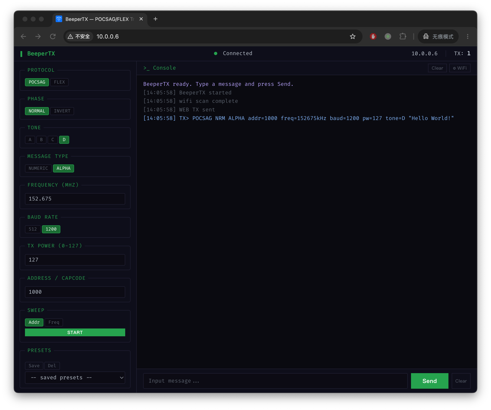

# BeeperTX — ESP32-S3 + Si4463 POCSAG / FLEX Pager Transmitter

A dual-protocol pager transmitter built on the ESP32-S3 and the Si4463 sub-GHz
transceiver. It speaks both **POCSAG** and **FLEX**, and delivers mixed
Chinese/English messages by combining the GB2312 character set with the
`\x0E` / `\x0F` shift control characters used by Chinese pager firmware.

**English** | [简体中文](README.zh-CN.md)

---


## Features

- **Three control surfaces**: a **web control panel**, a **serial command line**
  and **WiFi provisioning**, all sharing one API command set.
  
- **Dual-protocol pager encoding**: POCSAG (512 / 1200 bps) and FLEX
  (1600 / 2400 / 3200 bps). Transmissions are routed to the matching encoder
  automatically; numeric, alphanumeric and Chinese messages are supported.
- **Mixed Chinese/English**: UTF-8 input is converted to GB2312 on device and
  switched between Chinese and ASCII modes with the `\x0E` (SO) / `\x0F` (SI)
  control characters, so a single message can freely mix both.
- **Wide frequency coverage**: 119–1050 MHz with automatic band selection
  (OUTDIV / CLKGEN_BAND). Frequency and power are configurable at runtime with
  no recompilation.
- **One Si4463 config for both protocols**: a fixed **±4.5 kHz 2FSK**
  modulation (WDS `Fdev=4500`, `MOD_type=2`) shared by POCSAG and FLEX through a
  single `radio_config.h`. Frequency changes go through
  `Si446x_setFrequencyKHz()` (EZ frequency programming) and bit-rate changes go
  through GPIO0 bit-bang timing (`bitTimeUs()`); both take effect immediately,
  with **no chip reconfiguration or reload**.
- **Direct TX mode**: GPIO0 bit-bangs the FSK data stream (no FIFO). A dedicated
  `txTask` owns Core 1 for precise timing.
- **Asynchronous transmit architecture**: Core 0 pre-encodes → FreeRTOS queue →
  `txTask` (Core 1) bit-bangs. The AsyncWebServer event loop is never blocked, so
  web and serial stay responsive during transmission.
- **Address / frequency scanning (Sweeper)**: batch address scanning (POCSAG with
  a single preamble, FLEX with one ERS carrying multiple frames) and frequency
  stepping, implemented as a non-blocking state machine controllable from the
  WebUI, the serial console or the REST API.
- **Batch encoding speedup**: POCSAG packs multiple batches across SYNC under one
  preamble; FLEX packs multiple frames and multiple addresses per frame under one
  ERS (roughly a 23x speedup).
- **Configuration persistence**: `SAVE` writes the transmit configuration to NVS
  (magic + version checked) and it is restored on boot.
- **TX log ring buffer**: transmissions are recorded in a ring buffer and can be
  queried from the web UI or the serial console.
- **FLEX Mail Drop**: optional Mail Drop flag for ALPHA messages.
- **Presets**: the web UI stores and restores transmit presets in LocalStorage.

## Hardware

### Pinout

| ESP32-S3 | → | Si4463 | Function |
|:---|---:|:---|---:|
| **GPIO16** | → | **GPIO0** | **TX data (Direct Mode)** |
| GPIO5 | → | SDN | Shutdown control |
| GPIO10 | → | nSEL | SPI chip select |
| GPIO11 | → | SDI | SPI MOSI |
| GPIO12 | → | SCLK | SPI clock |
| GPIO13 | ← | SDO | SPI MISO |
| GPIO4 | ← | nIRQ | Interrupt output (active low; optional — firmware runs `PIN_NIRQ=-1` in polling mode) |
| 3V3 | → | VDD | Power (3.3V) |
| GND | → | GND | Common ground |

> Note: GPIO4 → nIRQ is optional. The current firmware uses **polling mode**
> (`PIN_NIRQ = -1`, see `src/main.cpp`) and does not rely on the interrupt pin.
> Connecting it is harmless.

### RF antenna switch (optional)

Only needed for a single-antenna half-duplex design where an RF switch toggles
between TX and RX. Skip this section if you use separate TX/RX antennas or a
module with no switch (which is how this project is wired).

**No ESP32 pin is involved.** The firmware uses the SPI `GPIO_PIN_CFG` command
(`Si446x_configRFswitch()`, see `src/main.cpp`) to configure **Si4463 GPIO2 /
GPIO3** as state outputs that drive an external RF switch directly:

| Si4463 pin | Mode | During TX | During RX |
|-----------|------|-----------|-----------|
| GPIO2 | TX_STATE (0x21) | HIGH | LOW |
| GPIO3 | RX_STATE (0x20) | LOW | HIGH |

> Si4463-side pin usage: GPIO0 = Direct TX data input (see the pinout),
> GPIO1 = TX_DATA_CLK (external data-source clock, unused here),
> GPIO2/GPIO3 = the RF switch state outputs above. These pins are **not**
> connected to the ESP32; if no RF switch is used, leave them floating.

### Frequency range

119–1050 MHz (6 bands, automatic OUTDIV / CLKGEN_BAND selection). Configurable at
runtime from the web panel or via API commands (default `152675` kHz).

---

> [!WARNING]
> **Radio regulations and safe use**
>
> This device is an RF transmitter. **You must comply with the radio regulations
> of your jurisdiction.**
>
> - **Frequency authorization**: the device can transmit anywhere in
>   119–1050 MHz. Most frequencies in that range (paging bands, aeronautical,
>   emergency services, …) are **licensed bands**, and transmitting without a
>   licence is illegal. Before transmitting, confirm that the target frequency is
>   authorized by your regulator (in mainland China: MIIT Radio Management
>   Bureau / local radio management offices; elsewhere: FCC, ETSI, OFCOM, …).
> - **Power limits**: observe local limits on transmit power, duty cycle and
>   spurious emissions. Exceeding them can interfere with licensed services and
>   lead to penalties.
> - **Intended use**: this project is for **study, research and experimentation
>   only**. Do not use it for unlicensed commercial paging or any other illegal
>   purpose.
> - **Antennas and exposure**: choose an appropriate antenna and respect RF
>   exposure safety — avoid prolonged close contact with a transmitting antenna.
> - **Liability**: any legal consequences arising from the use of this device are
>   the user's own. The authors accept no responsibility for misuse.

## Architecture

```
src/main.cpp                         Composition layer: hardware init and component wiring
├── src/Controller/                  Control layer: API dispatch + Transmitter + Web + serial
│   ├── API.h / .cpp                 (Command dispatch: CmdRequest → CmdResponse)
│   ├── Transmitter.h / .cpp         (Direct TX control + pre-encoding + async scheduling)
│   ├── Sweeper.h / .cpp             (Address/frequency sweep: non-blocking FSM driven by loop())
│   ├── TxQueue.h / .cpp             (FreeRTOS TX queue: core0 pre-encode → txTask)
│   ├── ConfigStore.h / .cpp         (NVS persistence, magic+version checked)
│   ├── LogRingBuffer.h / .cpp       (TX log ring buffer)
│   ├── ProtocolTypes.h              (Single source for protocol enums: POCSAG/FLEX/PHASE/TONE/MSG)
│   ├── WebServer.h / .cpp           (REST API + LittleFS static files)
│   └── SerialConsole.h / .cpp       (Serial CLI: line parsing + command dispatch)
├── src/WiFiManager/                 WiFi: AP provisioning / STA connection / NVS persistence
│   └── WiFiManager.h / .cpp
├── lib/Pocsag/                      Encoding layer: POCSAG protocol (GB2312 Chinese included)
│   └── Pocsag.h / Pocsag.cpp
├── lib/Flex/                        Encoding layer: FLEX protocol
│   ├── flex.h                       (single-header C encoder library)
│   └── FlexEncoder.h / .cpp         (C++ wrapper)
├── lib/si4463/                      Si4463 SPI transceiver driver
│   ├── Si446x.h / .cpp              (Zak Kemble port, ESP32-S3 adapted, cross-core SPI mutex)
│   └── radio_config.h               (generated by WDS 3.2.11.0)
├── lib/Charset/                     Charset: UTF-8 → GB2312 conversion
│   └── Charset.h / .cpp
├── data/                            Web frontend assets (LittleFS)
│   ├── index.html                   (SPA control panel)
│   ├── css/style.css
│   ├── css/terminal.min.css
│   └── js/
│       ├── main.js                  (app entry + status polling)
│       ├── api-client.js            (REST API client)
│       ├── config-panel.js          (config panel + Sweeper controls)
│       ├── terminal-view.js         (terminal view + message TX)
│       └── wifi-modal.js            (WiFi provisioning modal)
└── tools/                           Verification tools (not part of the firmware build)
    ├── verify_pocsag_batch.py       (POCSAG batch BCH check + address decode)
    ├── verify_flex_batch.py         (FLEX batch frame-structure check)
    ├── verify_sweep_ui.js           (frontend Sweeper UI state machine)
    ├── verify_sweeper_state.sh      (Sweeper state transitions)
    ├── verify_logring.sh            (LogRingBuffer boundary behaviour)
    ├── verify_serial_sweep.sh       (serial SWEEP command interaction)
    └── *-test/                      (C++ harnesses, e.g. sweeper-test with 52 checks)
```

### Data flow

```
[Web UI / Serial / WiFi]
  → CmdRequest (unified command struct)
    → api_dispatch() command dispatcher
      → Transmitter::send(Config)          // single entry point, routes the encoder
        → [POCSAG] PocsagEncoder::encode() + GB.get() GB2312
        → [FLEX]   FlexEncoder::encode()   + GB.get() GB2312
      → sendPocsagRaw() / sendFlexRaw()    // deep-copy into the queue
  → txTask (core 1) transmits asynchronously:
      → Transmitter::enterTx()             // Si446x_startDirectTX()
      → sendCodewords() / sendBytes()      // GPIO0 bit-banging
      → Transmitter::exitTx()              // Si446x_stopTX()
  → CmdResponse → serialized back to the caller
  → Si4463 direct FSK modulation (Direct TX Mode, not FIFO)
```

## WiFi and the web control panel

### WiFi modes

Selected automatically at boot:

1. **Saved credentials present** → STA mode, connect to the router (10 s
   timeout), hostname `BeeperTX.local`
2. **Connection failed / no credentials** → fall back to AP mode, SSID `BeeperTX`
   (open network), IP `192.168.4.1`

In AP mode a captive-portal DNS server is active, so the provisioning page pops
up automatically on a phone. Credentials are persisted in NVS (Preferences) and
the device reboots into STA mode after successful provisioning.

### Web control panel

Open `http://BeeperTX.local/` (STA mode) or `http://192.168.4.1/` (AP mode) in a
browser for full device control:

- **Configuration panel**: protocol (POCSAG/FLEX), phase, tone, message type,
  frequency, baud rate, power, address, Mail Drop (Phase/Tone are hidden under
  FLEX and Mail Drop is shown instead; frequency is entered in MHz; baud options
  follow the selected encoding)
- **Message TX**: type a UTF-8 message and transmit it with one click
- **Sweeper**: Addr/Freq mode switch, START/STOP, live progress (current value /
  total / batch range)
- **WiFi provisioning**: scan nearby networks, enter a password, connect and
  reboot
- **Live status**: connection indicator, IP address, cumulative TX count
- **Presets**: save/load transmit presets (LocalStorage)

### REST API endpoints

| Method | Path | Description |
|--------|------|-------------|
| GET | `/api/ping` | Heartbeat |
| GET | `/api/status` | Device status (frequency / power / chip info / uptime / TX count) |
| GET | `/api/config` | Current transmit configuration |
| POST | `/api/config` | Update the transmit configuration (JSON body) |
| POST | `/api/transmit` | Transmit a message |
| POST | `/api/reset` | Reboot the device |
| GET | `/api/wifi/status` | WiFi status (does not trigger a scan) |
| GET | `/api/wifi/scan` | Scan nearby WiFi networks |
| POST | `/api/wifi` | Set WiFi credentials (JSON: `{"ssid":"...","password":"..."}`) |
| GET | `/api/log` | Recent TX log |
| POST | `/api/sweep/start` | Start an address/frequency sweep (JSON: `{"mode":"addr"\|"freq"}`, parameters come from the current config) |
| POST | `/api/sweep/stop` | Stop the sweep (frequency is restored to the start value after a delay) |
| GET | `/api/sweep/status` | Sweep status (running/mode/current/total/done/batchStart/batchEnd) |

## Serial console

Serial baud rate is **115200 bps**; any serial terminal works (`pio device
monitor`, `screen`, `minicom`, …).

### Command format

All commands follow `<CMD> [key=value ...]\r\n`, are case-insensitive, and
responses start with `OK` or `ERR`.

| Command | Description | Example |
|---------|-------------|---------|
| `HELP` | Print help | `HELP` |
| `STATUS` | Device status (chip/frequency/power/RSSI/uptime) | `STATUS` |
| `CONFIG` | Current transmit configuration | `CONFIG` |
| `SET` | Change transmit parameters | `SET freq=152675 power=100` |
| `TX` | Transmit (optionally override the message) | `TX` / `TX msg=Hello` |
| `WIFI` | Show WiFi status | `WIFI` |
| `WIFI` | Set WiFi credentials and reboot | `WIFI ssid=MyWiFi pass=12345678` |
| `SCAN` | Scan nearby WiFi networks | `SCAN` |
| `SWEEP` | Start/query an address or frequency sweep | `SWEEP addr` / `SWEEP freq` / `SWEEP status` |
| `STOP` | Stop the sweep (alias of `SWEEP stop`) | `STOP` |
| `SAVE` | Persist the current transmit config to NVS (restored on reboot) | `SAVE` |
| `RESET` | Reboot the device | `RESET` |
| `PING` | Heartbeat | `PING` |

### Boot output

```
==========================================
   BeeperTX — Si4463 POCSAG/FLEX TX
==========================================

=== BeeperTX Serial Commands ===

  HELP                  Show this help
  STATUS                Device status (chip, freq, power, IP)
  CONFIG                Current TX config
  SET key=value ...     Set TX parameters
     freq=<kHz>         Frequency (119000-1050000)
     pwr=<0-127>        TX power
     baud=<rate>        Baud rate (POCSAG: 512/1200, FLEX: 1600/2400/3200)
     addr=<n>           Pager address/capcode
     encoding=pocsag|flex
     phase=norm|inv     Phase (normal/inverted)
     tone=a|b|c|d       POCSAG tone
     msgType=num|alpha  Numeric / Alphanumeric
     mailDrop=0|1       FLEX Mail Drop flag (ALPHA only)
     msg=<text>         Message content (UTF-8)
  TX [msg=<text>]       Transmit once (optional msg override)
  SWEEP [START] addr|freq [encoding=pocsag|flex] [baud=<rate>]
       [phase=norm|inv] [tone=a..d] [msgType=num|alpha] [interval=<ms>]
  SWEEP [START] stop|status  Stop sweep / show progress
  STOP                   Alias for SWEEP stop
  WIFI                  Show WiFi status
  WIFI ssid=X pass=Y    Set WiFi credentials (connects immediately)
  SCAN                  Scan nearby WiFi networks
  SAVE                  Persist current TX config to NVS (survives reboot)
  RESET                 Reboot device
  PING                  Heartbeat
```

### Command reference and examples

#### `SAVE` — persist the configuration

Writes the current transmit configuration to ESP32 NVS (namespace `beepertx`);
`api_init()` restores it after a reboot.

```
> SET freq=155000 baud=1200
OK SET
> SAVE
OK SAVE: config persisted to NVS
> RESET
...(reboot)...
> CONFIG
freq=155000kHz baud=1200 ...
```

#### `PING` — heartbeat

Checks that the device is alive and returns the system uptime in milliseconds,
which is handy for latency estimates.

```
> PING
OK PING uptime=54912
```

#### `STATUS` — device status

Reads Si4463 chip information, the current frequency, power, RSSI, cumulative TX
count and uptime.

```
> STATUS
OK STATUS part=0x4463 rom=6 rev=0 state=3 freq=152675kHz pwr=127 rssi=-120dBm uptime=123s tx=5
```

Field reference:

| Field | Meaning |
|-------|---------|
| `part` | Si4463 part number (0x4463) |
| `rom` | ROM version (3=B1, 6=C2) |
| `rev` | Chip revision |
| `state` | Radio state machine (3=READY, 5=TX, 7=RX) |
| `freq` | Current locked frequency (kHz) |
| `pwr` | PA power (0–127) |
| `rssi` | Current RSSI (dBm) |
| `uptime` | Uptime (seconds) |
| `tx` | Cumulative TX count |

#### `CONFIG` — show the transmit configuration

Displays all current transmit parameters.

```
> CONFIG
OK CONFIG encoding=pocsag phase=norm tone=D msgType=alpha freq=152675kHz pwr=127 baud=1200 addr=1000 msg="BeeperTX OK"
```

#### `SET` — change the transmit configuration

Accepts one or more `key=value` pairs separated by spaces. Omitted parameters
keep their current values.

Supported parameters:

| Parameter | Range | Example |
|-----------|-------|---------|
| `freq` | 119000–1050000 (kHz) | `freq=153950` |
| `pwr` | 0–127 | `pwr=100` |
| `baud` | 512 / 1200 (POCSAG); 1600 / 2400 / 3200 (FLEX) | `baud=2400` |
| `addr` | POCSAG: 0–2097151, FLEX: CAPCODE | `addr=12345` |
| `encoding` | `pocsag` / `flex` | `encoding=flex` |
| `phase` | `norm` / `inv` | `phase=inv` |
| `tone` | `a` / `b` / `c` / `d` | `tone=c` |
| `msgType` | `num` / `alpha` | `msgType=num` |
| `mailDrop` | `0` / `1` (FLEX ALPHA only) | `mailDrop=1` |
| `msg` | UTF-8 text (may contain spaces) | `msg=Hello world` |

**Note**: `SET` applies frequency and power to the Si4463 hardware immediately;
other parameters are cached in memory. Changes are not persisted automatically —
run `SAVE` to write them to NVS.

```
> SET freq=153950 baud=2400 msg=Hello
OK SET
> CONFIG
OK CONFIG encoding=pocsag phase=norm tone=D msgType=alpha freq=153950kHz pwr=127 baud=2400 addr=1000 msg="Hello"
```

```
> SET encoding=flex msgType=num addr=2100001
OK SET
```

#### `SET mailDrop=1` — FLEX Mail Drop message

The Mail Drop flag applies only to FLEX alphanumeric messages (ALPHA): the
encoder sets bit 20 of the first message word, which triggers the Mail Drop
notification behaviour on pagers that support it. After setting it, `TX` sends a
Mail Drop message:

```
> SET encoding=flex mailDrop=1 msg=Important notice
OK SET
> TX
OK TX count=0
```

> `mailDrop=0` restores normal messages. POCSAG has no Mail Drop concept and the
> flag does not affect POCSAG transmissions. It can also be set over REST:
> `POST /api/config` with `"mailDrop":true` in the body.

Invalid parameters return an error code:

```
> SET freq=999999
ERR SET code=2 detail=-1
```

#### `TX` — transmit

With no arguments the current message is transmitted. `msg=` overrides the
message for this transmission only (the stored configuration is untouched).

```
> TX
OK TX count=0
```

The serial port prints the TX log (scheduled in the background by `api_loop()`):

```
[LOG] TX> POCSAG NRM ALPHA addr=1000 freq=152675kHz baud=1200 pw=127 tone=D "BeeperTX OK"
TX[0][POCSAG] addr=1000 tone=D baud=1200 ALPHA NRM "BeeperTX OK"
. OK
```

```
> TX msg=中文测试
OK TX count=0
[LOG] TX> POCSAG NRM ALPHA addr=1000 freq=152675kHz baud=1200 pw=127 tone=D "中文测试"
...
```

#### `WIFI` — WiFi status / provisioning

**Query status** (no arguments):

```
> WIFI
OK WIFI state=CONNECTED
```

States: `DISCONNECTED` (0), `CONNECTING` (1), `CONNECTED` (2), `AP` (3)

**Set credentials**:

```
> WIFI ssid=MyWiFi pass=12345678
OK WIFI saved, connecting...
Device will reboot in STA mode if connection succeeds.
```

Credentials are saved to NVS and a connection is attempted; on success the
device reboots into STA mode.

#### `SCAN` — scan WiFi

Triggers a background WiFi scan and immediately returns the cached scan results
as a JSON array.

```
> SCAN
OK SCAN [{"ssid":"MyWiFi","rssi":-45,"secure":true},{"ssid":"Neighbor","rssi":-78,"secure":true}]
```

#### `SWEEP` — address / frequency sweep

Starts or queries an address sweep (paging-address scan) or a frequency sweep.
Parameters may override the current configuration. See
[Address / frequency sweep (Sweeper)](#address--frequency-sweep-sweeper).

```
> SWEEP addr
OK SWEEP mode=addr start=1000

> SWEEP status
OK SWEEP running mode=addr batch=1000-1054 done=55/2096152

> SWEEP stop
OK STOP sweep stopped
```

`STOP` is an alias for `SWEEP stop`. When a frequency sweep is stopped or
finishes, the frequency is automatically restored to its start value.

#### `RESET` — reboot

```
> RESET
OK RESET rebooting...
```

#### `HELP` — help

```
> HELP
```

(Prints the full help text shown above.)

### Error response format

Every command returns a uniform error on failure:

```
ERR <CMD> code=<N> detail=<M>
```

| code | Meaning |
|------|---------|
| 0 | OK |
| 1 | Unknown command |
| 2 | Invalid parameter (out of range / unsupported baud rate, …) |
| 3 | Device busy (transmitting) |
| 4 | Hardware fault (Si4463 not responding, …) |
| 5 | Out of memory |
| 6 | Transmission aborted by the user |

## Command system (API)

Every external interface (web, serial, future MQTT, …) shares the same command
definitions:

```
Transport layer              Command dispatch
┌──────────┐  serialize  ┌──────────┐
│ Web JSON │ ──────────→ │          │
│ Serial   │ ──────────→ │  CmdID   │ → api_dispatch()
│ MQTT TLV │ ──────────→ │   enum   │        ↓
└──────────┘             └──────────┘  CmdResponse
```

Command ID enum (`API.h`):

| Category | Command | ID | Description |
|----------|---------|----|-------------|
| System | `CMD_PING` | 0x00 | Heartbeat |
| System | `CMD_GET_STATUS` | 0x01 | Read device status |
| System | `CMD_GET_CONFIG` | 0x02 | Read transmit configuration |
| System | `CMD_RESET` | 0x03 | Reboot the device |
| Config | `CMD_SET_CONFIG` | 0x10 | Set transmit configuration |
| Config | `CMD_SAVE_CONFIG` | 0x11 | Save configuration to NVS (restored on boot) |
| TX | `CMD_TRANSMIT` | 0x20 | Transmit a message |
| TX | `CMD_ABORT` | 0x21 | Abort transmission |
| Query | `CMD_GET_LOG` | 0x30 | Read the TX log |
| WiFi | `CMD_SET_WIFI` | 0x40 | Set WiFi credentials |
| WiFi | `CMD_SCAN_WIFI` | 0x41 | Scan WiFi networks |
| WiFi | `CMD_GET_WIFI_STATUS` | 0x42 | Query WiFi status |
| Sweep | `CMD_SWEEP_START` | 0x50 | Start an address/frequency sweep |
| Sweep | `CMD_SWEEP_STOP` | 0x51 | Stop the sweep |
| Sweep | `CMD_SWEEP_STATUS` | 0x52 | Query sweep status |

## Transmit configuration

The following parameters can be changed at runtime from the web panel, the
serial console or the API (no recompilation):

| Parameter | Range | Default | Description |
|-----------|-------|---------|-------------|
| encoding | POCSAG / FLEX | POCSAG | Encoding protocol |
| freqKHz | 119000–1050000 | 152675 | Transmit frequency (kHz) |
| txPower | 0–127 | 127 | PA power (127 = +20 dBm) |
| phase | NORMAL / INVERTED | NORMAL | FSK phase polarity (POCSAG only; FLEX always direct) |
| tone | A / B / C / D | D | POCSAG tone/function code (POCSAG only; N/A for FLEX) |
| baudRate | POCSAG: 512/1200, FLEX: 1600/2400/3200 | 1200 / 1600 | Bit rate (bps, per encoding) |
| msgType | NUMERIC / ALPHANUMERIC | ALPHANUMERIC | Message type |
| mailDrop | 0 / 1 | 0 | FLEX Mail Drop flag (ALPHA only, sets bit 20 of the first word) |
| address | 0–2097151 (POCSAG) | 1000 | Pager address / CAPCODE |
| message | UTF-8, max 1023 bytes | "BeeperTX OK" | Message body (messages exceeding protocol limits are rejected before the HTTP response) |

## Address / frequency sweep (Sweeper)

A non-blocking state-machine module for batch scanning paging addresses (address
sweep) or stepping the RF frequency (frequency sweep). It is driven by
`loop()` in `main.cpp` and never busy-waits; the actual transmissions are
performed asynchronously by `txTask` (Core 1), so web and serial remain
responsive throughout.

### The two modes

| Mode | Behaviour |
|------|-----------|
| **Address sweep (addr)** | Increments the address by one from `addrStart`. POCSAG packs 55 addresses per batch under a single preamble with continuous batches; FLEX packs 55 addresses per batch into one ERS with continuous frames. The whole batch is queued and transmitted at once. |
| **Frequency sweep (freq)** | Steps from `freqStartKHz` by `freqStepKHz` (default 25 kHz), transmitting the current address plus the frequency value at each step. Stops automatically at `freqMaxKHz` (default 999999 kHz) and restores the frequency to its start value. |

### Parameters

| Parameter | Default | Description |
|-----------|---------|-------------|
| `mode` | — | `addr` / `freq` (required) |
| `addrStart` / `addrEnd` | current address / 0x1FFFFF | Address sweep range |
| `freqStartKHz` / `freqStepKHz` / `freqMaxKHz` | current frequency / 25 / 999999 | Frequency sweep range and step |
| `encoding` / `baud` / `phase` / `tone` / `msgType` | current config | Transmit parameter overrides (-1 = keep current) |
| `interval` | 500 ms | Delay between batches / frequency points (minimum 50 ms) |

### Web UI

The Sweep group at the bottom of the configuration panel offers an
`Addr` / `Freq` mode switch and a `START` button. While running it shows a status
line (mode, current value, progress, current batch range) and can be stopped with
a click. During a sweep the web UI pauses `/api/status` polling to reduce
AsyncTCP callback load, and resumes automatically when the sweep ends.

### REST API

```
POST /api/sweep/start   body: {"mode":"addr"} or {"mode":"freq"}
                        → {"code":0,"mode":"addr","start":1000}
POST /api/sweep/stop    → stop the sweep (the frequency is restored after a delay in freq mode)
GET  /api/sweep/status  → {"code":0,"running":true,"mode":1,"current":1054,
                           "total":2096152,"done":55,"batchStart":1000,"batchEnd":1054}
```

`mode`: 0=IDLE, 1=ADDR_SWEEP, 2=FREQ_SWEEP. `batchStart`/`batchEnd` describe the
current batch range (equal to `current` outside batch mode).

### Serial commands

```
> SWEEP addr
OK SWEEP mode=addr start=1000

> SWEEP freq
OK SWEEP mode=freq start=152675kHz step=25kHz max=999999kHz

> SWEEP status
OK SWEEP running mode=addr batch=1000-1054 done=55/2096152

> SWEEP stop        # or STOP
OK STOP sweep stopped
```

`SWEEP` accepts an optional `[START]` prefix (`SWEEP START addr` equals
`SWEEP addr`) and optional `encoding=.. baud=.. phase=.. tone=.. msgType=..
interval=..` overrides.

## POCSAG encoding in detail

### Frame structure

A POCSAG batch consists of a sync codeword followed by 16 frames:

```
Preamble (576 bits of alternating 1/0)
  → Sync codeword 0x7CD215D8
  → Frame 0: [address codeword | idle codewords ...]
  → Frame 1: [message codeword | message codeword ...]
  → ...
  → Frame 15: [idle codewords ...]
```

### Codeword structure (32-bit)

```
Address codeword: 0 | 18-bit address | 2-bit function | 10-bit BCH | even parity
Message codeword: 1 | 20-bit message fragment | 10-bit BCH | even parity
```

Function codes:

| Func | Mode | Description |
|------|------|-------------|
| 0 (00) | Numeric | Numeric message (4-bit BCD) |
| 1 (01) | Tone-only | Alert tone only |
| 2 (10) | Alphanumeric | Letters/ASCII (CCITT No.5) |
| 3 (11) | Tone-D | Chinese alphanumeric (GB2312, a.k.a. Tone-D) |

### Alphanumeric encoding (func=2/3)

The POCSAG standard only defines 7-bit ASCII alphanumeric messages. Chinese
pagers use the GB2312-80 double-byte character set, activated by **function code
3 (11)**, and switch between Chinese and English with control characters:

| Control character | Value | Meaning |
|-------------------|-------|---------|
| `\x0E` (Shift Out / SO) | 14 | Switch to GB2312 Chinese mode (pairing two bytes) |
| `\x0F` (Shift In / SI) | 15 | Switch back to ASCII English mode (single byte) |
| `\x04` (EOT) | 4 | End of message |

In Chinese mode the pager pairs every two received 7-bit characters and
reassembles them into a GB2312-80 character.

### 7-bit bit-reversed encoding (LSB-first)

Per CCITT No.5, each byte is transmitted LSB-first in POCSAG:

```
Input:  '1' = 0x31 = 0b00110001
Output: 7-bit reversed = 0b1000110 (MSB → LSB: 1,0,0,0,1,1,0)

Input:  GB2312 0xB2 = 0b10110010
Output: 7-bit reversed = 0b0100110 (bit 7 dropped; only bits 6..0 sent)
```

### Mixed Chinese/English encoding flow

```
UTF-8 input: "ABCD - 简体中文 -"
  ↓ GB.get() converts to GB2312
GB2312 bytes: 41 42 43 44 20 2D 20 BC F2 CC E5 D6 D0 CE C4 20 2D

  ↓ deCodeAlpha() runs (pagers start in Chinese mode)
  ↓ for each byte:

[41] ASCII → insert \x0F (switch to English) → 7-bit reverse encoding
[42] ASCII → 7-bit reverse encoding
...
[BC] GB2312 → insert \x0E (switch to Chinese) → 7-bit reverse encoding
[F2] GB2312 → 7-bit reverse encoding  ← pairs with BC to form "简"
...

  ↓ append \x04 (EOT) terminator
  ↓ pack into 20-bit words → message codewords → POCSAG baseband
  ↓ optional inversion (invert=true)
```

### Numeric encoding (4-bit BCD, func=0)

POCSAG numeric messages use 4-bit BCD (Binary Coded Decimal), handled by
`deCodeNumeric()`. Unlike alphanumeric messages they use function code func=0,
and characters map per the POCSAG standard:

| Input character | BCD value | Description |
|-----------------|-----------|-------------|
| 0-9 | 0x0-0x9 | Digits |
| Space | 0xA | SPACE |
| U | 0xB | Urgent indicator |
| - | 0xD | Hyphen |
| ) | 0xE | Right bracket |
| ( | 0xF | Left bracket (swapped mapping) |
| Unknown | 0xA | → space |

Each BCD nibble is also bit-reversed LSB-first (`flip4bitOrder`) and the message
is padded with 0xA (SPACE) to the 20-bit word boundary.

### Address/message word ordering fix

`genSignal()` guarantees that the **address codeword precedes the message
codewords**: each frame first checks whether the address has been sent, then
fills the remaining slots with message codewords, padding the tail with idle
codewords (`0x7A89C197`). Earlier versions could emit message codewords before
the address, which some pagers could not decode.

### Batch encoding (encodeBatchMulti)

`encodeBatchMulti()` encodes up to 55 addresses as **one preamble followed by
continuous batches** (ITU-R M.584): the preamble is sent once and message
codewords may extend across SYNC continuously, eliminating the per-address
preamble overhead entirely. The Sweeper's address mode calls it once per batch,
queues the whole batch, and transmits it asynchronously.

## FLEX encoding in detail

### Frame structure (1600 bps)

A FLEX frame (FLEX-TD, ARIB STD-43A):

```
ERS (emergency re-sync, 35 repetitions: BS + AR + /BS + /AR)
  → S1 (bit sync: 0xAA 0xAA 0xAA 0xAA + A1 + B + /A1)
  → FIW (frame information word: cycle 0 + frame 0)
  → S2 (/C block: block sync)
  → BIW1 + address field + vector field + message field (11 blocks × 8 words, interleaved)
```

### Intra-frame layout

Each frame is 88 words, each word a 32-bit BCH(31,21)+even-parity codeword:

```
Frame 0:
  ┌───────┬───────┬───────┬──────────────────────────┐
  │ BIW1  │ Addr  │Vector │ Message words [0..84]    │
  │ word 0│ word 1│ word 2│ word 3..87               │
  └───────┴───────┴───────┴──────────────────────────┘
  │← blk 0 →│← blk 1 →│← ... →│← blk 10              →
```

Each block's 8 words undergo **block interleaving**, so a burst error corrupts
only one bit per word — and BCH(31,21) corrects 2 bits per word.

### Vector types

Bits 6:4 of the vector word define the message type (per the PCD5008 datasheet):

| v2v1v0 | Type | Description |
|--------|------|-------------|
| 010 | Tone-only | Alert tone only |
| 011 | Numeric | Numeric (0-9, -, _, [, ], space, U) |
| 101 | **Alphanumeric** | **Alphanumeric message (Chinese uses this type)** |
| 110 | Hex/Binary | 8-bit binary transparent transport |

### Chinese encoding (Alphanumeric V=101)

Unlike the commonly used Hex/Binary transparent mode, Chinese FLEX pagers in
China carry Chinese text in the **Alphanumeric vector type (V=101)**:

1. The UTF-8 message is converted to GB2312 double-byte by `GB.get()`
2. Bit 7 of each GB2312 byte is stripped with `& 0x7F` and placed in a 7-bit field
3. The pager reassembles all 7-bit bytes into 8-bit values and decodes them in pairs

### 7-bit packing (3 characters per word)

Each 21-bit data word stores three 7-bit characters:

```
Word N: [char0(bits 6..0) | char1(bits 6..0) | char2(bits 6..0)]
         bits 20..14        bits 13..7        bits 6..0
```

`create_alphanumeric_msg()` packs word by word:

```c
msg_word[word_idx] |= ((uint32_t)msg[i] & 0x7F) << shift;
shift += 7;
if (shift == 21) { word_idx++; shift = 0; }  // 3 chars full → next word
```

### Mixed Chinese/English control characters (same mechanism as POCSAG)

Chinese FLEX pagers also use the `\x0E`(SO) / `\x0F`(SI) control characters to
switch between Chinese and English, exactly like POCSAG's `deCodeAlpha()`:

```
GB2312 byte stream: BC F2 CC E5 D6 D0 CE C4 20 41 42 43 20 31 32 33
                            "简体中文字 ABC 123"

Pager starts in Chinese mode:
  BC F2 → "简"     (Chinese pairing)
  CC E5 → "体"
  D6 D0 → "中"
  CE C4 → "文"

  20 41 → hits 0x20 (space) — already sent before the upper layer inserts \x0F
  ⚠ 0x41 ('A') is taken as the second GB2312 byte and paired with 0x20 → garbage!

After inserting control characters:
  BC F2 CC E5 D6 D0 CE C4    → "简体中文" (Chinese pairing)
  0F 20 41 42 43 20 31 32 33 → switch to English: " ABC 123" (single-byte ASCII)
```

Implemented in `Transmitter::send()`:

```cpp
static uint8_t mixed[512];
size_t m = 0;
bool inChinese = true;  // pagers start in Chinese mode

for (size_t i = 0; i < gbLen && m < sizeof(mixed) - 8; i++) {
  uint8_t byte = (uint8_t)gbStr[i];

  if (byte >= 0x80) {          // GB2312 Chinese byte
    if (!inChinese) {
      mixed[m++] = 0x0E;       // switch to Chinese
      inChinese = true;
    }
    mixed[m++] = byte;
  } else {                     // ASCII byte
    if (inChinese) {
      mixed[m++] = 0x0F;       // switch to English
      inChinese = false;
    }
    mixed[m++] = byte;
  }
}
mixed[m] = '\0';
encoder.encode(cfg.address, (const char*)mixed, FlexEncoder::ALPHA);
```

Both `\x0E` (0x0E) and `\x0F` (0x0F) are below 0x80, so they survive the
`& 0x7F` masking unchanged and travel with the ordinary characters in the 7-bit
packing.

### FLEX frame word generation flow

```
                      ┌─────────────────┐
                      │ tf_encode_flex_ │
                      │ packet_internal │
                      └────────┬────────┘
                               │
               ┌───────────────┼───────────────┐
               v               v               v
        create_          create_          create_
        alphanumeric_    numeric_msg     tone_only_msg
        msg              (V=011)         (V=010)
        (V=101)
               │               │               │
               v               v               v
        ┌─────────────────────────────────────────┐
        │  BCH(31,21) encoding + even parity      │
        │  encode_word(rev32(dw))                 │
        │  → 32-bit codeword per word             │
        └────────────────┬────────────────────────┘
                         │
                         v
        ┌─────────────────────────────────────────┐
        │  Block interleaving                     │
        │  interleave_block(0..10)                │
        │  → column-major bit reordering          │
        └────────────────┬────────────────────────┘
                         │
                         v
        ┌─────────────────────────────────────────┐
        │  Byte serialization                     │
        │  SAVE_VEC() / SAVE_WORD()               │
        │  → sync header + frame data → uint8_t[] │
        └─────────────────────────────────────────┘
```

### Mail Drop flag

FLEX alphanumeric messages (ALPHA, V=101) may optionally set the Mail Drop flag:
the encoder sets bit 20 of the first message word to trigger the pager's Mail
Drop notification behaviour (pager-specific). The web UI sends it along with the
message when the checkbox is ticked.

### Batch encoding (encodeBatch)

`FlexEncoder::encodeBatch()` encodes multiple (address, message) pairs as **one
ERS followed by continuous frames** (each frame frame=0), packing multiple
addresses and messages per frame and sending the whole batch in a single
transmission (about 23x faster than sending them one at a time). The Sweeper's
address mode uses it for 55 addresses per batch. The total batch message length is
bounded by FLEX's 248-character single-frame limit; oversized batches are
explicitly rejected before the HTTP response (no silent truncation).

## POCSAG vs FLEX

| Feature | POCSAG | FLEX |
|---------|--------|------|
| Bit rate | 512 / 1200 bps | 1600 / 2400 / 3200 bps |
| Preamble | 576 bits alternating 1/0 | 35 ERS repetitions + S1 sync |
| Error correction | BCH(31,21) | BCH(31,21) + block interleaving |
| Address | 21-bit, one address per frame | Short/long addresses, multiple per frame |
| Numeric mode | func=0, 4-bit BCD | V=011 Numeric |
| Alphanumeric mode | func=2/3, 7-bit ASCII | V=101 Alphanumeric |
| Chinese mechanism | func=3 + `\x0E`/`\x0F` | V=101 alpha + `\x0E`/`\x0F` |
| Encoder | Pocsag::deCodeAlpha/Numeric | FlexEncoder (encoded in send, transmitted by sendFlexRaw) |
| Modulation | Direct FSK (GPIO0 bit-bang) | Direct FSK (GPIO0 bit-bang) |
| Buffers | Static (`.bss`) | Static (`.bss`) |

## Build and flash

```bash
pio run                                    # build
pio run --target upload                    # flash the firmware
pio run --target uploadfs                  # flash the LittleFS image (web frontend)
pio run --target upload_all                # flash firmware + LittleFS in one go
pio device monitor -b 115200               # serial monitor (115200 bps)
```

### Dependencies

| Library | Version | Purpose |
|---------|---------|---------|
| ESP32Async/AsyncTCP | ^3.3.2 | TCP layer under the web server |
| ESP32Async/ESPAsyncWebServer | ^3.7.4 | Asynchronous HTTP server |
| bblanchon/ArduinoJson | ^7.3.0 | JSON serialization/deserialization |

### Board

| Environment | Description |
|-------------|-------------|
| `luatos-esp32s3` (default) | ESP32-S3, 16MB flash, PSRAM, LittleFS |

## Tests and verification tools

The `tools/` directory contains standalone verification scripts (not part of the
firmware build) for regression-checking the encoders, state machines and UI:

| Tool | Coverage |
|------|----------|
| `tools/verify_pocsag_batch.py` | POCSAG batch encoding: BCH check + address decoding |
| `tools/verify_flex_batch.py` | FLEX batch encoding: frame structure check |
| `tools/verify_sweep_ui.js` | Frontend Sweeper UI state machine |
| `tools/verify_sweeper_state.sh` | Sweeper state transitions |
| `tools/verify_logring.sh` | LogRingBuffer boundary behaviour |
| `tools/verify_serial_sweep.sh` | Serial SWEEP command interaction |
| `tools/sweeper-test/` | C++ harness (52 checks) |
| `tools/serial-test/` | Serial parser harness |
| `tools/logring-test/` | Ring buffer harness |

## Debug output

Sample serial output at 115200 bps:

```
╔══════════════════════════════════════════╗
║       BeeperTX — POCSAG/FLEX     ║
╚══════════════════════════════════════════╝
Build: Jul 22 2026, 12:00:00

Chip Model: ESP32-S3
Chip Revision: 0

--- Si4463 ---
  Part:   0x4463 (Si4463 = 0x4463)
  ROM ID: 6 (3=B1B, 6=C2A)
  Rev:    ext=2 branch=0
  State:  READY (3)
  Freq:   152.675 MHz
  PA PWR: 127
  RSSI:   -120 dBm

WiFi: Connected to "MyWiFi"
IP:    192.168.1.100
Host:  BeeperTX.local
Web:   http://192.168.1.100/
BeeperTX started
```

## Known limitations

1. **Busy-wait timing**: `txTask` (Core 1) uses `busyWaitUntil()` busy-waiting for
   microsecond-accurate bit-banging, lasting roughly 1–2 s (POCSAG) or ~10 s
   (FLEX batch). The code calls `esp_task_wdt_reset()` every 500 bits. The
   Sweeper is a non-blocking state machine (`loop()` never busy-waits); only
   `txTask` owns Core 1 for transmission.
2. **POCSAG Chinese default mode**: `deCodeAlpha()` hard-codes the pager's default
   Chinese mode (`inGB = true`, func=3), so pure-ASCII messages carry an extra
   `\x0F` control character — harmless for display.
3. **FLEX Chinese length limit**: bounded by FLEX's 248-character single-frame
   limit; each GB2312 character counts as 2 characters, and the control
   characters add roughly 1–2 bytes.
4. **POCSAG numeric limitation**: numeric messages require a pager that supports
   func=0 numeric mode; alphanumeric messages use func=3 Chinese mode. The two
   cannot be mixed.
5. **Single-frame FLEX (single send)**: a single message still occupies one frame
   (frame 0). Address-sweep batching (`FlexEncoder::encodeBatch`) supports one ERS
   plus continuous frames (each frame=0) with multiple addresses and messages per
   frame; v1 supports short addresses only.
6. **Pre-encode + async TX**: `Transmitter::send()` performs GB2312 conversion and
   protocol encoding in the caller's context (Core 0 / `api_loop`), then hands the
   encoded RAW data to `txTask` (Core 1) through a FreeRTOS queue for asynchronous
   transmission, keeping the AsyncWebServer event loop free.

## Credits

This project builds on the following open-source work — many thanks to the
original authors:

| Project | Use | License |
|---------|-----|---------|
| [Theldus/tinyflex](https://github.com/Theldus/tinyflex) | FLEX encoder (`lib/Flex/flex.h`, single-header C implementation) | Public Domain |
| [ZakKemble/Si446x](https://github.com/ZakKemble/Si446x) | Si4463 radio driver (`lib/si4463/`, adapted for ESP32-S3 and cross-core SPI mutexes) | GNU GPL v3 |
