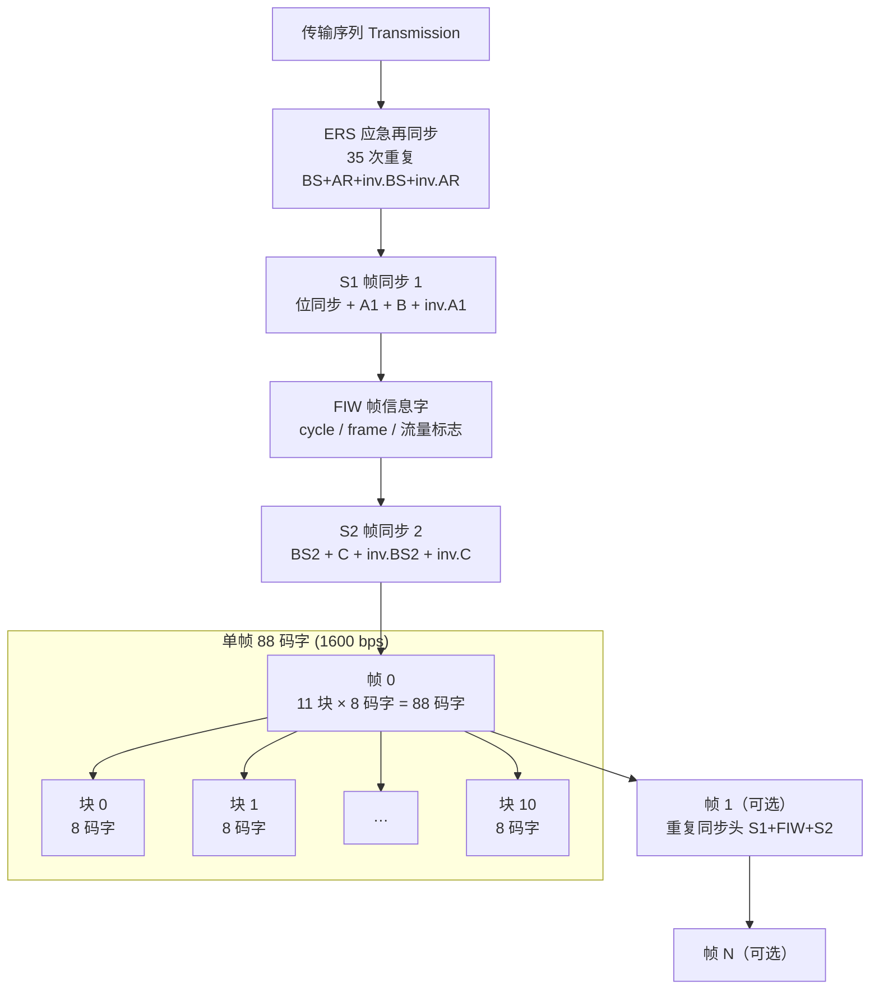
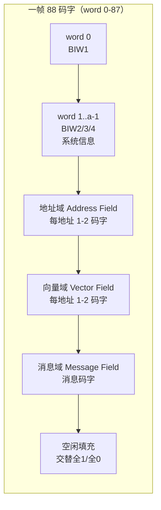
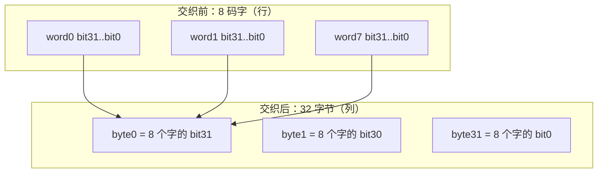
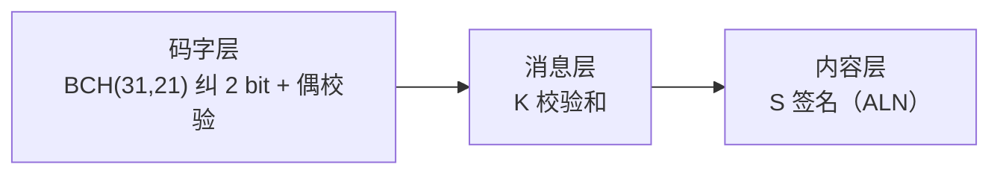
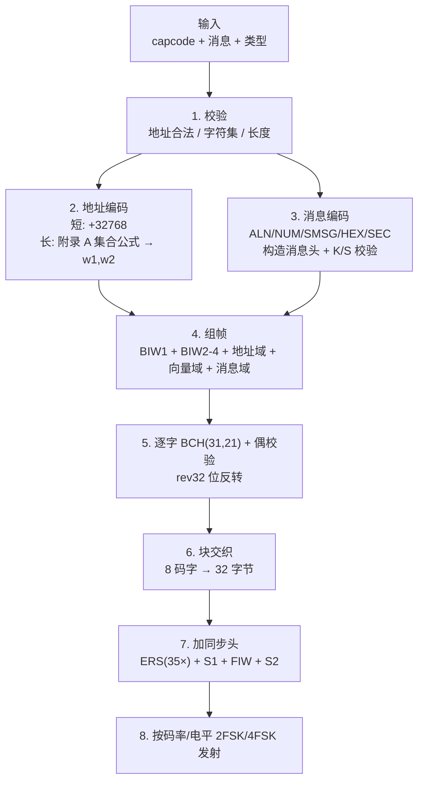
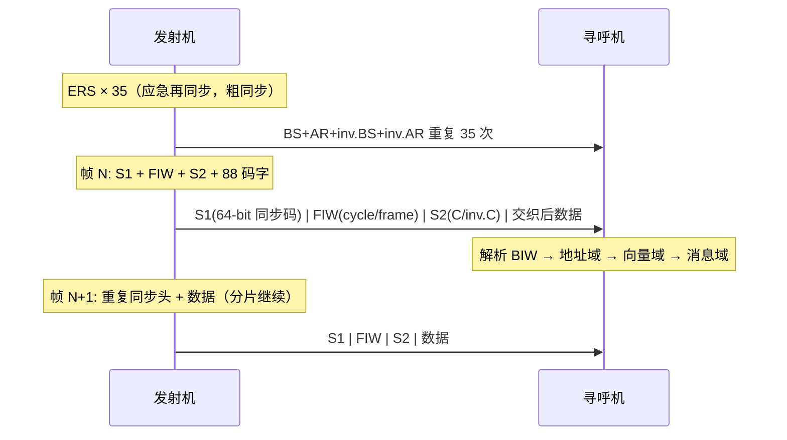

# FLEX 寻呼协议 — 协议结构与编码过程

> 本文从**协议本身**的角度介绍 FLEX（FLEX-TD Radio Paging System）的传输结构、
> 码字格式、同步机制、地址/向量/消息编码与差错控制，不涉及具体代码实现。
> 内容以 **RCR STD-43A（ARIB STD-43A）** 标准为依据，交叉参照项目中的 FLEX
> 编码器（`lib/Flex/flex.h`）与完整解码方案（`flex_decode.c`）以保证准确。
> 与 BeeperTX 实现的关系见文末[附录](#附录与本项目实现的关系)。

---

## 目录

- [1. 协议简介](#1-协议简介)
- [2. 传输序列总体结构](#2-传输序列总体结构)
- [3. 码字结构](#3-码字结构)
- [4. 同步机制](#4-同步机制)
- [5. 帧定时与相位](#5-帧定时与相位)
- [6. 帧数据布局](#6-帧数据布局)
- [7. 块交织](#7-块交织)
- [8. 地址编码](#8-地址编码)
- [9. 向量与消息类型](#9-向量与消息类型)
- [10. 消息编码](#10-消息编码)
- [11. 校验与差错控制](#11-校验与差错控制)
- [12. 片段、重传与去重](#12-片段重传与去重)
- [13. 时间同步（Flextime）](#13-时间同步flextime)
- [14. 编码完整流程](#14-编码完整流程)
- [15. 协议常数速查](#15-协议常数速查)
- [附录：与本项目实现的关系](#附录与本项目实现的关系)

---

## 1. 协议简介

FLEX 是由 Motorola 于 1988 年提出、后被日本无线工业会（ARIB）采纳为
**RCR STD-43A** 标准的一种**单向高速无线寻呼协议**，是 POCSAG 的后续演进。
它在 1990–2000 年代广泛部署于北美、日本与亚太市场，最高码率可达 6400 bps，
吞吐量是 POCSAG 的 10 倍以上。

协议的核心特征：

| 项目 | 规范 |
|------|------|
| 通信方式 | 单向广播（基站 → 寻呼机） |
| 调制方式 | 2FSK / 4FSK |
| 标准码率 | 1600 / 3200 / 6400 bps |
| 码字长度 | 32 bit（21-bit 数据 + 10-bit BCH + 1-bit 偶校验） |
| 差错控制 | BCH(31,21) 纠错 + 1 bit 偶校验 + K/S 校验和 |
| 寻址空间 | 短地址 ≤ 1,933,312；长地址 ≤ 4,297,068,542 |
| 消息类型 | 字母数字、数字、十六进制、二进制、短消息、Tone-only 等 |
| 省电机制 | 帧分片 + 折叠周期（Collapse），接收机只监听指定帧 |
| 帧结构 | 每帧 88 个码字，块交织抗突发错误 |

与 POCSAG 的关键差异：

| 维度 | POCSAG | FLEX |
|------|--------|------|
| 码率 | 512 / 1200 / 2400 bps | 1600 / 3200 / 6400 bps |
| 帧组织 | 前导码 + 批（1 SYNC + 8 帧×2 码字） | ERS + S1 + FIW + S2 + 帧（11 块×8 码字） |
| 地址映射 | 低 3 位决定帧号 | 寻呼机在固定帧号唤醒，用向量定位消息 |
| 交织 | 无 | 8 码字块交织 |
| 多相位 | 无 | 1600 bps 1 相位，3200/6400 bps 2–4 相位 |
| 校验 | 仅 BCH + 偶校验 | BCH + 偶校验 + 消息级 K/S 校验和 |
| 分片 | 无 | K/F/C 片段标志，支持长消息分片重组 |

---

## 2. 传输序列总体结构

一次完整的 FLEX 发射由**同步段**和**数据帧**组成：



### 2.1 ERS（Emergency Re-Synchronization，应急再同步）

发射序列开头的**粗同步段**，为尚未同步或中途开机的接收机提供重新锁定机会：

```
ERS = [BS + AR + inv.BS + inv.AR] × 35 次

BS        = 0xAA 0xAA                    (16-bit 交替 1/0 位同步)
AR        = 0xCB 0x20 0x59 0x39          (区域识别码)
inv.BS    = 0x55 0x55                    (BS 取反)
inv.AR    = 0x34 0xDF 0xA6 0xC6          (AR 取反)

每次 12 字节，35 次共 420 字节
```

### 2.2 S1（Sync 1，帧同步 1）

每帧数据前的**精同步段**，包含 64-bit 同步码，接收机在符号流中滑动匹配：

```
S1 = 位同步(4B) + A1(4B) + B(2B) + inv.A1(4B) = 14 字节

位同步  = 0xAA 0xAA 0xAA 0xAA     (32-bit 交替 1/0)
A1      = 0x78 0xF3 0x59 0x39     (同步码)
B       = 0x55 0x55               (翻转位)
inv.A1  = 0x87 0x0C 0xA6 0xC6     (A1 取反)
```

解码侧把 64-bit 同步段组织为 `AAAA : BBBBBBBB : CCCC`：

- `BBBBBBBB` 固定为 `0xA6C6AAAA`（同步标记，Hamming 距离 < 4 视为匹配）；
- `AAAA` 与 `CCCC` 互为反码（`AAAA ^ CCCC == 0xFFFF`）；
- **`AAAA` 的具体取值决定后续波特率与调制电平**（见第 4 节）。

### 2.3 FIW（Frame Information Word，帧信息字）

FIW 是 32-bit 编码码字，紧跟 S1，携带**帧定时**信息（cycle 号、帧号）与
网络状态标志：

```
bit: 20    19    18    17    16    15   14             8   7        4   3        0
    ┌─────┬─────┬─────┬─────┬─────┬─────┬───────────────┬─────────┬──────────┐
    │ t3  │ t2  │ t1  │ t0  │  r  │  n  │  frame 0-127  │ cycle   │  校验和   │
    └─────┴─────┴─────┴─────┴─────┴─────┴───────────────┴─────────┴──────────┘
```

| 位段 | 位数 | 含义 |
|------|------|------|
| bits 0–3 | 4 | 校验和（5 组求和反码） |
| bits 4–7 | 4 | cycle 号（0–14，共 15 个周期） |
| bits 8–14 | 7 | frame 号（0–127） |
| bit 15 | 1 | n：漫游标志（1=允许漫游） |
| bit 16 | 1 | r：多重传输标志（1=本帧重复发射） |
| bits 17–20 | 4 | t：低流量标志；r=1 时 t3t2=重复间隔折叠周期、t1t0=发射次数(2/3/4) |

> 校验：把 5 个 4-bit 组（bits 0–19）与 bit 20 求和，结果应为 0xF。
> 接收机据此快速剔除被破坏的 FIW。

### 2.4 S2（Sync 2，帧同步 2）

波特率在 FIW 之后切换，S2 用于**定时验证与边界校正**：

```
S2 = BS2 + C(16-bit) + inv.BS2 + inv.C(16-bit)    持续 25 ms

C     = 0xED84
inv.C = 0x127B
```

解码器对 C 与 inv.C 独立相关匹配（容忍 ≤2 bit 错误），用二者在符号流中的
间隔精确定位数据段起点，必要时做 ±1 符号的边界修正。

### 2.5 数据帧

- 每帧 88 个码字（11 块 × 8 码字），1600 bps 下共 2816 bit ≈ 1.76 s；
- 每帧数据前**必须**重新发送 S1 + FIW + S2（寻呼机按帧边界唤醒，靠 S1 锁定、
  FIW 匹配帧号），批量连续发射只省重复 ERS、不省每帧同步头；
- 帧内的 88 个码字在发射前先做**块交织**（见第 7 节）。

---

## 3. 码字结构

所有码字都是 32 bit：**21-bit 数据 + 10-bit BCH 校验 + 1-bit 偶校验**。
与 POCSAG 不同，FLEX 码字在编码前需要先做 **32-bit 位序反转（rev32）**。

```
bit:  31              11   10              1   0
     ┌───────────────────┬────────────────────┬─────┐
     │  21-bit 数据字     │  10-bit BCH 校验    │ 偶  │
     └───────────────────┴────────────────────┴─────┘
```

| 位段 | 位数 | 说明 |
|------|------|------|
| bits 31–11 | 21 | 数据字（地址、向量、消息、控制字） |
| bits 10–1 | 10 | BCH(31,21) 校验位 |
| bit 0 | 1 | 偶校验位（对全部 32 bit 保证 1 的个数为偶数） |

### 3.1 BCH(31,21)

- 生成多项式与 POCSAG **完全相同**：

```
G(x) = x^10 + x^9 + x^8 + x^6 + x^5 + x^3 + 1   （0x769）
```

- 最小码距 d = 5，**每码字可纠正最多 2 bit 错误**；
- 解码器在逐字 BCH 纠正后保留原始数据字（21-bit），并统计每帧
  0 错 / 1 错 / 2 错 / 不可纠正的字数。

### 3.2 位序反转（rev32）

编码侧对数据字先做 32-bit 位反转再做 BCH 编码；解码侧同理。这是 FLEX
与 POCSAG 在码字构造上的显著差异，交换双方必须遵循同一约定。

### 3.3 空闲码字

数据不足时，帧内剩余位置用**交替的全 1 / 全 0** 空闲字填充
（偶数位 0x1FFFFF、奇数位 0x000000），不是 POCSAG 式的固定 IDLE 码字。

---

## 4. 同步机制

### 4.1 同步码与波特率表

S1 同步段中 `AAAA` 字段的取值（ARIB STD-43A Table 3.2-5）同时声明波特率与
调制电平：

| 同步码 | 码率 | 电平 | 符号率 | 相位数 |
|--------|------|------|--------|--------|
| A1 `0x870C` | 1600 bps | 2FSK | 1600 baud | 1（A） |
| A2 `0x7B18` | 3200 bps | 2FSK | 3200 baud | 1（A） |
| A3 `0xB068` | 3200 bps | 4FSK | 1600 baud | 2（A/B） |
| A4 `0xDEA0` | 6400 bps | 4FSK | 3200 baud | 4（A/B/C/D） |
| A7 `0x4C7C` | 6400 bps | 4FSK | 3200 baud | 4（ReFLEX，同 A4） |

- 2FSK 每个符号 1 bit，4FSK 每个符号 2 bit；
- 符号流支持**正极性与负极性**（信号取反），解码器在同步阶段自动判别；
- 同步码匹配容忍 ≤3 bit 误差。

### 4.2 接收状态机


---

## 5. 帧定时与相位

### 5.1 帧空间

FLEX 网络时间被组织为**每小时循环**的帧空间：

```
1 小时 = 15 个 cycle × 128 帧 = 1920 帧
每帧时长 = 3600 s / 1920 = 1.875 s
```

- cycle 号（0–14）与 frame 号（0–127）由 FIW 广播；
- 寻呼机按自己的 **capcode 对应的帧号** 定时唤醒（省电），发射机必须把该
  寻呼机的地址放在其所属帧。

### 5.2 相位（Phase）

高速模式把一帧数据分成多个**相位**（子帧），每相位 88 码字：

| 模式 | 相位 | 说明 |
|------|------|------|
| A1（1600/2FSK） | A | 单相位，每帧 88 码字 |
| A3（3200/4FSK） | A、B | 两相位交替 |
| A4（6400/4FSK） | A、B、C、D | 四相位交替 |

每相位独立做 BCH 解码与消息解析；同一地址的多个片段可能分布在后续帧的
对应相位上。

### 5.3 重复发射（Multiple Transmission）

FIW 的 r 标志置位时，同一帧内容会连续发射 2–4 次（t1t0 指定次数），
用于恶劣信道下提高成功率。接收机按 r 与 t 字段识别并只解码一次。

---

## 6. 帧数据布局

每相位 88 个码字按**字段**组织：



### 6.1 BIW（Block Information Word，块信息字）

**BIW1（word 0）** 描述本帧的结构：

```
bit:  20       18   17       16   15         10   9       8   7        4   3        0
    ┌───────────┬───────────┬──────────────┬─────────┬─────────┬──────────┐
    │ collapse  │   carry   │  s_vfield    │ e_biw   │  prio   │  校验和   │
    │  0-7      │   0-3     │  1-63        │ 0-3     │  0-15   │           │
    └───────────┴───────────┴──────────────┴─────────┴─────────┴──────────┘
```

| 字段 | 位段 | 含义 |
|------|------|------|
| 校验和 | bits 0–3 | 4-bit 校验 |
| prio | bits 4–7 | 地址域开头的优先地址数 |
| e_biw | bits 8–9 | BIW 结束位置 → 地址域起始偏移（aoffset = e_biw + 1） |
| s_vfield | bits 10–15 | 向量域起始字（1–63） |
| carry | bits 16–17 | 本帧内容是否延续到后续帧（0=不延续） |
| collapse | bits 18–20 | 折叠周期：2^n（1=每 2 帧、4=每 4 帧…；0=全帧监听） |

**BIW2/3/4（word 1 至 aoffset-1）** 携带系统级信息，类型由 bits 6–4 标识：

| 类型 | 内容 | 字段 |
|------|------|------|
| 000 | SSID1 | LID（本地 ID 9-bit）+ 覆盖区 CZ（5-bit） |
| 001 | 日期 Date | 年（5-bit，基准 1994，32 年回卷）+ 日（5-bit）+ 月（4-bit） |
| 010 | 时间 Time | 时（5-bit）+ 分（6-bit）+ 粗秒（3-bit × 7.5 s） |
| 101 | 系统信息 SysInfo | A 子类型：0–3=系统消息；4/8=时区（5-bit）+ DST（1-bit）+ 扩展秒（3-bit × 0.9375 s） |
| 111 | SSID2 | 国家码（10-bit）+ TMF（4-bit） |

- 空闲帧的特征是 `voffset == aoffset`（无地址域），此时只有 BIW 与系统信息；
- BIW 系统信息在**空闲帧也照常广播**，是接收机获取空中时间/时区的途径。

### 6.2 字段定位

- **地址域**：word `aoffset` 起，每地址 1 码字（短地址）或 2 码字（长地址）；
- **向量域**：word `s_vfield` 起，每地址 1 码字（短地址）或 2 码字（长地址），
  与地址域**一一对应**；长地址时向量域第二个码字同时是消息首字；
- **消息域**：向量中的 `b` 字段指向消息首字，`n` 字段给出消息字数；
- 消息之后的空位用交替全 1/全 0 空闲字填充。

---

## 7. 块交织

发射前，每 8 个 32-bit 码字做一次**列方向交织**，变成 32 个字节：



- 每个输出字节包含**8 个不同码字同一位置的 1 bit**；
- 效果：突发干扰只破坏每个码字的 1 bit，而 BCH(31,21) 可纠正 ≤2 bit，
  从而把突发错误转化为可纠正的随机错误；
- 每帧 11 个块全部交织后按字节流发射，接收机反向解交织再逐字 BCH 纠错。

---

## 8. 地址编码

### 8.1 地址字分类

21-bit 原始地址字（Address Word, AW）的取值区间定义了地址类型
（ARIB STD-43A Table 3.8.1-1）：

| 类型 | 原始地址字范围 | capcode 范围 |
|------|----------------|--------------|
| 长地址 LA1 | `0x000001` – `0x008000` | 长地址第一字 |
| 短地址 SA | `0x008001` – `0x1E0000` | 1 – 1,933,312 |
| 长地址 LA3 | `0x1E0001` – `0x1E8000` | 长地址第二字 |
| 长地址 LA4 | `0x1E8001` – `0x1F0000` | 长地址第二字 |
| 保留短 1 | `0x1F0001` – `0x1F27FF` | 1,998,849 – 2,009,087 |
| Info 服务 | `0x1F2800` – `0x1F67FF` | 2,009,088 – 2,025,471 |
| 网络 NID | `0x1F6800` – `0x1F77FF` | 2,025,472 – 2,029,567 |
| 临时地址 | `0x1F7800` – `0x1F780F` | 2,029,568 – 2,029,583（16 个组播槽） |
| 运营商 | `0x1F7810` – `0x1F781F` | 2,029,584 – 2,029,599 |
| 保留短 2 | `0x1F7820` – `0x1F7FFE` | 2,029,600 – 2,031,614 |
| 长地址 LA2 | `0x1F7FFF` – `0x1FFFFE` | 长地址第一字 |

### 8.2 短地址

```
地址字 = (capcode + 32768) & 0x1FFFFF
```

- 覆盖 capcode 1 – 1,933,312（7 位号码）；
- 编码后按 21-bit 数据字做 rev32 + BCH 得到 32-bit 地址码字。

### 8.3 长地址

长地址（capcode 2,101,249 – 4,297,068,542）占用**两个地址码字**，按附录 A
的地址集合公式换算为 (w1, w2)：

| 集合 | 适用 capcode | 公式 |
|------|--------------|------|
| Set 1-2 | 2,101,249 – 1,075,843,072 | w1 = r % 32768 + 1；w2 = 2097151 − r / 32768 |
| Set 1-3/1-4 | 1,075,843,073 – 3,223,326,720 | w1 同上；w2 = r / 32768 + 1933312 |
| Set 2-3 | 3,223,326,721 – 4,297,068,542 | w1 = r % 32768 + 2064383；w2 = r / 32768 + 1867776 |

其中 r = capcode − 2068481（Set 2-3 为 capcode − 2068479）。

- 第一字决定集合（LA1 或 LA2），第二字落在 LA2/LA3/LA4 区间确定具体集合；
- 长地址的向量域占 2 码字，**第二个向量字同时就是消息首字**，消息域相应减 1 字。

### 8.4 组播（Temporary Address / Group）

- 临时地址（16 个槽位）由**短指令**（V=001）建立：指令给出目标帧号与槽位，
  随后若干 capcode 注册到该组；
- 组建立后，发射机把组消息放到指定帧，成员寻呼机在目标帧唤醒接收；
- 接收机跟踪组的交付状态，超时未完成则清空该组。

---

## 9. 向量与消息类型

每个地址对应一个**向量字（Vector Word, VW）**：

```
bit:  20       14   13       7   6        4   3        0
    ┌──────────────┬───────────┬───────────┬──────────┐
    │ n（消息字数） │ b（起始字）│ V（类型）  │  校验和   │
    └──────────────┴───────────┴───────────┴──────────┘
```

向量类型由 bits 4–6 的 V 字段标识（ARIB STD-43A §3.9）：

| V | 类型 | b 字段含义 | n 字段含义 |
|---|------|-----------|-----------|
| 000 | Secure（加密） | 消息起始字 | 消息字数（7-bit） |
| 001 | Short Instruction（短指令） | 指令数据（14-bit） | — |
| 010 | Short Message（短消息） | 短消息数据 | — |
| 011 | Standard Numeric（标准数字） | 消息起始字 | 字数−1（3-bit） |
| 100 | Special Numeric（特殊数字） | 消息起始字 | 字数−1（3-bit） |
| 101 | Alphanumeric（字母数字） | 消息起始字 | 消息字数（7-bit） |
| 110 | Binary/Hex（二进制） | 消息起始字 | 消息字数（7-bit） |
| 111 | Numbered Numeric（编号数字） | 消息起始字 | 字数−1（3-bit） |

- **数字类**（011/100/111）：n 为 3-bit 字数−1（最多 8 码字），
  bits 17–20 存 K 校验和低 4 位；
- **Alpha/Hex/Secure**（000/101/110）：n 为 7-bit 消息字数，
  消息首字是**消息头**（含 K/F/C/N/R/M 标志）；
- **短指令**（001）：指令数据直接内嵌在向量字中，无消息域；
- **短消息**（010）：消息数据内嵌在向量字中，b/n 不指向消息域。

---

## 10. 消息编码

### 10.1 消息头（Header Word）

Alpha/Hex/Secure 消息的第一个消息字是消息头，携带分片与校验信息：

```
ALN/SEC 消息头（V=000/101）:
bit:  20    19   18            13   12   11   10   9                0
    ┌─────┬─────┬───────────────┬────┬────┬─────┬──────────────────┐
    │  M  │  R  │  N 消息号(6)   │ F  │ F  │  C  │  K 校验和(10)     │
    └─────┴─────┴───────────────┴────┴────┴─────┴──────────────────┘

HEX 消息头（V=110）:
bit:  20           15   14   13   12   11                   0
    ┌───────────────┬────┬────┬─────┬──────────────────────┐
    │ N 消息号(6)    │ F  │ F  │  C  │  K 校验和(12)         │
    └───────────────┴────┴────┴─────┴──────────────────────┘
```

| 标志 | 含义 |
|------|------|
| K | 校验和（对全部消息字 3 组求和反码） |
| C | 延续标志：1=还有后续片段，0=最后/唯一片段 |
| F | 片段号：11=初始片段，00/01/10=后续片段 |
| N | 消息号（6-bit），标识同一分片流 |
| R | 检索标志（初始片段才有）：1=新消息，0=重传 |
| M | Mail Drop 标志（初始片段才有，仅 ALN 生效） |

### 10.2 字母数字消息（Alphanumeric，V=101）

- 每个 7-bit 字符取 ASCII 低 7 位（`char & 0x7F`）；
- **每 3 个字符打包进一个 21-bit 消息字**：`[char3 << 14 | char2 << 7 | char1]`；
- 最后一个字未用的 7-bit 槽位填 **ETX（0x03）**（标准强制，不能留空）；
- 首个内容字（初始片段）的 bits 0–6 存 **S 签名**（对全部 7-bit 字符槽
  求和反码），bits 7–13 为 char1、bits 14–20 为 char2；
- 消息字数上限：单帧最多 `88 − 4 = 84` 字，字符数约 `84×3 − 4 = 248`。

### 10.3 数字消息（Numeric，V=011/100/111）

- 每个字符编码为 **4-bit BCD**，连续打包进 21-bit 消息字；
- 标准数字字符表：

| 值 | 显示 | 含义 |
|----|------|------|
| 0–9 | `0`–`9` | 数字 |
| A | `.` | 保留（句点） |
| B | `U` / `u` | 紧急 |
| C | （空格） | SPACE，同时用于填充 |
| D | `-` / `_` | 连字符 |
| E | `]` | 右括号 |
| F | `[` | 左括号 |

- 消息字从 **bit 2** 开始打包（预留 K5K4 两个校验位）；
- 不足时用 `0xC`（SPACE）填充；
- **Standard**（011）与 **Special**（100）的区别在扩展头；**Numbered**
  （111）在首个数据字带 10-bit 头：K5K4（2）+ 消息号 N（6）+ R（1）+ S（1，
  特殊格式标志）。

### 10.4 短消息（Short Message，V=010）

- 消息数据内嵌在向量字内，不占用消息域；
- t1t0 子字段标识消息类型（00=Tone-only 等）；
- Tone-only 页码（无消息内容）即此类型，地址后**没有**对应向量字，
  解码器通过"地址数 > 向量数"识别。

### 10.5 二进制 / 十六进制（Binary/Hex，V=110）

- 数据以二进制形式按字存放，12-bit K 校验；
- 支持分片（F/C 标志布局与 ALN 不同，见 10.1）；
- 可携带附加头字段（blocking 位数、显示方向、头部消息标志等）。

### 10.6 加密消息（Secure，V=000）

- 与 ALN 同款消息头，但 bits 19–20 为 t1t0 子类型：
  - `00`：7-bit 字母数字内容（按 ALN 解码）；
  - `10`：二进制数据（按 HEX 解码）；
  - `01` / `11`：厂商定义 / 保留。

---

## 11. 校验与差错控制

FLEX 采用**三层**差错保护：



### 11.1 码字层：BCH(31,21) + 偶校验

- 每码字 10-bit BCH（0x769）+ 1-bit 偶校验，可纠正 ≤2 bit；
- 解码器逐字纠正，无法纠正的码字标记为损坏（显示为 `?`）。

### 11.2 消息层：K 校验和

- 把每个消息字按 **g1（bits 0–7）+ g2（bits 8–15）+ g3（bits 16–20）**
  三组求和，全部消息字累加后**取反**；
- **ALN**：K 为 10-bit，存于消息头 bits 0–9（求和时清零）；
- **HEX**：K 为 12-bit；
- **Numeric**：K 为 6-bit，拆为 K5K4（body0 的 bits 0–1）与 K3–K0
  （向量字 bits 17–20），求和时需对 body0 清零 K5K4、折叠求和。

### 11.3 内容层：S 签名（仅 ALN）

- 对消息所有 7-bit 字符槽（**不含 ETX 填充**）求和取反，得 7-bit S 签名，
  存于初始片段首内容字的 bits 0–6；
- 分片重组后对全部片段的字符槽重新求和验证，任何 BCH 损坏或漏片都会导致
  签名不符，接收机据此标记消息不可信（`.SIG-`）。

### 11.4 FIW / 向量 / BIW 校验

- FIW、BIW、向量字都带 4-bit 校验和（5 组求和反码），接收机用它做
  快速合法性判定（如识别 Tone-only 地址、过滤坏向量）。

---

## 12. 片段、重传与去重

### 12.1 分片标志（K / F / C）

长消息被拆成多个片段跨帧发送，接收机按 F/C/N 重组：

| 组合 | 含义 |
|------|------|
| F=11, C=0 | **K**：完整消息（唯一片段） |
| C=1 | **F**：片段，还有后续 |
| F≠11, C=0 | **C**：最后片段，与已缓冲片段拼接 |

- F 序列约定：初始 F=11 之后按 **00 → 01 → 10 → 00…** 循环递增；
- 序号不连续说明中间片段丢失，接收机插入 `<...>` 缺口标记；
- N（消息号）区分同一地址的不同消息流，避免串片。

### 12.2 片段重组

- 接收机维护分片缓冲槽（64 槽），按 (capcode, 类型, N) 索引；
- 片段超时（128 帧）未收齐则丢弃；
- 重组完成后对全部片段重新验证 K 校验与 S 签名。

### 12.3 字级去重

- 完整消息按 (capcode, 类型, N) 缓存在去重槽（32 槽）；
- 同一消息重传时按**字级**比较：若重传中某字比缓存更干净（BCH 错误更少），
  合并出更好的字集重新解码（DUP+）；
- 完全相同的重传标记为 DUP 去重输出。

---

## 13. 时间同步（Flextime）

FLEX 网络通过 BIW 系统信息广播空中时间（Over-The-Air Time），解码器据此
校时。时间组件分三块、各自独立确认：

| 组件 | BIW 类型 | 字段 |
|------|----------|------|
| 日期 | 001 | 年（5-bit，基准 1994，2026 年起 32 年回卷）、月、日 |
| 时间 | 010 | 时、分、粗秒（S2–S0，每单位 7.5 s） |
| 时区+扩展秒 | 101（A=4/8） | 时区码 Z4–Z0（5-bit）、DST 标志、扩展秒 S5–S3（0.9375 s） |

- 时区码 0–15 为整小时偏移，17–31 为半/四分之一小时偏移（如 +5h45m、−3h30m），
  16 保留；
- 时间精度：粗秒 7.5 s + 扩展秒 0.9375 s → 组合分辨率约 0.94 s；
- 由于损坏码字会带来随机垃圾，接收机对时间组件做**多数表决**（历史环，
  3 次一致才确认），时间还需与 FIW 推导的分钟交叉验证并向前推进；
- 确认后的时间/日期/时区可输出为网络校时事件。

---

## 14. 编码完整流程

从协议视角，发射一条 FLEX 消息的完整编码过程：



逐步说明：

1. **校验** — 检查 capcode 是否在短/长地址有效范围、消息字符集与长度
   （ALN ≤ 248 字符、Numeric 限 BCD 字符集）。
2. **地址编码** — 短地址 `(capcode + 32768) & 0x1FFFFF`；长地址按集合公式
   生成 2 个地址字。
3. **消息编码** — 按类型生成消息头（K/C/F/N/R/M）与内容字，计算 K 校验和、
   S 签名，ETX 填充未用字符槽。
4. **组帧** — 写 BIW1（prio/e_biw/s_vfield/carry/collapse）、BIW2-4 系统信息、
   地址域、向量域（`msg_start` 指向消息域）、消息域，空闲位交替全 1/全 0。
5. **码字构造** — 每个 21-bit 数据字 rev32 后做 BCH(31,21) + 偶校验。
6. **块交织** — 每 8 码字列交织为 32 字节，抗突发错误。
7. **加同步头** — 帧前写 S1（位同步 + A1 + B + inv.A1）、FIW（cycle/frame）、
   S2（C/inv.C）；传输开头额外写 35 次 ERS。
8. **发射** — 2FSK（1600/3200 bps）或 4FSK（3200/6400 bps）按符号率逐符号输出。

### 一次完整发射的时间线



---

## 15. 协议常数速查

| 常数 | 值 | 说明 |
|------|-----|------|
| ERS 次数 | 35 | BS+AR+inv.BS+inv.AR，共 420 字节 |
| S1 结构 | 位同步(4B) + A1(4B) + B(2B) + inv.A1(4B) | 14 字节 |
| S1 同步标记 | `0xA6C6AAAA` | 64-bit 同步码中部字段 |
| 同步码 A1–A4 | `0x870C / 0x7B18 / 0xB068 / 0xDEA0` | 波特率+电平声明 |
| S2 C 模式 | `0xED84`（inv. `0x127B`） | 25 ms 定时验证 |
| 码字 | 32 bit = 21 数据 + 10 BCH + 1 偶校验 | rev32 后编码 |
| BCH 多项式 | `x^10+x^9+x^8+x^6+x^5+x^3+1`（0x769） | 纠 2 bit |
| 帧结构 | 11 块 × 8 码字 = 88 码字 | 2816 bit @1600bps ≈ 1.76 s |
| 帧空间 | 15 cycle × 128 帧 = 1920 帧/小时 | 每帧 1.875 s |
| 短地址 | capcode 1 – 1,933,312 | `(capcode+32768) & 0x1FFFFF` |
| 长地址 | capcode 2,101,249 – 4,297,068,542 | 2 地址字，4 集合 |
| 向量类型 | V=000..111 | 8 种消息类型 |
| ALN 字符 | 7-bit ASCII ×3/字 | ETX 填充，S 签名 |
| NUM 字符 | 4-bit BCD | 空格 0xC 填充 |
| 块交织 | 8 字 × 32 bit → 32 字节 | 列方向 |
| 分片标志 | F/C/N | 11=初始，00/01/10=后续 |
| 时间精度 | 7.5 s（粗）+ 0.9375 s（扩展） | BIW 广播 |

---

## 附录：与本项目实现的关系

BeeperTX 的 FLEX 编码实现（`lib/Flex/flex.h` + `FlexEncoder.h/.cpp`）严格遵循
RCR STD-43A：

- 同步段：35 次 ERS + S1 + FIW（固定 cycle=0、frame=0）+ S2，与标准一致；
- 码字：rev32 + BCH(31,21)（0x769）+ 偶校验，与 POCSAG 共用同一多项式；
- 组帧：BIW1 + 地址域（短地址 1 字/长地址 2 字）+ 向量域 + 消息域 +
  交替全 1/全 0 空闲填充；
- 消息：ALN（3 字符/字 + K/S 校验 + ETX 填充）、Numeric（4-bit BCD +
  K5K4/K3-K0 校验）、Tone-only，mailDrop 置消息头 bit20；
- 块交织：每 8 码字列交织；
- 批量模式：一次 ERS 贯穿连续多帧，每帧独立同步头，与 §3.4 一致。

文档中的协议级信息同时参考了完整解码方案 `flex_decode.c`（GNURadio/Multimon
移植，含逐字 BCH 纠错、BIW/FIW 解析、全消息类型解码、分片重组与 Flextime）。

实现层面的细节见 [docs/wiki/flex-encoding.md](wiki/flex-encoding.md) 与
[docs/POCSAG_FLEX_ENCODING.md](POCSAG_FLEX_ENCODING.md)。
