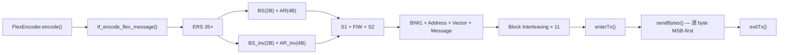

## FLEX 编码帧结构

### 一、时间层次架构

FLEX 协议用三级时间分层组织数据 [[docs/flex-protocol-advanced-features.md:25-30]]：

```
1 小时 = 15 个 Cycle (编号 0–14)
1 Cycle = 128 个 Frame (编号 0–127) = 4 分钟
1 Frame = 1.875 秒 @ 1600 bps
1 Frame = 11 Block × 8 Word = 88 Word
```

本项目当前仅实现 **单帧 (Frame 0, Cycle 0)** 发送 [[docs/flex-protocol-advanced-features.md:56-63]]。

---

### 二、单帧完整结构 (1600 bps)

```
┌─────────────────────────────────────────────────────────────────────────┐
│                         ERS (Emergency Re-Sync)                         │
│             35 × [BS][AR][BS_inv][AR_inv] = 35 × 12 bytes              │
├─────────────────────────────────────────────────────────────────────────┤
│ S1: Sync1 — 112 bits                                                    │
│  [bit_sync_1: 0xAAAAAAAA][A1: 0x78F35939][B: 0x5555][A1_inv: 0x870CA6C6]│
├─────────────────────────────────────────────────────────────────────────┤
│ FIW: Frame Information Word — 32-bit codeword                           │
├─────────────────────────────────────────────────────────────────────────┤
│ S2: Sync2 — 40 bits                                                     │
│  [C_block: 0xAED845127B]                                                │
├─────────────────────────────────────────────────────────────────────────┤
│ Block 0..10 — × 11 Block, 每 Block 8 Word = 88 Word                    │
│  Word 0..3: BIW1 + Address(es) + Vector + ...                           │
│  Word 4..7: Message data / Idle words                                   │
│  ★ 发送前做 Block Interleaving (列交织)                                │
└─────────────────────────────────────────────────────────────────────────┘
```

每个码字编码流程：**21-bit 数据 → rev32 (位反转) → BCH(31,21) → 偶校验 → 32-bit codeword** [[lib/Flex/flex.h:144-191]]

#### 2.1 发射时间开销 (1600 bps)

| 阶段 | 字节数 | 位时间 | 耗时 |
|------|--------|--------|------|
| ERS (35 × 12B) | 420 B | 625 µs/bit | ~2.10 s |
| S1 + FIW + S2 | 23 B | — | ~0.12 s |
| 数据 (88 Word × 4B) | 352 B | — | ~1.76 s |
| **总计** | **795 B** | — | **≈ 4.0 s** |

> 一次 FLEX 单帧发射约 **4 秒**（含 ERS），是 POCSAG 单批次 ~1.36s 的约 3 倍。长消息在 POCSAG 中会生成多个 Batch，FLEX 则因单帧容量更大（88 word）通常一次发完。

---

### 三、各字段详解

#### 3.1 ERS (Emergency Re-Synchronization) [[lib/Flex/flex.h:36]][[lib/Flex/flex.h:67-72]]

```c
static const uint8_t flex_bs[]    = {0xAA, 0xAA};  // Bit Sync
static const uint8_t flex_ar[]    = {0xCB, 0x20, 0x59, 0x39};  // A-R
static const uint8_t flex_bs_inv[]= {0x55, 0x55};
static const uint8_t flex_ar_inv[]= {0x34, 0xDF, 0xA6, 0xC6};
```

- 重复 **35 次** (`ERS_AMOUNT`)
- 每次 = BS (2B) + AR (4B) + BS_inv (2B) + AR_inv (4B) = **12 bytes**
- 目的：紧急重同步，唤醒处于深度休眠的寻呼机
- **正反相配对**：ERS 交替发送正相 (BS/AR) 和反相 (BS_inv/AR_inv) 序列。无论接收端信号极性是否翻转，总有一组可被成功锁定，确保时钟同步。

#### 3.2 S1 — 帧同步1 (112 bits) [[lib/Flex/flex.h:66-73]]

| 段 | 值 | 长度 |
|---|------|------|
| bit_sync_1 | `0xAAAAAAAA` | 4 bytes (32 bits 1010...) |
| A1 | `0x78F35939` | 4 bytes (32-bit) |
| B | `0x5555` | 2 bytes (16 bits 0101...) |
| A1_inv | `0x870CA6C6` | 4 bytes (A1 按位取反) |

#### 3.3 FIW — Frame Information Word [[lib/Flex/flex.h:225-236]]

32-bit codeword，21-bit 数据字段结构：

```
Bit:  20..17    16     15     14..8    7..4    3..0
    ┌─────────┬─────┬─────┬─────────┬───────┬───────┐
    │  t3-t0  │  r  │  n  │ f6-f0   │ c3-c0 │       │
    │ Low Tr. │M帧TX│漫游 │Frame#   │Cycle# │    CKS│
    └─────────┴─────┴─────┴─────────┴───────┴───────┘
```

当前调用 `create_fiw(0, 0, 0, 0, 0)` [[lib/Flex/flex.h:691]] — 全部硬编码为 0。

各字段正常取值范围：
- `cycle` (位 7..4)：0–14（每小时 15 个 Cycle，值 15 保留）
- `frame` (位 14..8)：0–127（每个 Cycle 128 帧）
- `n` (位 15)：0=禁止漫游, 1=允许漫游
- `r` (位 16)：0=无多帧传输, 1-2=跨帧传输类型
- `t` (位 20..17)：低流量标志（0=无，1-14=低流量等级）

#### 3.4 S2 — 帧同步2 (C Block) [[lib/Flex/flex.h:74]]

```c
static const uint8_t flex_cblock[] = {0xAE, 0xD8, 0x45, 0x12, 0x7B};  // 5 bytes
```

#### 3.5 BIW1 — Block Information Word 1 [[lib/Flex/flex.h:255-266]]

```
Bit:  20..18    17..16    15..10    9..8    7..4    3..0
    ┌─────────┬─────────┬──────────┬───────┬───────┬───────┐
    │collaps  │  carry  │ s_vfield │ e_biw │  prio │    CKS│
    │节电周期 │跨帧传输 │Vector偏移│BIW长度│优先级 │       │
    └─────────┴─────────┴──────────┴───────┴───────┴───────┘
```

当前调用 `create_biw1(0, 0, 2 + is_long, 0, 0)` [[lib/Flex/flex.h:697]]：

| 字段 | 值 | 含义 |
|------|----|------|
| prio | 0 | 无优先地址 |
| e_biw | 0 | BIW 占 1 word |
| s_vfield | 2 或 3 | Vector Field 偏移 (short=2, long=3) |
| carry | 0 | 不跨帧 |
| collapse | 0 | 不节电 (监听所有帧) |

#### 3.6 Address Field — 地址字段 [[lib/Flex/flex.h:333-343]][[lib/Flex/flex.h:354-359]]

**Short Address** (7-digit CAPCODE，范围 1–1933312)：

```c
address = (cap_code + 32768) & 0x1FFFFF;  // 21-bit
frame_words[fwc++] = encode_word(rev32(address));
```

**Long Address** (9-10 digit CAPCODE，范围 2101249–4297068542)：

```c
// 编码为两个 21-bit 字
words[0] = encode_word(rev32(w1));
words[1] = encode_word(rev32(w2));
```

CAPCODE 到 Frame#/Phase 的计算公式 [[docs/flex-protocol-advanced-features.md:256-268]]：

```
Frame = ((Address - Offset) / 16) mod 128
Phase = (((Address - Offset) / 4) mod 4) → 0=A, 1=B, 2=C, 3=D
```

> **省电原理**：每个寻呼机只监听自己所属的 Frame/Phase 组合，其余时间休眠。Frame 将寻呼机分散到 128 个时隙，Phase（仅 3200/6400 bps 多相位模式）进一步将同一 Frame 中的寻呼机分组。1600 bps 仅 Phase A。与 POCSAG 的 `addr & 0x07` 硬编码帧号相比，FLEX 的地址分配更灵活，可通过调整 Offset 优化网络负载分布。

#### 3.7 Vector Word — 向量字

**Alphanumeric Vector** (V=101) [[lib/Flex/flex.h:278-287]]：

```
Bit:  20..14   13..7    6..4    3..0
    ┌──────────┬────────┬───────┬───────┐
    │msg_words │msg_strt│V=101  │  CKS  │
    │  7-bit   │  7-bit │(Alpha)│       │
    └──────────┴────────┴───────┴───────┘
```

**Numeric Vector** (V=011) [[lib/Flex/flex.h:300-310]]：

```
Bit:  20..17   16..14   13..7    6..4    3..0
    ┌─────────┬────────┬────────┬───────┬───────┐
    │  kbit   │msg_wrd │msg_strt│V=011  │  CKS  │
    │  4-bit  │  3-bit │  7-bit │ (Num) │       │
    └─────────┴────────┴────────┴───────┴───────┘
```

**Tone-only Vector** (V=010) [[lib/Flex/flex.h:319-326]]：

```
Bit:  20..17    16..14   13..7   6..4   3..0
    ┌─────────┬────────┬───────┬──────┬───────┐
    │    0    │   2    │   1   │  0   │   CKS │
    │         │(V=010) │t1t0=01│      │       │
    └─────────┴────────┴───────┴──────┴───────┘
```

Tone-only 消息不携带文本，仅触发寻呼机的提示音（可配置不同铃音类型）。
在 `Transmitter::sendFlex()` 中通过 `cfg.msgType == TONE_ONLY` 触发，
调用 `FlexEncoder::encode(addr, "", FlexEncoder::TONE_ONLY)`。

#### 3.8 Message Field — 消息字段

**Alphanumeric** (7-bit 字符编码) [[lib/Flex/flex.h:483-601]]：

```
每个 Word 承载 3 个 ASCII 字符 (每个 7 bit = 21 bit)：
Word n: [ch[i+2] 7b | ch[i+1] 7b | ch[i] 7b | ...]
                         ↑ MSB
Word[0]: [f1f0=11 | k9-k0 10-bit cks | MailDrop | padding]
Word[1]: [s6-s0 7-bit signature | ch[2] 7b | ch[1] 7b | ch[0] 7b]
Word[2..]: [ch[i+2] | ch[i+1] | ch[i]] × N
```

- 最大 **MAX_CHARS_ALPHA** = (88 − 4) × 3 − 4 = **248 字符** [[lib/Flex/flex.h:49-55]]
- 未满的 7-bit 位置用 ETX (`0x03`) 填充
- **S-bit**（7-bit 签名, word[1] bits 6..0）：对 word[1..N-1] 中每个 7-bit 字符字段求和 → 按位取反 → 取低 7 位。用于接收端快速校验消息完整性。
- **K-bit**（10-bit 校验和, word[0] bits 9..0）：对所有 word[0..N-1] 分别拆分低 8 位 (`bits 7..0`)、中 8 位 (`bits 15..8`)、高 5 位 (`bits 20..16`) 三组求和 → 按位取反 → 取低 10 位。比 S-bit 更强校验，覆盖包括 word[0] 在内的完整消息。

**Numeric** (4-bit 编码) [[lib/Flex/flex.h:854-924]]：

```
每个 Word 承载 5 个数字 (每个 4 bit = 20 bit)：
Word 0: [k1k0 2-bit | d4 | d3 | d2 | d1 | d0]
Word 1..: [d4 | d3 | d2 | d1 | d0] × N
```

- 字符映射：`0-9→0x0-0x9`, `U/u→0xB`, 空格→`0xC`, `-`/`_`→`0xD`, `]→0xE`, `[→0xF`
- 最大 **MAX_CHARS_NUMERIC** = 8 字 = **最多 41 个数字** [[lib/Flex/flex.h:58-63]]
- 尾部用 `0xC` (空格) 填充至 4-bit 边界

---

### 四、Block Interleaving (列交织) [[lib/Flex/flex.h:449-468]]

所有 88 个 word 被分到 11 个 block，每 block 8 word。发送前按 **bit 列交织**：

```
原始:  word0=[b31..b0] word1=[b31..b0] ... word7=[b31..b0]
发送:  [w0b31,w1b31,w2b31,w3b31,w4b31,w5b31,w6b31,w7b31]  ← 第1字节
       [w0b30,w1b30,...]                                    ← 第2字节
       ...
       [w0b0, w1b0, ...]                                    ← 第32字节
```

目的：突发干扰仅破坏每 word 的 1 bit，BCH(31,21) 可纠正 ≤2 bit/word。

---

### 五、Idle Word 填充规则 [[lib/Flex/flex.h:713-718]]

88-word 帧未填满时，交替发送全 1 和全 0 作为空闲填充（无需经 BCH 编码，直接作为原始 32-bit 值写入帧缓冲区）：

```c
if ((fwc % 2) == 0)
    frame_words[fwc] = 0xFFFFFFFF;  // 偶索引 → 全 1
else
    frame_words[fwc] = 0;            // 奇索引 → 全 0
```

FLEX 标准还定义了两个 21-bit 数据域的 idle 宏，但这些宏未在填充循环中使用（仅作标准参考）[[lib/Flex/flex.h:32-33]]：

```c
#define IW1 0         /* Idle word 1 (21-bit data domain). */
#define IW2 0x1FFFFFU /* Idle word 2 (21-bit data domain). */
```

---

### 六、与 POCSAG 的关键差异

| 维度 | POCSAG | FLEX |
|------|--------|------|
| 前导码 | 576-bit 固定 1010... | ERS (35×12B) + Sync1/Sync2 |
| 帧结构 | 1 Sync + 16 时隙 | 1 FIW + 11 Block × 8 Word |
| 地址位宽 | 21-bit | 21-bit (Short) / 2×21-bit (Long) |
| 地址→时隙 | 固定 `addr & 0x07` | 公式计算 `Frame = ((addr - off)/16) mod 128` |
| 消息编码 | 7-bit LSB-first 反转 | 7-bit MSB-packed (Alphanum) / 4-bit (Numeric) |
| BCH/校验 | BCH(31,21) + 偶校验 | 相同 BCH(31,21) + 偶校验 |
| 抗突发干扰 | 无 | Block Interleaving (列交织) |
| 节电 | 无 | 两级 Collapse (系统级 + 寻呼机级) |
| 中文 | 7-bit + 0x0E/0x0F 控制符 | 同 7-bit + 0x0E/0x0F 控制符 |

### 七、码字编码 (BCH) [[lib/Flex/flex.h:144-191]]

```
21-bit data
   → rev32() 位反转
   → BCH(31,21) 除以 G(x)=x¹⁰+x⁹+x⁸+x⁶+x⁵+x³+1 (0x769)
   → 拼接: [21 data][10 BCH ECC]
   → 偶校验
   → 32-bit codeword
```

与 POCSAG 使用相同的 BCH 生成多项式 `0x769`。

> **💡 rev32() vs POCSAG 位反转的关键差异**：
> **POCSAG** 对消息字节做 **7-bit/4-bit LSB-first** 逐位反转（`flip7bitOrder`/`flip4bitOrder`），这是在**消息字符级**的操作，因为 POCSAG 的消息码字是多个字符拼接成的 20-bit，逐字符反转后接收端能正确恢复。
>
> **FLEX** 的 `rev32()` 对**整个 21-bit 数据字**做 32-bit 位反转（MSB‑LSB 整体交换），这是在**码字级**的操作，因为 FLEX 的消息字段已按 MSB-packed 排列（每 word 3 字符，高位优先），无需逐字符反转。
>
> 两者对应不同的编码层次：POCSAG 在字符层反转，FLEX 在码字层反转。

---

### 八、发射流程 [[src/Controller/Transmitter.cpp:161-223]]



物理层：`enterTx()` → Si446x_startDirectTX (10ms PLL 锁定) → `sendBytes()` 逐位 busy-wait GPIO0 → `exitTx()` [[src/Controller/Transmitter.cpp:217-219]]。1600 bps 位时间 = 625 µs。

---

### TL;DR

FLEX 帧结构显著复杂于 POCSAG：**ERS(35×12B) → Sync1(14B) → FIW(4B) → Sync2(5B) → 11 Block × 8 Word (含列交织)**。地址分为 Short(21-bit) 和 Long(42-bit) 两种，消息以 7-bit MSB-packed (Alphanumeric, 最长 248 字符) 或 4-bit (Numeric, 最长 41 字符) 编码。当前实现为单帧 (Frame 0/Cycle 0) 模式，所有高级特性 (SSID/NID/Collapse/时间BIW) 尚未实现。