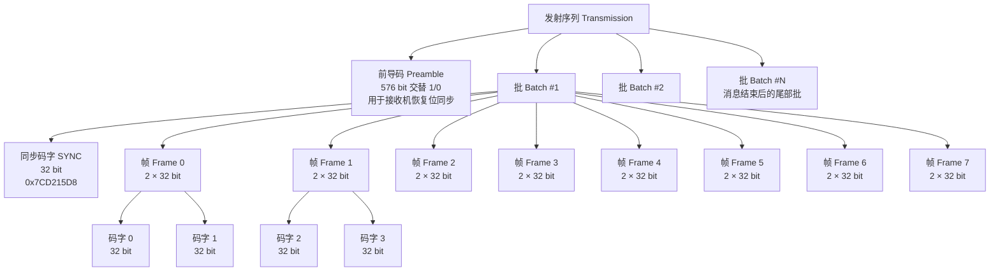
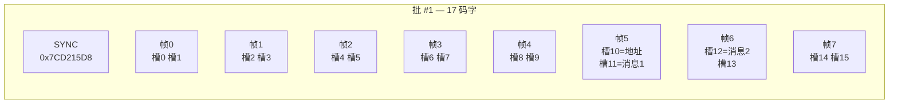
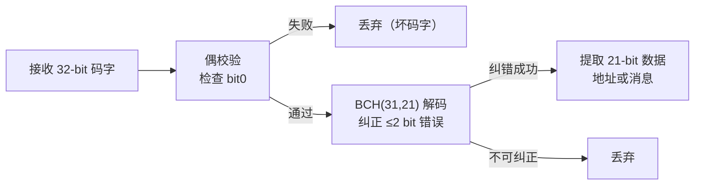
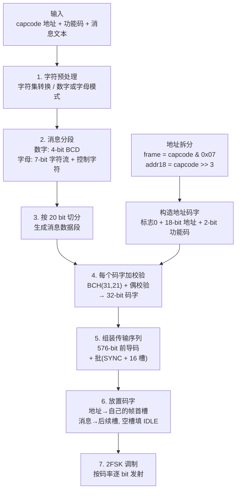
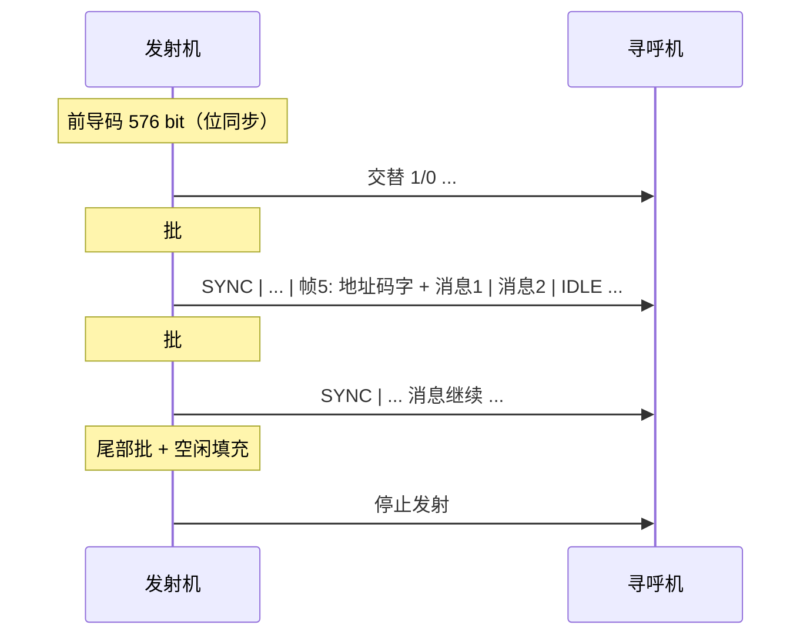

# POCSAG 寻呼协议 — 协议结构与编码过程

> 本文从**协议本身**的角度介绍 POCSAG（Post Office Code Standardisation Advisory Group）的
> 传输结构、码字格式、差错控制与消息编码过程，不涉及具体代码实现。
> 与 BeeperTX 实现的关系见文末[附录](#附录与本项目实现的关系)。

---

## 目录

- [1. 协议简介](#1-协议简介)
- [2. 传输序列总体结构](#2-传输序列总体结构)
- [3. 码字结构](#3-码字结构)
- [4. 地址、帧映射与省电机制](#4-地址帧映射与省电机制)
- [5. 差错控制](#5-差错控制)
- [6. 消息编码](#6-消息编码)
- [7. 编码完整流程](#7-编码完整流程)
- [8. 调制方式与发射时序](#8-调制方式与发射时序)
- [9. 协议常数速查](#9-协议常数速查)
- [附录：与本项目实现的关系](#附录与本项目实现的关系)

---

## 1. 协议简介

POCSAG 是由英国邮政总局标准顾问小组（Post Office Code Standardisation Advisory Group）于
1970 年代末制定、1978 年发布的一种**单向无线寻呼协议**，后来被 CCIR（现 ITU-R）采纳为
建议书 M.584。它是 20 世纪 80 至 90 年代全球最普及的寻呼标准，至今仍在部分专用
调度、安防与遥测场景使用。

协议的核心特征：

| 项目 | 规范 |
|------|------|
| 通信方式 | 单向广播（基站 → 寻呼机） |
| 调制方式 | 2FSK（二进制频移键控） |
| 标准码率 | 512 / 1200 / 2400 bps |
| 码字长度 | 32 bit |
| 差错控制 | BCH(31,21) 纠错 + 1 bit 偶校验 |
| 寻址空间 | 21-bit 地址（capcode），最多 2,097,152 个 |
| 消息类型 | 数字（Numeric）与字母数字（Alphanumeric） |
| 工作频段 | VHF / UHF 寻呼频段（如 137–174 MHz、400–512 MHz 等） |

设计目标：**简单、可靠、省电**。寻呼机是电池供电的小型设备，协议通过"帧分片 +
只监听自己的帧"的方式，把接收机解码电路的占空比降到约 1/17，从而获得很长的电池寿命。

---

## 2. 传输序列总体结构

一次完整的 POCSAG 发射由**前导码**和连续若干个**批（Batch）**组成：



### 2.1 前导码（Preamble）

- 标准规定前导码为**至少 576 bit** 的交替 1/0 模式（`101010...`）。
- 作用：让刚开机的接收机恢复**位同步**（时钟提取），为随后解析码字做准备。
- 576 bit 恰好等于 18 个 32-bit 码字长度（`18 × 32 = 576`），实现上常以
  18 个 `0xAAAAAAAA` 表示。
- 若发射机两次发射之间有停顿，再次发射前需要重新发送前导码，以便
  中途开机或失步的接收机重新同步。

### 2.2 批（Batch）

前导码之后是连续发送的批，每批 17 个码字、共 544 bit：

```
一个批 = [ 1 × 同步码字 SYNC ] + [ 8 × 帧（每帧 2 码字）]
       = 1 + 16 = 17 个码字 = 17 × 32 = 544 bit
```

- 每批开头是固定的**同步码字** `0x7CD215D8`，接收机靠它建立**批同步**。
- 同步码字之后是 8 个帧，帧号 0–7，每帧 2 个码字槽位（槽号 0–15）。
- 消息可以跨批延续：一条消息的消息码字如果超过当前批剩余槽位，
  会在后续批中继续，接收机通过同步码字维持连续跟踪。

### 2.3 帧与槽位（Frame / Slot）

- 每批 16 个码字槽位，按 2 个一组划分为 8 帧。
- **地址码字固定放在所属帧的第一个槽位**（槽号 = 帧号 × 2）。
- 同一帧的第二个槽位、以及后续帧的槽位，按顺序放置消息码字；
  没有数据时填**空闲码字（Idle）** `0x7A89C197`。

一个示例批的槽位布局（地址属于帧 5，消息占 2 个码字）：



---

## 3. 码字结构

所有码字都是 32 bit，按 **MSB-first**（bit 31 先发送）传输。
最高位 bit 31 是类型标志：**0 = 地址码字，1 = 消息码字**。

### 3.1 地址码字（Address Codeword，bit31 = 0）

```
bit:  31    30                   13   12   11   10               1   0
     ┌─────┬──────────────────────┬────┬────┬────────────────────┬─────┐
     │  0  │  18-bit 地址         │功能│功能│  10-bit BCH 校验    │ 偶  │
     │ 标志│  (capcode >> 3)      │b1  │b0  │                     │校验 │
     └─────┴──────────────────────┴────┴────┴────────────────────┴─────┘
```

| 位段 | 位数 | 含义 |
|------|------|------|
| bit 31 | 1 | 类型标志，0 = 地址码字 |
| bit 30 – 13 | 18 | 地址字段 = 21-bit 寻呼机地址右移 3 位（capcode >> 3） |
| bit 12 – 11 | 2 | 功能码（Function），4 种提示音/功能可选 |
| bit 10 – 1 | 10 | BCH(31,21) 校验位 |
| bit 0 | 1 | 偶校验位（对全部 32 bit 保证 1 的个数为偶数） |

> 地址的低 3 位不在码字里，而是体现在**帧号**上（见第 4 节）。

### 3.2 消息码字（Message Codeword，bit31 = 1）

```
bit:  31    30                   11   10               1   0
     ┌─────┬──────────────────────┬────────────────────┬─────┐
     │  1  │  20-bit 消息数据     │  10-bit BCH 校验    │ 偶  │
     │ 标志│                       │                     │校验 │
     └─────┴──────────────────────┴────────────────────┴─────┘
```

| 位段 | 位数 | 含义 |
|------|------|------|
| bit 31 | 1 | 类型标志，1 = 消息码字 |
| bit 30 – 11 | 20 | 消息数据（数字为 5×4-bit BCD；字母为 7-bit 字符流） |
| bit 10 – 1 | 10 | BCH(31,21) 校验位 |
| bit 0 | 1 | 偶校验位 |

### 3.3 同步码字与空闲码字

| 码字 | 十六进制 | 作用 |
|------|----------|------|
| 同步码字（SYNC） | `0x7CD215D8` | 每批开头，标识批边界、恢复批同步 |
| 空闲码字（IDLE） | `0x7A89C197` | 无数据槽位填充，接收机收到后忽略 |

同步码字和空闲码字都是协议规定的**固定比特模式**，接收机按模式匹配识别，
不参与地址/消息解码。

---

## 4. 地址、帧映射与省电机制

### 4.1 地址结构

POCSAG 地址是 21-bit 的 capcode，范围 0 – 2,097,151。它被拆成两部分：

```
capcode = [ 18-bit 码字内地址 ] [ 3-bit 帧号 ]
```

| 部分 | 位 | 作用 |
|------|-----|------|
| 帧号 | 低 3 位（capcode & 0x07） | 决定地址码字放在哪个帧（帧 0–7） |
| 码字内地址 | 高 18 位（capcode >> 3） | 填入地址码字的 bit 30 – 13 |

### 4.2 帧映射

地址码字**必须**出现在与其低 3 位对应的帧的**第一个槽位**：

```
帧号 frame  = capcode & 0x07
槽号 slot   = frame × 2        （该帧的第一个码字槽）
```

例如 capcode = 1225429（`0x12B2D5`）：

```
capcode = 0x12B2D5 = 00 0001 0010 1011 0010 1101 01
frame   = 0x12B2D5 & 0x07 = 5          → 帧 5
槽号    = 5 × 2 = 10                    → 槽 10（帧 5 的第一个码字）
码字内地址 = 0x12B2D5 >> 3 = 0x2565A   → 填入地址码字 bit 30 – 13
```

### 4.3 省电机制（Battery Saving）

- 接收机平时处于**休眠**状态，只在每批中自己所属的那一帧醒来。
- 每批醒来 1 帧（2 个码字）+ 同步码字，占空比约为 `3 / 17 ≈ 18%`；
  若只唤醒数据帧（同步由快速同步码字处理）则更低。
- 因为寻呼机只在自己帧内找地址，发射机**必须**把地址码字放在正确的帧，
  否则接收机永远等不到自己的呼叫——这是地址与帧映射存在的原因。
- 功能码（Function）为每个地址提供 4 种不同的提示方式（通常对应
  Tone A / B / C / D，如不同铃音或静音振动）。

---

## 5. 差错控制

每个 32-bit 码字携带两层差错保护：**BCH(31,21)** 纠错码 + **1 bit 偶校验**。

### 5.1 BCH(31,21)

- 数据：21 bit（地址码字的前 21 位：标志+地址+功能；消息码字的前 21 位：标志+消息）。
- 生成多项式：

```
G(x) = x^10 + x^9 + x^8 + x^6 + x^5 + x^3 + 1   （十六进制 0x769）
```

- 校验位：10 bit，即码字的 bit 10 – 1。
- 纠错能力：最小码距 d = 5，**可纠正每个码字最多 2 个比特错误**，对
  突发干扰、多径衰落导致的误码有较强恢复能力。

### 5.2 偶校验位

- 在 BCH 基础上再对整个 32-bit 码字附加 1 bit 偶校验（bit 0），
  使码字中 1 的个数为偶数。
- 作用：把只能"纠 2 位"的 BCH 能力扩展为**同时检测更多错误**的
  冗余层——接收机先做偶校验快速剔除明显坏码字，再做 BCH 纠错。

### 5.3 差错处理流程



---

## 6. 消息编码

POCSAG 支持两种消息格式：**数字（Numeric）** 与 **字母数字（Alphanumeric）**。
消息数据以 20-bit 为单位填进消息码字；长消息会占用多个连续的消息码字。

### 6.1 数字消息（Numeric）

- 每个字符编码为 **4-bit BCD**，20 bit 一个码字 → **每码字 5 个字符**。
- 字符按 **LSB-first** 顺序传输（与码字本身的 MSB-first 相反）。
- 标准字符表：

| 输入字符 | BCD 值 | 寻呼机显示 |
|----------|--------|------------|
| `0` – `9` | `0x0` – `0x9` | 数字 |
| 空格 | `0xA` | 空格 |
| `U` | `0xB` | 紧急标志 |
| （保留） | `0xC` | 未定义 |
| `-` | `0xD` | 连字符 |
| `]` | `0xE` | `)` |
| `[` | `0xF` | `(` |

- **尾随填充**：最后一个不满 20 bit 的码字用 `0xA`（SPACE）填充，
  标准明确要求不能补零——接收机据此判断消息已结束。

示例：消息 `"1234"` 共 4 个字符 = 16 bit，最后一个码字再填 1 个 SPACE
凑满 20 bit，即 `"1234 "`。

### 6.2 字母数字消息（Alphanumeric）

- 每个字符编码为 **7 bit**（CCITT No.5 字符集，ASCII 子集），同样按
  **LSB-first** 传输。
- 20 bit 一个码字，7-bit 字符流**连续跨码字打包**：每码字含 2 个完整
  字符（14 bit）+ 下个字符的前 6 bit，长度不强制对齐码字边界。
- 消息以控制字符 **EOT（0x04，文本结束）** 收尾，接收机收到 EOT 或
  后续出现地址/空闲码字即认为消息结束。
- 标准控制字符（CCITT No.5）：

| 控制字符 | 值 | 含义 |
|----------|-----|------|
| SI（Shift In） | `0x0F` | 切换到基本字符集（英文） |
| SO（Shift Out） | `0x0E` | 切换到扩展字符集 |
| EOT（End of Text） | `0x04` | 消息结束 |

### 6.3 中文寻呼的扩展约定

POCSAG 标准本身面向西文字符，中文寻呼机厂商在 7-bit 框架内做了扩展：

- 中文字符以 **GB2312 双字节**编码，字节值均 ≥ `0x80`；
- 每个字节取低 7 位参与 7-bit 传输（高位剥离）；
- 用 **SO / SI** 控制字符在中文模式与英文模式之间切换；
- 消息默认中文模式，遇到 ASCII 字节前插入 SI（`0x0F`），遇到 GB2312
  字节前插入 SO（`0x0E`），切换状态机确保字符模式与实际内容一致；
- 消息尾部追加 EOT（`0x04`）。

示例：中英混排消息 "Hi你好" 编码后的 7-bit 字符序列为：

```
[SI] H i [SO] 你(首) 你(次) 好(首) 好(次) [EOT]
 0x0F 48 69 0x0E C4 E3 BA C3 0x04
```

> 注意：部分寻呼机在**显示层**另有字符集切换码约定（如 `0x70 → GB2312`、
> `0xF0 → ASCII`），这是设备厂商约定，不是 POCSAG 协议内容。

---

## 7. 编码完整流程

从协议视角，发射一条 POCSAG 消息的完整编码过程：



逐步说明：

1. **字符预处理** — 确定消息类型（Numeric / Alphanumeric），做字符集
   转换（如 UTF-8 → GB2312）。
2. **消息分段** — 数字消息按 4-bit BCD 编码，字母消息按 7-bit 编码并
   插入 SI/SO/EOT 控制字符。
3. **20-bit 切分** — 把比特流按 20 bit 一组切分成消息码字的数据段，
   不足一组按类型规则填充（数字填 SPACE，字母填 0）。
4. **加校验** — 对每个码字计算 BCH(31,21) 的 10-bit 校验位与 1 bit
   偶校验位，构成完整 32-bit 码字。
5. **组装序列** — 写 576-bit 前导码，然后逐批写入 SYNC + 16 个槽位。
6. **放置码字** — 地址码字放在 `(capcode & 0x07) × 2` 槽位，消息码字
   紧接其后连续放置（可跨批延续），空槽填空闲码字。
7. **调制发射** — 32-bit 码字 MSB-first 逐位输出，2FSK 调制，按码率
   对应的位时间定时。

### 一次完整发射的时间线



---

## 8. 调制方式与发射时序

- **调制**：2FSK，频率偏移通常为 ±4.5 kHz；二进制 1 与 0 对应两个
  不同频率。
- **位传输顺序**：码字整体 MSB-first；码字内的消息字符数据 LSB-first。
- **码率与位时间**：

| 码率 (bps) | 位时间 | 前导码时长 (576 bit) | 单批时长 (544 bit) |
|-----------|--------|----------------------|--------------------|
| 512       | 1953 µs | 1.125 s             | 1.0625 s           |
| 1200      | 833 µs  | 480 ms               | 453 ms             |
| 2400      | 417 µs  | 240 ms               | 227 ms             |

- 实际系统最常用 **512 bps**（覆盖好、接收灵敏度高）与 **1200 bps**（吞吐折中）。

---

## 9. 协议常数速查

| 常数 | 值 | 说明 |
|------|-----|------|
| 前导码长度 | 576 bit（至少） | 交替 1/0，位同步 |
| 前导码字 | `0xAAAAAAAA` | 18 次重复 = 576 bit |
| 同步码字 | `0x7CD215D8` | 每批开头 |
| 空闲码字 | `0x7A89C197` | 空槽填充 |
| 批结构 | 1 SYNC + 8 帧 × 2 码字 = 17 码字 | 544 bit |
| 码字长度 | 32 bit | bit31 标志 + 数据 + BCH + 偶校验 |
| BCH 生成多项式 | `x^10 + x^9 + x^8 + x^6 + x^5 + x^3 + 1`（0x769） | 纠 2 位错 |
| 地址字段 | 18 bit（capcode >> 3） | bit 30 – 13 |
| 功能码 | 2 bit | bit 12 – 11 |
| 帧号 | 3 bit（capcode & 0x07） | 决定帧与槽 |
| 地址总数 | 2^21 = 2,097,152 | 每个含 4 个功能 |
| 数字字符 | 4-bit BCD | 5 字符/码字 |
| 字母字符 | 7-bit（CCITT No.5） | 跨码字连续打包 |

---

## 附录：与本项目实现的关系

BeeperTX 的 POCSAG 编码实现（`lib/Pocsag/`）严格遵循上述协议：

- 前导码 = 18 个 `0xAAAAAAAA`，批 = 1 个 SYNC + 16 槽，尾部补 16 个 IDLE；
- 地址槽 = `(capcode & 0x07) × 2`，地址码字填 `capcode >> 3`；
- BCH 多项式 `0x769`，全部码字带偶校验；
- 数字消息 4-bit BCD + LSB-first 反转，尾部 SPACE 填充；
- 字母消息 7-bit LSB-first，含 GB2312 中文的 SO/SI 切换与 EOT 结束符；
- 批量追码模式使用单前导码贯穿连续多批，消息码字可跨 SYNC 延续
  （符合 ITU-R M.584 §2.2）。

实现层面的细节见 [docs/wiki/pocsag-encoding.md](wiki/pocsag-encoding.md) 与
[docs/PocsagEncoding.md](PocsagEncoding.md)。
