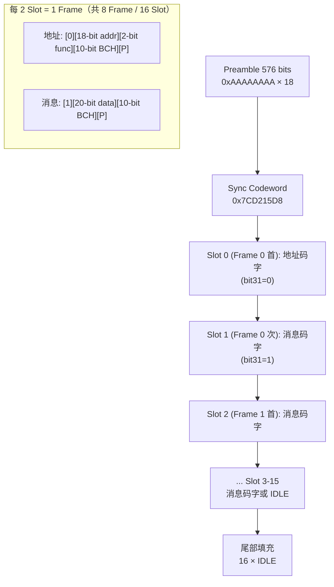

## POCSAG 编码帧结构

### 一、帧结构总览

POCSAG 一帧 (Batch) 的结构为 [[lib/Pocsag/Pocsag.cpp:285-361]]：

```
┌──────────┬──────────┬──────────────────┬──────────────────┬──────────────────────┐
│ Preamble │  Sync    │    Frame 0       │    Frame 1       │   ...  Frame 7       │
│ 576 bits │  32-bit  │  2 × 32-bit      │  2 × 32-bit      │  2 × 32-bit each     │
└──────────┴──────────┴──────────────────┴──────────────────┴──────────────────────┘
        ↑ 每批 17 个码字 (1 Sync + 8 帧)
        ↑ 每帧 = 2 个码字 (地址/消息/空闲)
```

### 二、关键协议常量

定义于 [[lib/Pocsag/Pocsag.h:8-10]]：

| 常量 | 值 | 用途 |
|------|-----|------|
| `POCSAG_PREAMBLE` | `0xAAAAAAAA` | 前导码 — 576 位交替 1/0 模式 (0101...) |
| `POCSAG_SYNC` | `0x7CD215D8` | 帧同步码字 |
| `POCSAG_IDLE` | `0x7A89C197` | 空闲码字 — 无数据时填充 |

### 三、码字结构 (32-bit)

#### 地址码字 — bit31=`0` [[lib/Pocsag/Pocsag.cpp:106-114]]

```
Bit:  31    30..13      12..11      10..1      0
    ┌─────┬───────────┬───────────┬──────────┬─────┐
    │  0  │ 18-bit    │ 2-bit     │ 10-bit   │ 偶  │
    │     │ 地址      │ 功能码    │ BCH 校验 │ 校验 │
    └─────┴───────────┴───────────┴──────────┴─────┘
```

- **bit31 = 0** — 标识为地址码字
- **bit30..13** — 21-bit 地址右移 3 位后填入 (18-bit 有效)
- **bit12..11** — 2-bit 功能码 (0=TONE_A, 1=TONE_B, 2=TONE_C, 3=TONE_D)
- **bit10..1** — BCH(31,21) 校验码，生成多项式 `G(x) = x¹⁰ + x⁹ + x⁸ + x⁶ + x⁵ + x³ + 1` (`0x769`) [[lib/Pocsag/Pocsag.cpp:64-77]]
- **bit0** — 偶校验位

#### 消息码字 — bit31=`1` [[lib/Pocsag/Pocsag.cpp:120-126]]

```
Bit:  31    30..11      10..1      0
    ┌─────┬───────────┬──────────┬─────┐
    │  1  │ 20-bit    │ 10-bit   │ 偶  │
    │     │ 消息数据  │ BCH 校验 │ 校验 │
    └─────┴───────────┴──────────┴─────┘
```

- **bit31 = 1** — 标识为消息码字
- **bit30..11** — 20-bit 消息数据片段
- **bit10..1** — BCH(31,21) 校验码
- **bit0** — 偶校验位

### 四、编码流程 (`genSignal()`) [[lib/Pocsag/Pocsag.cpp:285-361]]

```
genSignal(addr, func, msg, len, mode, invert)
  │
  ├─ 1. genPreamble()        — 18 × 0xAAAAAAAA = 576 bit 前导码
  │
  ├─ 2. 消息编码:
  │      ├─ deCodeAlpha()    — 7-bit 字符编码 + GB2312 中文支持
  │      └─ deCodeNumeric()  — 4-bit BCD 编码
  │
  ├─ 3. 地址帧号:
  │      frameNum = addr & 0x07    (地址低 3 位决定帧号)
  │      addrSlot = frameNum * 2   (每帧 2 个码字槽位)
  │      → 寻呼机只监听自己地址对应的帧以省电
  │
  ├─ 4. 组装批次 (循环发送，直到消息码字全部送出):
  │      while (!addrSent || 还有消息码字) {
  │          [Sync][Slot 0..15]   — 每批 1 Sync + 16 码字
  │          地址码字放在 addrSlot 位置
  │          其余 Slot 依次填充消息码字或 POCSAG_IDLE
  │      }
  │      → 消息超过 16 码字时会自动产生多个 Batch
  │      → 基带缓冲区 MAX_BASEBAND = 768, 超限静默截断
  │
  ├─ 5. 尾部: 16 个空闲码字
  │
  └─ 6. invert=true → 全部码字取反
```

### 五、Alphanumeric 编码 (`deCodeAlpha`) [[lib/Pocsag/Pocsag.cpp:163-215]]

字符以 **7-bit LSB-first 位反转** 编码，每 20 bit 打包成一个消息码字：

| 字节范围 | 处理方式 |
|----------|----------|
| `< 0x80` | ASCII，7-bit 位反转后编码 |
| `>= 0x80` | GB2312 中文，同 7-bit 位反转（只取低 7 位） |
| `0x0E` (SO) | 自动插入 — 切换中文模式 |
| `0x0F` (SI) | 自动插入 — 切换英文模式 |
| `0x04` (EOT) | 消息结束符 — 自动追加 |

控制字符自动插入逻辑 [[lib/Pocsag/Pocsag.cpp:174-194]]：寻呼机默认中文模式，遇 ASCII 字节自动插 `0x0F`，遇 GB2312 字节自动插 `0x0E`。

### 六、Numeric 编码 (`deCodeNumeric`) [[lib/Pocsag/Pocsag.cpp:245-277]]

4-bit BCD 映射表：

| 字符 | BCD | 字符 | BCD |
|------|-----|------|-----|
| `0`-`9` | `0x0`-`0x9` | 空格 | `0xA` |
| `U` | `0xB` | `-` | `0xD` |
| `]`→`)` | `0xE` | `[`→`(` | `0xF` |

- 每个 nibble 做 4-bit LSB-first 位反转
- 每 5 个 nibble (20 bit) 生成一个消息码字
- 尾部用 SPACE (`0xA`) 填充至 20-bit 边界

### 七、物理层发射时序 [[src/Controller/Transmitter.cpp]]

```
enterTx() → Si446x_startDirectTX(0, 1) + 2ms PLL 锁定
sendCodewords(bb, bandLen, bitTime)      — MSB-first, 32-bit/word (含 576-bit 前导码)
exitTx() → Si446x_stopTX()
```

波特率对应位时间 [[src/Controller/Transmitter.cpp]]：

| 波特率 | 位时间 |
|--------|--------|
| 512 | 1953 µs |
| 1200 | 833 µs |
| 1600 | 625 µs |
| 2400 | 417 µs |
| 3200 | 312 µs |
| 6400 | 156 µs |

单帧时长示例 (1200 bps, 1 batch)：576 preamble × 833µs + 33 codewords (Sync + 16 Slot + 16 IDLE) × 32 bits × 833µs ≈ **1.36s**。

> ⚠️ `MAX_BASEBAND = 768` 码字 (`Pocsag.h:15`)，减去前导码 (18) 和尾部 IDLE (16) 后，实际有效容量约 **734 码字 ≈ 45 批**。超长消息会被 `bandPtr >= MAX_BASEBAND → break` 静默截断。`MAX_CODEMORDS = 512` 消息码字也受 `Pocsag.h:16` 限制。

### 八、完整示意图



### TL;DR

本项目 POCSAG 实现严格遵循标准协议：**576-bit 前导码 + 1 Sync + 8 帧 (每帧 2 码字)**，地址通过 `addr & 0x07` 映射到固定帧。Alphanumeric 用 **7-bit LSB-first 位反转** 编码并支持 GB2312 中文 (通过 `0x0E`/`0x0F` 控制字符切换)，Numeric 用 **4-bit BCD + 4-bit 位反转**。BCH(31,21) 校验码生成多项式为 `0x769`，所有码字最后 1 bit 为偶校验。