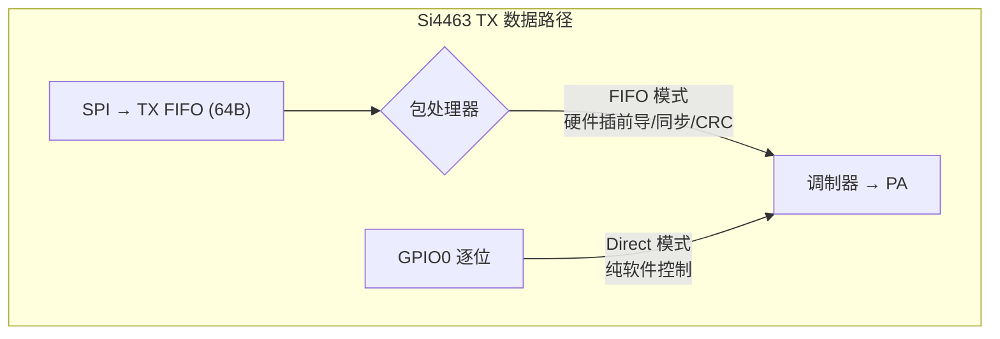

## Si4463 FIFO 模式与 POCSAG/FLEX 兼容性分析

### 结论：不兼容，Direct TX 是正确的做法

本项目使用的 Si446x `startDirectTX(0, 1)`（异步直发模式）是 POCSAG 和 FLEX 寻呼协议的**唯一正确选择**。芯片内置的 FIFO/包处理硬件无法用于这两种连续流协议。

---

### 一、Si4463 三种 TX 模式

| 模式 | 数据来源 | 前导码/同步字/CRC | 适合场景 |
|------|---------|-------------------|---------|
| **FIFO/包模式** (Packet) | SPI 写入 TX FIFO | 硬件自动插入 | 标准数据包协议（传感器、遥控器） |
| **同步直发** (Direct Sync) | GPIO0 + GPIO1 位时钟 | 全部软件控制 | 自定义连续流，需精确时序 |
| **异步直发** (Direct Async) — **本项目在用** | GPIO0，不带时钟 | 全部软件控制 | 自定义连续流，低波特率 |



---

### 二、FIFO/Packet 模式不可行的原因

#### 2.1 POCSAG 需要连续跨批次传输

POCSAG 一帧的完整时序是**连续的**：

```
Preamble → [Sync + Slot0..15] → [Sync + Slot0..15] → ... → Idle×16
                                    ↑ 同步字出现在帧中间，不是开头
```

FIFO 模式下，每次 `START_TX` 是一个独立的"数据包"。芯片在包结束后回到 IDLE 态，**包与包之间出现载波间隙**，导致寻呼机丢失同步。

即使将 `PREAMBLE_LEN`、`SYNC_CONFIG`、`CRC_ENABLE` 全部置零，让芯片退化为"裸 FIFO 调制器"，`START_TX` 仍然会在 FIFO 清空后**自动终止发射**，无法做到连续不间断载波。

#### 2.2 FLEX 的前导/同步序列远超硬件能力

FIFO 模式支持的硬件特性：
- **前导码**：单一重复模式（如 0xAA，长度可配置）
- **同步字**：最多 **4 字节**（32 bit）
- **CRC**：标准多项式（CRC-16/CCITT 或 CRC-32/IEEE 802.3），**不是 BCH**

而 FLEX 的完整前导/同步序列：

| 段 | 组成 | 长度 | 芯片能否处理 |
|----|------|------|------------|
| ERS | BS + AR + BS_inv + AR_inv × **35** | 420 B | ❌ 正反相交替，前导码不支持 |
| S1 | bit_sync_1 + A1 + B + A1_inv | 14 B | ❌ 4 段拼接，单个同步字不够 |
| FIW | 32-bit 码字（含 BCH） | 4 B | ❌ 含软件 BCH，不是 CRC |
| S2 | C block | 5 B | ❌ 第 3 个同步段 |

#### 2.3 Si4463 硬件 CRC ≠ BCH(31,21)

POCSAG 和 FLEX 都使用 **BCH(31,21)**，生成多项式 `G(x) = x¹⁰ + x⁹ + x⁸ + x⁶ + x⁵ + x³ + 1` (`0x769`)。

Si4463 的硬件 CRC 支持的常见多项式：
- CRC-16/IBM：`x¹⁶ + x¹⁵ + x² + 1`
- CRC-16/CCITT：`x¹⁶ + x¹² + x⁵ + 1`
- CRC-32/IEEE 802.3：`x³² + x²⁶ + x²³ + ...`

**三者与 BCH(31,21) 完全不同**，硬件帮不上忙，BCH 必须在软件中完成。

#### 2.4 TX FIFO 只有 64 字节

即使绕开包处理做裸 FIFO 输出，Si4463 的 TX FIFO 只有 **64 字节**：

| 协议 | 波特率 | 64B 可覆盖时长 | 一次发射总时长 | 需刷新次数 |
|------|--------|---------------|---------------|-----------|
| POCSAG | 1200 bps | ~427 ms | ~1.36 s | **3-4 次** |
| FLEX | 1600 bps | ~320 ms | ~4.0 s | **12-13 次** |

任何一次 SPI 刷新延迟都会导致 FIFO 下溢，芯片立即停止发射。在带 WiFi/BLE 协议栈的 ESP32-S3 上，不可预测的延迟使这种方案不可靠。

---

### 三、当前 Direct Async TX 的优势

| 方面 | Direct Async TX | FIFO/Packet 模式 |
|------|----------------|-----------------|
| 连续载波 | ✅ **完美支持**，`STOP_TX` 前载波不中断 | ❌ 包之间有 IDLE 间隙 |
| 任意位模式 | ✅ GPIO 逐位控制，无限制 | ❌ 受限于硬件前导/同步配置 |
| BCH/校验 | ✅ 软件完成，灵活 | ❌ 硬件 CRC 不匹配 BCH |
| FIFO 下溢风险 | ✅ 无 FIFO | ❌ 64B 小 FIFO，需频繁刷新 |
| CPU 占用 | ⚠️ 忙等待 ~1.4-4s | ✅ 中断驱动，CPU 基本空闲 |
| 代码复杂度 | ✅ 简单直接 | ❌ 需中断/轮询 FIFO 管理 |

---

### 四、同步 Direct TX 是否更好？

当前是**异步**模式（`startDirectTX(0, 1)` 第二个参数 = 1），MCU 用 `delay(833 µs)` 自己控制位时序。

同步模式（`startDirectTX(0, 0)`）下，Si4463 在 GPIO1 输出位时钟，MCU 在每个时钟边沿往 GPIO0 写数据：

```
GPIO1:  █▁█▁█▁█▁█▁█▁█▁█▁  ← 芯片提供的位时钟 (1200 Hz)
GPIO0:  ▁█▁█▁█▁█▁▁█▁█▁▁  ← MCU 在时钟上升沿送数据
```

**优点**：消除 `esp_timer_get_time()` 忙等待的时序抖动，位间隔完全由芯片保证。

**缺点**：
- 对 POCSAG 1200 bps（833 µs/bit），软件延时已经足够稳定
- 同步模式仍需在时钟边沿即时响应，无法避免 CPU 占用
- 增加一根 GPIO1 位时钟连线

**建议**：保持异步直接模式。对低波特率的寻呼协议，软件忙等待的时序精度已满足要求。如果将来需要**6400 bps**（156 µs/bit）的高速模式，同步模式可减少抖动，但改动收益有限。

---

### 五、参考

- [Si4463 数据手册 (Silicon Labs)](https://www.silabs.com/documents/public/data-sheets/Si4464-63-61-60.pdf)
- [AN633: Si446x Programming Guide](https://www.silabs.com/documents/public/application-notes/AN633.pdf)
- 项目源码：`src/Controller/Transmitter.cpp` — `enterTx()`/`exitTx()`
- WDS 配置文件：`lib/si4463/radio_config.h` — `MODEM_MOD_TYPE` 设置 Direct TX 模式
