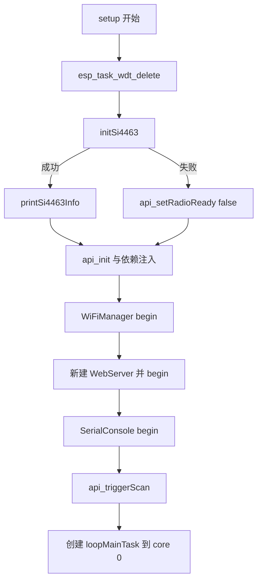
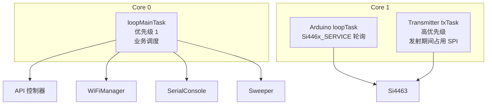

# Application Entry

## Application Entry 模块

`src/main.cpp` 是 BeeperTX 固件的组装层（composition root）。它不实现具体业务逻辑，而是负责：

- 定义硬件引脚映射；
- 创建并持有全局组件实例（`Transmitter`、`WiFiManager`、`Sweeper`、`SerialConsole`、`WebServer`）；
- 初始化 Si4463 射频芯片，并在失败时进入后台自动重试的降级模式；
- 将组件依赖注入到 API 控制器；
- 启动双核任务布局：业务主循环在 core 0，Si446x SPI 事件轮询保留在 core 1。

Arduino 框架入口 `setup()` 与 `loop()` 均在此文件实现，但 `loop()` 只承担射频事件轮询，不承担业务调度。

---

## 硬件引脚映射

引脚定义集中在文件头部宏，硬件连接如下：

| 宏          | GPIO | 方向 | 连接目标              |
| ----------- | ---- | ---- | --------------------- |
| `PIN_CS`    | 10   | 输出 | Si4463 `nSEL`（SPI CS） |
| `PIN_SDN`   | 5    | 输出 | Si4463 `SDN`（关断引脚） |
| `PIN_TX_DATA` | 16 | 输出 | Si4463 `GPIO0`（TX 调制数据） |
| `PIN_SCLK`  | 12   | 输出 | SPI SCK                |
| `PIN_MOSI`  | 11   | 输出 | SPI MOSI（SDI）        |
| `PIN_MISO`  | 13   | 输入 | SPI MISO（SDO）        |
| `PIN_NIRQ`  | -1   | —   | 未使用，轮询模式       |

注意：`PIN_NIRQ` 定义为 `-1`，表示不使用 Si4463 中断引脚。即使硬件上 IRQ 连接到 GPIO4，驱动也通过轮询方式工作，`loop()` 中周期性调用 `Si446x_SERVICE()` 处理 Si446x 事件。

---

## 全局组件与依赖关系

文件顶部定义以下全局对象：

- `Transmitter s_tx(PIN_TX_DATA)`：发射器，负责 POCSAG/FLEX 信号的时序输出。
- `WiFiManager s_wifi`：管理 STA/AP 模式、重连和后台扫描。
- `Sweeper s_sweeper`：非阻塞调度器，持有发射器指针，用于频率扫描。
- `SerialConsole s_serial(Serial)`：串口控制台。
- `WebServer* s_web`：堆上创建的 Web 服务器，提供配置界面与 Captive Portal。

`API` 是控制层核心，`main.cpp` 在 `setup()` 中通过以下调用完成依赖注入：

- `api_init()`
- `api_setTransmitter(&s_tx)`
- `api_setSweeper(&s_sweeper)`
- `api_setWiFiManager(&s_wifi)`

这样 `API` 可以在不直接引用全局对象的情况下调度发射、查询 WiFi 状态、驱动 Sweeper。

---

## 启动流程：`setup()`

`setup()` 的执行顺序如下：



### 1. 移除 Task Watchdog 订阅

```cpp
esp_task_wdt_delete(NULL);
```

这行代码将当前任务（即 Arduino `loopTask`，运行在 core 1）从 Task WDT 订阅中移除。原因是发射任务 `txTask` 会长期占用 core 1，长 POCSAG 帧可能超过 5 秒，如果不移除订阅，`loopTask` 会被误判为死锁而触发复位。发射期间 `txTask` 负责喂狗。

这是一个有意的权衡：空闲期没有任务订阅 Task WDT，若 `loopMainTask` 死锁，只能依靠硬件 WDT 兜底，但设计者认为发射期任务栈冻结才是实际风险源。

### 2. Si4463 初始化

调用 `initSi4463()`：

- 通过 `Si446x_setPins()` 配置 SPI 引脚；
- 将 `PIN_TX_DATA` 设为输出并拉低；
- 调用 `Si446x_init()` 完成芯片启动；
- 调用 `Si446x_getInfo()` 读取 `part` 字段，校验是否为 `0x4463`；
- 调用 `Si446x_configRFswitch()` 配置 RF 天线开关。

若初始化失败，系统不阻塞、不复位，而是：

- 打印错误信息；
- 设置 `g_radioReady = false`；
- 调用 `api_setRadioReady(false)` 通知 API 层射频不可用；
- 继续执行后续 WiFi/Web/串口初始化。

### 3. API 初始化与依赖注入

`api_init()` 初始化 API 内部状态，随后注入 `Transmitter`、`Sweeper`、`WiFiManager` 指针。之后 `api_triggerScan()` 启动后台 WiFi 扫描，供 Web 配网页面使用。

### 4. WiFi 与 Web 服务器

`WiFiManager::begin()` 负责连接已有网络或进入 AP 模式。`WebServer` 在 AP 和 STA 两种模式下都会启动，用于 Captive Portal 和配置界面。Web 服务器通过 `new WebServer(80)` 创建，失败时不中断系统，仅打印错误。

### 5. 创建业务主循环任务

```cpp
xTaskCreatePinnedToCore(loopMainTask, "loopMain", 10240, nullptr, 1, nullptr, 0);
```

`loopMainTask` 固定运行在 core 0，优先级 1，栈大小 10240 字节。这样做的原因是：`txTask` 独占 core 1 发射时，若 `loop()` 仍在 core 1 运行会被饿死。迁移到 core 0 后，发射期间 Web、串口、STOP 命令仍然可用。

---

## 任务结构

系统运行时有三个主要任务：



### `loopMainTask()`：业务主循环

运行在 core 0，每次迭代执行：

- 如果 `g_radioReady == false`，调用 `radioRetryTick()` 尝试后台重连射频；
- `s_wifi.loop()`：处理 WiFi 事件；
- `s_serial.loop()`：处理串口命令；
- `api_loop()`：处理 API 调度；
- `s_sweeper.loop()`：非阻塞调度 Sweeper；
- `vTaskDelay(1)` 让出 CPU。

`loopMainTask` 不直接访问 SPI（除通过 `radioRetryTick()` 间接重试 Si4463 初始化）。它与 `AsyncTCP` 回调同核，但 SPI 访问由 Si446x 驱动的跨核递归锁保护。

### `loop()`：Si446x 事件轮询

```cpp
void loop() {
  if (g_radioReady) {
    Si446x_SERVICE();
  }
  vTaskDelay(2);
}
```

`loop()` 保留在 Arduino 默认的 core 1 `loopTask` 中，与 `txTask` 同核。`Si446x_SERVICE()` 负责处理 Si446x 中断标志和 FIFO 状态，与 `txTask` 串行执行，避免跨核 SPI 并发触发看门狗。

---

## Si4463 降级模式与后台重试

如果初始化失败，`g_radioReady` 为 `false`。`loopMainTask()` 每次迭代都会调用 `radioRetryTick()`，其逻辑为：

- 距上次重试不足 10 秒则直接返回；
- 打印 `"RADIO: retrying Si4463 init..."`；
- 再次调用 `initSi4463()`；
- 成功后：
  - 设置 `g_radioReady = true`；
  - 调用 `printSi4463Info()` 打印诊断信息；
  - 调用 `api_setRadioReady(true)` 通知 API 层射频已恢复；
  - 打印 `"RADIO: online"`。

该机制保证射频硬件故障、接触不良或上电时序异常时，系统其余功能（WiFi、Web、串口、Sweeper）不受影响；硬件恢复后无需重启即可自动恢复发射能力。

`printSi4463Info()` 输出内容包括：

- 芯片 Part ID（应为 `0x4463`）；
- ROM ID 与版本信息；
- 当前状态（通过 `Si446x_getState()`）；
- 载波频率（通过 `Si446x_getFrequencyKHz()`）；
- PA 功率（通过 `Si446x_getTxPower()`）；
- RSSI（通过 `Si446x_getRSSI()`）。

---

## 关键设计权衡

1. **射频失败不阻塞启动**：Si4463 初始化失败不会导致系统挂死，而是进入可恢复的降级模式。
2. **业务循环与射频轮询分离**：业务放在 core 0，射频 SPI 轮询留在 core 1，避免发射任务与业务任务互相饿死。
3. **Task WDT 移除是权衡结果**：为了长发射帧不误复位，主动放弃空闲期 Task WDT 保护；这是对实际风险（发射期任务栈冻结）的针对性取舍。
4. **SPI 跨核锁保护**：`loopMainTask` 中的重试初始化与 core 1 上的 `Si446x_SERVICE()` 可能并发访问 SPI，驱动层使用跨核递归锁保证互斥。

---

## 与其它模块的接口

`main.cpp` 是唯一同时了解所有模块的源文件。它通过以下方式与各层交互：

- **API 控制器**：调用 `api_init()`、`api_setTransmitter()`、`api_setSweeper()`、`api_setWiFiManager()`、`api_setRadioReady()`、`api_triggerScan()`、`api_loop()`、`api_log()`。
- **Si446x 驱动**：`Si446x_setPins()`、`Si446x_init()`、`Si446x_getInfo()`、`Si446x_configRFswitch()`、`Si446x_SERVICE()`、`Si446x_getState()` 等。
- **WiFiManager**：`s_wifi.begin()`、`s_wifi.loop()`、`s_wifi.isConnected()`、`s_wifi.ssid()`、`s_wifi.ipAddress()`。
- **SerialConsole**：`s_serial.begin()`、`s_serial.loop()`。
- **WebServer**：构造、`begin()`。
- **Sweeper**：`s_sweeper.setTransmitter()`、`s_sweeper.loop()`。
- **Transmitter**：构造时传入 `PIN_TX_DATA`，由 API 持有其指针。

新增业务模块时，通常不需要修改 `main.cpp` 以外的组装逻辑；若需要新组件接入调度，应在 `loopMainTask()` 中补充对应的 `loop()` 调用。