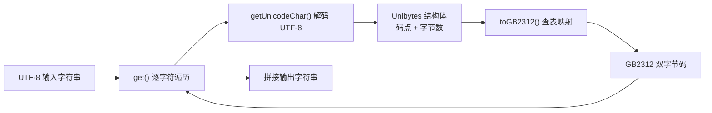

# Character Set Conversion

# Character Set Conversion

## 模块概述

`Charset` 模块为 Arduino 平台提供 UTF-8 到 GB2312 的字符集转换能力。模块以 `U2GB` 类封装，通过两级静态查找表（`Summary16` 索引表 + `gb2312_2charset` 码表）实现 Unicode 码点到 GB2312 双字节码的映射。

模块版本：1.1.52

典型应用场景：

- 驱动仅支持 GB2312 编码的中文 LCD 或点阵显示屏；
- 将 Arduino IDE 源码中的 UTF-8 中文字符串转换为硬件所需的 GB2312 字节流。

## 转换流程

整个转换分为三个步骤：

1. `U2GB::get()` 逐字符遍历 UTF-8 输入字符串；
2. 对每个字符调用 `U2GB::getUnicodeChar()`，解码出 Unicode 码点及该字符的原始字节数；
3. 将解码结果（`Unibytes` 结构）交给 `U2GB::toGB2312()` 查表，得到 GB2312 编码后拼接到输出字符串。



`get()` 内部按 `ub.bytes` 推进游标，保证多字节 UTF-8 字符的边界处理正确：

```cpp
while (utf8_str[i])
{
    ub = getUnicodeChar(&utf8_str[i]);
    res += toGB2312(ub);
    i += ub.bytes;
}
```

## 核心数据结构

### Unibytes

`getUnicodeChar()` 的返回类型，携带单个字符的解码结果：

| 字段 | 类型 | 说明 |
|------|------|------|
| `unicode` | `ucs4_t`（`unsigned int`） | Unicode 码点 |
| `bytes` | `int` | 原始 UTF-8 字符的字节数（1 ~ 6） |

### Summary16

查找表的索引条目，用于快速定位某页（16 个码点）在码表中的位置：

| 字段 | 类型 | 说明 |
|------|------|------|
| `indx` | `unsigned short` | 该页在 `gb2312_2charset` 中的起始下标 |
| `used` | `unsigned short` | 16 位位图，标记本页中哪些码点存在 GB2312 映射 |

### 静态查找表

- `gb2312_2charset[7445]`：GB2312 码值表。每项为 16 位无符号整数，高、低字节分别对应 GB2312 区位码（存储时未加 `0x80`，输出时补上）。
- `gb2312_uni2indx_pageXX` 系列数组：按 Unicode 页组织的 `Summary16` 索引表，覆盖以下区段：

| Unicode 区段 | 内容 |
|--------------|------|
| `0x0000 ~ 0x0460` | 基本拉丁、拉丁扩充、希腊文、西里尔文 |
| `0x2000 ~ 0x2650` | 标点、数字形式、箭头、数学符号等 |
| `0x3000 ~ 0x3230` | CJK 符号、日文假名等 |
| `0x4e00 ~ 0x9cf0` | CJK 统一表意文字（汉字主区） |
| `0x9e00 ~ 0x9fb0` | CJK 统一表意文字扩展区 |
| `0xff00 ~ 0xfff0` | 全角 ASCII、全角标点 |

## 函数详解

### U2GB::get(String utf8_str)

字符串级转换入口。

- 输入：UTF-8 编码的 Arduino `String`
- 输出：GB2312 编码的 `String`

遍历输入串，对每个字符依次执行解码与查表，并将结果拼接到输出字符串。

### U2GB::getUnicodeChar(char *str)

将单个 UTF-8 字符解码为 Unicode 码点。

- 输入：指向 UTF-8 字符起始字节的指针
- 输出：`Unibytes`（码点 + 字节数）

根据首字节范围判断字符长度，并通过位运算将各字节的有效位拼装为 32 位码点：

| 首字节范围 | 字符长度 | 首字节有效位 |
|------------|----------|--------------|
| `0x00 ~ 0xBF` | 1（ASCII） | 直接取值 |
| `0xC0 ~ 0xDF` | 2 | 低 5 位 |
| `0xE0 ~ 0xEF` | 3 | 低 4 位 |
| `0xF0 ~ 0xF7` | 4 | 低 3 位 |
| `0xF8 ~ 0xFB` | 5 | 低 2 位 |
| `0xFC ~ 0xFD` | 6 | 低 1 位 |

后续字节统一取低 6 位并入结果。

### U2GB::toGB2312(Unibytes ub)

将单个 Unicode 码点映射为 GB2312 编码。

- 输入：`Unibytes`
- 输出：GB2312 字符串。ASCII 字符原样单字节返回；可映射字符以双字节返回；不可映射字符静默丢弃。

映射步骤如下：

1. **ASCII 直通**：若 `ub.bytes == 1`，低 8 位即为 ASCII 码，直接返回。
2. **定位索引页**：按码点范围选择对应的 `gb2312_uni2indx_pageXX` 表，以 `(wc >> 4)` 计算页偏移，取得 `Summary16` 条目。
3. **位图检查**：令 `i = wc & 0x0F`，若 `used & (1 << i)` 为 0，说明该码点无 GB2312 映射，返回空串。
4. **计算实际下标**：对 `used` 低 `i` 位做汉明权重统计，得到该码点在页内的序号，加上 `summary->indx` 即为 `gb2312_2charset` 的下标。
5. **还原 GB2312 字节**：取码表值 `c`，输出字节为 `(c >> 8) | 0x80` 与 `(c & 0xff) | 0x80`。

步骤 4 使用 SWAR 并行位计数算法：

```cpp
used = (used & 0x5555) + ((used & 0xaaaa) >> 1);
used = (used & 0x3333) + ((used & 0xcccc) >> 2);
used = (used & 0x0f0f) + ((used & 0xf0f0) >> 4);
used = (used & 0x00ff) + (used >> 8);
```

## 使用示例

```cpp
#include "Charset.h"

U2GB converter;

void setup()
{
    Serial.begin(9600);

    // 将 UTF-8 字符串转换为 GB2312 字符串
    String gb2312String = converter.get("你好，世界");

    // 将结果发送给仅支持 GB2312 的显示设备
    // lcd.write(gb2312String);
}
```

## 与代码库的关联

- **入站依赖**：仅依赖 Arduino 核心库的 `String` 类型（`Arduino.h`）。
- **出站依赖**：无。模块不调用外部业务代码，当前也不被其他模块调用，属于独立工具类。
- **静态资源占用**：`gb2312_2charset` 与各 `Summary16` 索引表均为 `static const`，存储在 Flash 而非 RAM；但会显著增加固件体积，使用时需注意 Arduino 的 Flash 容量限制。

## 注意事项与限制

1. **字符覆盖范围**：仅能转换 GB2312 字符集内的字符。生僻汉字、Emoji 等不在映射表中的码点会被静默丢弃。
2. **输入合法性**：`getUnicodeChar()` 不做 UTF-8 合法性校验，畸形序列的解码结果不可预期。
3. **内存碎片**：`get()` 通过 `String` 逐字符拼接构建结果，超长字符串会产生多次堆分配；内存紧张的设备建议分段转换。
4. **`GB2312_MAXLENGTH`**：头文件定义该宏为 256，当前源码未直接引用，可视为输出缓冲区长度上限的约定，供调用方参考。