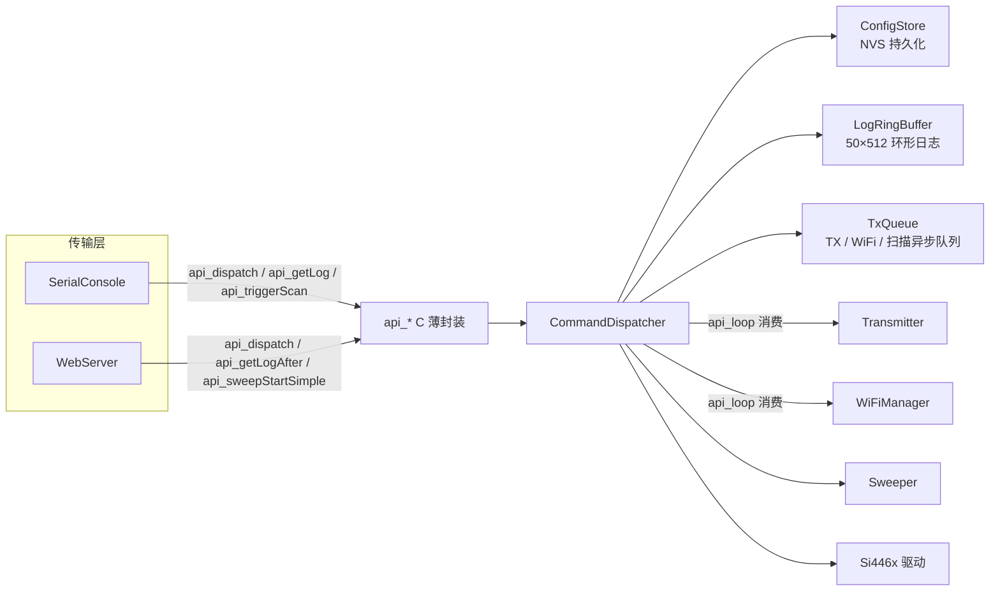

# Controller Services & Interfaces

## 模块概览

控制器服务与接口模块是 BeeperTX 固件的“控制面”核心。它定义全系统统一的命令协议与数据结构，实现命令调度、参数校验、状态持有、日志与配置持久化，并通过一组 `api_*` C 函数向外暴露，使串口、Web、MQTT 等传输层共享同一条调度路径。模块位于 `src/Controller/`，主要文件：

| 文件 | 职责 |
|---|---|
| `API.h` / `API.cpp` | 命令协议定义 + `CommandDispatcher` 调度器 + `api_*` C 薄封装 |
| `ProtocolTypes.h` | 协议枚举唯一来源（POCSAG/FLEX、相位、音调、消息类型） |
| `ConfigStore` | `TxConfig` 的 NVS 持久化（`CMD_SAVE_CONFIG` 落盘） |
| `LogRingBuffer` | 发射日志环形缓冲区（线程安全、支持增量导出） |
| `TxQueue` | 待发射 / 待配网 / 待扫描的异步请求队列 |
| `SerialConsole` | 串口命令行控制台 |
| `WebServer` | REST API + LittleFS 静态文件服务器 |

设计上刻意**取消模块级单例 Service Locator 模式**：`Transmitter`、`WiFiManager`、`Sweeper` 通过 `api_setTransmitter` / `api_setWiFiManager` / `api_setSweeper` 显式注入，模块内不再有可变全局状态，唯一实例是匿名命名空间中的 `g_dispatcher`（命令分发的唯一状态持有者）。

## 架构与数据流



数据流分为两条路径：

1. **同步命令路径**：传输层将请求反序列化为 `CmdRequest`，调用 `api_dispatch()`；调度器同步校验并分发给对应 handler，填充 `CmdResponse` 后返回。`PING`、`GET_STATUS`、`GET_CONFIG`、`SET_CONFIG` 等命令走此路径。
2. **异步执行路径**：`TRANSMIT`、`SET_WIFI`、`SCAN_WIFI` 只负责将请求写入 `TxQueue` 并立即返回；真正的执行发生在主循环 `api_loop()` 中——取出待发消息调用 `Transmitter::send()`、下发 WiFi 凭据、执行 `WiFiManager::scanNetworks()` 并缓存结果。耗时操作因此不阻塞传输层回调（AsyncWebServer 任务 / 串口轮询）。

## 命令协议

### 命令 ID

`CmdID` 枚举按功能分区定义：

| 分区 | 命令 |
|---|---|
| 系统 (0x00–0x0F) | `CMD_PING`、`CMD_GET_STATUS`、`CMD_GET_CONFIG`、`CMD_RESET` |
| 配置 (0x10–0x1F) | `CMD_SET_CONFIG`、`CMD_SAVE_CONFIG` |
| 发射 (0x20–0x2F) | `CMD_TRANSMIT`、`CMD_ABORT` |
| 查询 (0x30–0x3F) | `CMD_GET_LOG` |
| WiFi (0x40–0x4F) | `CMD_SET_WIFI`、`CMD_SCAN_WIFI`、`CMD_GET_WIFI_STATUS` |
| 扫描 (0x50–0x5F) | `CMD_SWEEP_START`、`CMD_SWEEP_STOP`、`CMD_SWEEP_STATUS` |

### 请求 / 响应结构与 payloadType 判别

`CmdRequest` 由 `cmd` + `payloadType` + 联合体负载组成。负载成员包括：

- `setConfig`（`TxConfig`，`CMD_SET_CONFIG`）
- `transmitMsg`（消息覆盖，`CMD_TRANSMIT`）
- `wifiCred`（SSID/密码，`CMD_SET_WIFI`）
- `logCount`（`CMD_GET_LOG`）
- `sweepStart`（追码/追频覆盖参数，`CMD_SWEEP_START`）

关键约束：**传输层必须设置 `payloadType`** 声明 union 实际填充的成员。调度器在 `dispatch()` 入口用 `expectedPayload(cmd)` 校验，不匹配立即返回 `ERR_PARAM`（detail = -99），防止“填了 A 成员、处理器读 B 成员”的未定义行为。`PayloadType::NONE = 0`，且 `CmdRequest` 构造函数会清空整个结构，因此无负载命令（如 `CMD_RESET`）即使不显式赋值也能通过校验。

### 响应码与错误约定

`RespCode` 统一为 `OK` / `ERR_UNKNOWN` / `ERR_PARAM` / `ERR_BUSY` / `ERR_HW` / `ERR_NOMEM` / `ERR_ABORTED`。具体失败原因由 `detail` 进一步细分，每个 handler 的 detail 含义见下表。`dispatch()` 末尾对任何非 `OK` 响应集中记日志，格式为 `"<CMD> ERR code=N detail=N"`（`cmdName()` 提供命令名映射）。

### 枚举唯一来源

`ProtocolTypes.h` 定义 `EncodingType`（POCSAG=0 / FLEX=1）、`PhaseType`（NORMAL=0 / INVERTED=1）、`ToneType`（A–D = 0–3）、`MsgType`（NUMERIC=0 / ALPHANUMERIC=1）。这些值**必须保持稳定**——它们直接落盘 NVS 并被 `Transmitter::Config` 与 `Sweeper::Config` 共用，消除了历史上三套枚举互相强转导致的值漂移问题。协议库（lib/Pocsag、lib/Flex）保留内部枚举，边界转换集中在调用处。

## 核心组件

### CommandDispatcher

匿名命名空间内的调度器，是模块中枢，持有全部可变状态：

- `m_config`：当前发射配置，`init()` 时从 NVS 恢复
- `m_status` / `m_statusCached` / `m_statusLastQueryMs`：设备状态缓存与查询限速
- `m_txCount`：累计发射计数
- `m_radioReady`：Si4463 可用标志（main.cpp 初始化失败时置 false，后台重试成功后恢复）
- 组件成员：`ConfigStore m_store`、`LogRingBuffer m_log`、`TxQueue m_queue`

`dispatch()` 公共流程：空指针保护 → 回显 `resp->cmd`、默认 `ERR_UNKNOWN` → payloadType 判别 → switch 分发给 15 个 handler → 集中错误日志。

| 命令 | 处理器 | 关键行为 |
|---|---|---|
| `CMD_PING` | `handlePing` | 返回 OK，detail = `millis()`（延迟估算） |
| `CMD_GET_STATUS` | `handleGetStatus` | 静态芯片信息首次查询后缓存；实时 SPI 查询 500ms 限速；发射期跳过 SPI 并置 state=TX |
| `CMD_GET_CONFIG` | `handleGetConfig` | 返回 `m_config` 快照 |
| `CMD_SET_CONFIG` | `handleSetConfig` | 扫描/发射中拒绝（detail -10/-11）；全套参数校验；FLEX 强制 INVERTED；立即写频率与功率 |
| `CMD_SAVE_CONFIG` | `handleSaveConfig` | `ConfigStore::save()` 落盘，失败返回 `ERR_HW` detail -1 |
| `CMD_TRANSMIT` | `handleTransmit` | 离线/扫描/地址/消息长度预检后入队；OK detail = 0 |
| `CMD_ABORT` | `handleAbort` | 扫描运行中整体 `m_sweeper->stop()`，否则 `m_tx->abortTx()` |
| `CMD_RESET` | `handleReset` | 仅回 OK，实际重启由传输层在响应后执行 `ESP.restart()` |
| `CMD_SET_WIFI` | `handleSetWiFi` | 校验 ssid 非空后入队，非阻塞 |
| `CMD_SCAN_WIFI` | `handleScanWiFi` | `triggerScan()` 后立即返回当前 WiFi 状态 |
| `CMD_GET_WIFI_STATUS` | `handleGetWifiStatus` | 填充 ssid/ip 与连接状态，rssi 默认 -1 |
| `CMD_GET_LOG` | `handleGetLog` | 仅回执；日志内容经 `api_getLogAfter()` 独立导出 |
| `CMD_SWEEP_START` | `handleSweepStart` | 校验 mode 与覆盖字段；从 `m_config` 继承发射参数 |
| `CMD_SWEEP_STOP` | `handleSweepStop` | 记录 done/total 后停止 |
| `CMD_SWEEP_STATUS` | `handleSweepStatus` | 填充 `sweepStatus` 结构 |

`loop()`（经 `api_loop()` 每帧调用）处理三类异步任务：

- **WiFi 扫描**：`consumeScan()` 有触发时执行 `m_wifi->scanNetworks()`，结果写入 `setScanCache()`
- **WiFi 凭据**：`consumeWifi()` 取出后调 `m_wifi->setCredentials(ssid, pass)`
- **单次发射**：`consumePendingTx()` 取出待发消息，临时覆盖 `m_config.message`，打印完整发射参数日志后调 `m_tx->send(makeTxConfig())`；成功则 `m_txCount++`；编码失败（如 `MSG_TOO_LONG`）记录原因并恢复原消息；`Transmitter` 内部队列忙则恢复消息并重新入队，下帧重试

`init()` 从 NVS 恢复配置后立即应用到 Si4463（频率 + 功率），清零发射计数与队列。

### api_* C 薄封装

`extern "C"` 块保持 ABI 稳定，所有调用方（SerialConsole、WebServer、main.cpp、Sweeper.cpp）零改动接入：

- 生命周期：`api_init()`、`api_loop()`
- 依赖注入：`api_setTransmitter()`、`api_setWiFiManager()`、`api_setSweeper()`、`api_setRadioReady()`
- 命令执行：`api_dispatch()`
- 快捷入口：`api_sweepStartSimple(mode, &start, &detail)` — 用当前 `TxConfig` 填充扫描参数并启动，供 Web `SWEEP START` 与串口 `SWEEP addr|freq` 共用
- 状态与日志：`api_getConfig()`、`api_getLog()`、`api_getLogAfter()`、`api_log()`
- 扫描：`api_triggerScan()`、`api_getScanCache()` — 扫描结果（约 4KB JSON）不放入 `CmdResponse` union 以避免撑爆任务栈，改为独立缓冲区临界区拷贝

### ConfigStore

负责 `TxConfig` 的 NVS 持久化，解决 `CMD_SET_CONFIG` 只改内存、重启丢失的问题。存储为单个 blob：

```
[magic 4B: 0x42545831 "BTX1"] [version 2B: 2] [TxConfig 按 sizeof 原样]
```

- NVS 命名空间 `beepertx`、键 `txcfg`，与 WiFiManager 的存储分离
- `load()` 严格校验长度、magic、version，任一不匹配视为无有效存档
- `loadOrDefault()` 在无存档时填入出厂默认：POCSAG / NORMAL / TONE_D / ALPHANUMERIC / 152675 kHz / 1200 baud / addr=1000 / pwr=127 / 消息 "BeeperTX OK"
- version=2 对应 `message[256]→[1024]` 的布局变更；旧存档因 `sizeof(TxConfig)` 变化导致读取长度不匹配，自然回退默认

### LogRingBuffer

固定容量 50 行 × 512 字节的日志环形缓冲区，满时覆盖最旧条目。由 `portMUX_TYPE` 临界区保护，`add()` 可在 ISR / 任意任务上下文调用——这使 Sweeper 的高频进度日志可以直接写入。

增量导出是核心特性：每条日志携带单调递增写序号 `m_seq`。`getAfter(buf, size, after, &seq, &wrapped)` 只返回写序号 `> after` 的行；窗口首条前序号定义为 `oldest = m_seq - m_count`，当 `after < oldest` 时说明客户端序号已滚出环形窗口（发生丢行），置 `wrapped = true` 让前端全量重绘。Web 端点 `/api/log?after=<seq>` 直接对应此接口。

### TxQueue

异步请求队列，承担三类跨任务交接：

- 待发射消息：`setPendingTx(msg)` / `consumePendingTx(buf, size)` — 单次发射入队，`CMD_TRANSMIT` 时若入队失败返回 `ERR_BUSY` detail -1
- WiFi 凭据：`setPendingWifi(ssid, pass)` / `consumeWifi(...)`
- 扫描：`triggerScan()` / `consumeScan()` / `setScanCache()` / `getScanCache()`

`CMD_SWEEP_START` 前会检查 `isPendingTx()`，避免扫描与排队发射冲突。

## 传输层实现

### SerialConsole

串口命令行控制台，文本协议 `<CMD> [key=value ...]`，回应 `OK ...` / `ERR ...`。支持 `HELP` / `STATUS` / `CONFIG` / `SET` / `TX` / `WIFI` / `SCAN` / `SWEEP` / `STOP` / `SAVE` / `RESET` / `PING`。

- `SET` 先用 `GET_CONFIG` 取当前配置，`strtok` 解析 `key=value` 对修改字段，再以 `SET_CONFIG` 提交
- `TX [msg=...]` 解析可选消息覆盖后走 `api_dispatch`
- `SWEEP` 接受可选 `START` 前缀；支持 `addr|freq` 模式与 `encoding/baud/phase/tone/msgType/interval` 覆盖，`SWEEP stop|status` 映射到对应命令
- `WIFI` 带 `ssid=` 参数时设置凭据，无参数时仅查询状态（不触发扫描）
- `RESET` 直接 `ESP.restart()`，不依赖 `CMD_RESET` 的“传输层负责重启”约定
- 行缓冲 384 字节，支持退格编辑

### WebServer

基于 `AsyncWebServer` 的 REST API 与静态文件服务器，监听 80 端口，从 LittleFS 提供 `index.html` 及前端资源。

| 方法 | 路径 | 说明 |
|---|---|---|
| GET | `/api/ping` | 心跳，返回 uptime |
| GET | `/api/status` | 设备状态 JSON |
| GET/POST | `/api/config` | 读配置 / patch 配置（先 GET 再合并） |
| POST | `/api/transmit` | 发射；支持 JSON body 中 `message` 覆盖 |
| POST | `/api/reset` | 重启 |
| GET | `/api/wifi/status` | WiFi 状态（不触发扫描） |
| GET | `/api/wifi/scan` | 触发扫描并返回缓存结果 |
| POST | `/api/wifi` | 设置凭据 |
| GET | `/api/log` | 日志；支持 `?after=<seq>` 增量拉取 |
| POST | `/api/sweep/start` | 用 `api_sweepStartSimple()` 启动扫描 |
| POST | `/api/sweep/stop` | 停止扫描 |
| GET | `/api/sweep/status` | 扫描进度 |

实现要点：

- JSON 序列化基于 `ArduinoJson`；`onConfigSet` 成功后对比修改前快照，只记录实际变更字段到日志，避免高频连点时刷屏
- `onTransmit` 对 `detail == -7`（消息超长）返回明确 400 文案
- 内置 captive portal 探测端点（`/generate_204`、`/hotspot-detect.html` 等）重定向首页；未匹配路径中 `/api/` 前缀返回 404 JSON，其余重定向首页

## 关键设计决策

### 状态查询限速与发射期跳过

`handleGetStatus` 首次查询成功后缓存 `partId/romId/chipRev` 静态信息；实时 SPI 查询（state/freq/power/RSSI）受 500ms 冷却窗口限制，且**发射期间完全跳过**（直接返回缓存的 `state = TX`）。原因：Si4463 处于 Direct TX 时不响应多数命令，`Si446x_*` 查询会忙等 CTS 超时（每次最多 400ms）并持有跨核递归锁，阻塞 txTask 的位敲击——这是历史上“追码自动停止”和 Web UI 高延时的根因。

### FLEX 强制 INVERTED

`handleSetConfig` 与 `handleSweepStart` 对 FLEX 编码一律强制 `phase = INVERTED`（直发）。FLEX 无极性概念，`NORMAL` 误配会导致接收机无法同步；出厂默认 `NORMAL` 仅对 POCSAG 有意义。

### 参数校验矩阵

| 参数 | 规则 | detail |
|---|---|---|
| `freqKHz` | 119000 – 1050000 | -1 |
| `baudRate` | POCSAG: 512/1200；FLEX: 1600/2400/3200 | -2 |
| `address` | POCSAG: 1 – 0x1FFFFF（21-bit）；FLEX: 短 1–1933312 / 长 2101249–4297068542 | -3 |
| `txPower` | 0 – 127 | -4 |

`handleTransmit` 另做地址非零校验（detail -5，地址 0 会导致编码失败后被误判为队列满而无限重试刷日志）、FLEX capcode 校验（-6）、字母数字消息长度预检（-7，FLEX 用 `FlexEncoder::MAX_ALPHA_CHARS`，POCSAG 用 `MAX_MESSAGE_LEN`）。预检只做 `strlen`——GB2312 字节数 ≤ UTF-8 字节数，因此是安全上界；精确限制由 `Transmitter::send()` 编码时二次校验。

### 扫描互斥

`m_sweeper->isRunning()` 时 `SET_CONFIG` 与 `TRANSMIT` 均被拒绝（detail -10）；`SWEEP_START` 在队列有待发消息时拒绝（detail -3）。`ABORT` 在扫描运行中整体停止扫描（内部先中止发射再恢复频率），否则只中止当前发射。

### 射频离线门控

`api_setRadioReady(false)`（Si4463 初始化失败、后台重试期间）使 `TRANSMIT`（detail -2）与 `SWEEP_START`（detail -4）直接返回 `ERR_HW`，避免向不可用的射频硬件下发命令。

## 扩展指南：新增命令

```cpp
// 1. CmdID 中追加枚举（选好分区与 ID）
CMD_MY_FEATURE = 0x60,

// 2. 需要负载时: CmdRequest union 加成员, PayloadType 加对应值
// 3. expectedPayload() 登记:
case CmdID::CMD_MY_FEATURE: return PayloadType::MY_FEATURE;

// 4. CommandDispatcher 加 handler 并实现校验/业务/响应填充
// 5. dispatch() switch 中登记
// 6. 传输层按需暴露: SerialConsole 加分支, WebServer 加路由
```

非 `OK` 响应集中日志、payloadType 判别、`cmdName()` 命令名映射均自动生效，新命令无需额外处理。

## 与代码库其他部分的连接

- **main.cpp**：`setup()` 中依次调用 `api_setTransmitter` → `api_setWiFiManager` → `api_setSweeper` → `api_setRadioReady` → `api_init()`；`loopMainTask` 每帧调用 `api_loop()`；射频后台重试通过 `api_setRadioReady(true)` 恢复。
- **Transmitter / WiFiManager / Sweeper**：作为注入依赖被调用。`Sweeper.cpp` 通过 `api_log()` 输出批量扫描与进度日志（高频场景验证了 LogRingBuffer 增量导出的价值）。
- **lib/si4463**：`CommandDispatcher::init()` 与 `handleSetConfig` 直接调 `Si446x_setFrequencyKHz` / `Si446x_setTxPower`；`handleGetStatus` 调 `Si446x_getInfo` / `Si446x_getState` / `Si446x_getFrequencyKHz` / `Si446x_getTxPower` / `Si446x_getRSSI`。
- **协议库**：lib/Pocsag 与 lib/Flex 不依赖上层类型，`ProtocolTypes.h` 枚举在调用处转换为协议库内部枚举。