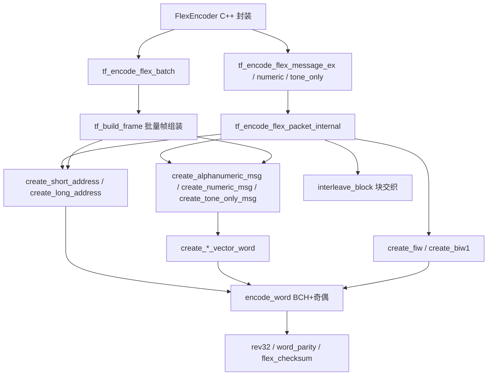

# FLEX Encoding

# FLEX Encoding 模块文档

## 概述

FLEX Encoding 模块提供 FLEX 无线寻呼协议（1600 bps / 2-FSK）的编码能力，支持 Alphanumeric（ASCII）、Numeric、Tone-only 三种消息类型，以及单帧、批量追码两种传输模式。

模块由两部分组成：

- `FlexEncoder.h/.cpp`：C++ 封装类，提供面向调用方的 `encode()` / `encodeBatch()` 接口。
- `flex.h`：单头文件、无依赖的 C 编码内核，基于 RCR STD-43A（ARIB STD-43A）实现，负责 BCH 校验、位序反转、块交织、帧/同步头组装等底层工作。

模块支持 FLEX 短地址（`1..1933312`）和长地址（`2101249..4297068542`）的单消息编码；批量模式 v1 仅支持短地址。

## 架构总览



上层调用 `FlexEncoder`，由其根据 `MsgType` 分发到对应 C API；`encodeBatch` 直接进入 C 层批量编码器，复用同一套消息编码内核和 BCH/交织原语。

## C++ 封装层

### 单条消息编码

```cpp
size_t FlexEncoder::encode(uint64_t capcode, const char *msg, MsgType type, bool mailDrop);
```

- `ALPHA`：调用 `tf_encode_flex_message_ex`，将 `mailDrop` 写入 `struct tf_message_config` 后透传。`mailDrop` 只对 ALPHA 消息生效，表现为置消息首字的 bit20。
- `NUMERIC`：调用 `tf_encode_flex_numeric_message`，`msg` 只能包含 `0-9`、`-`、`_`、`[`、`]`、空格和 `U/u`。
- `TONE_ONLY`：调用 `tf_encode_flex_tone_only_msg`，`msg` 传 `NULL`。

编码成功后通过 `getData()` / `getLength()` 取回字节流；失败时返回 0，可用 `getError()` / `getErrorString()` 获取原因。

### 批量消息编码

```cpp
size_t FlexEncoder::encodeBatch(const BatchMsg *msgs, size_t count, size_t *encoded);
```

批量模式在同一个传输序列中只发送一次 ERS（Emergency Re-Synchronization，35 次重复，共 420 字节），随后连续发送多个 frame，每个 frame 内含多个地址、向量和消息。相比逐条编码（每条都包含一次 ERS + 一帧），55 地址 ALPHA 批量约 1920 B，追码场景可显著减少空中占用时间。

`BatchMsg` 字段：

- `capcode`：短地址（`1..1933312`）。
- `msg`：ALPHA/NUMERIC 的文本；`TONE_ONLY` 时为 `nullptr`。
- `type`：`ALPHA` / `NUMERIC` / `TONE_ONLY`。
- `mailDrop`：仅 ALPHA 生效，批量编码时映射到 C 层 `tf_message_config`。

`encoded` 输出实际成功放入缓冲区的消息数。若缓冲区在下一个帧边界前放不下全部消息，`encodeBatch` 返回已完成帧的字节数，`*encoded < count`，此时 `hasError()` 为 `false`，调用方应将剩余消息放入下一批发送。

C++ 层在 `tf_encode_flex_batch` 返回非零错误时统一丢弃部分输出（`m_length=0`、`*encoded=0`），与 `encode()` 的失败语义保持一致。

### 协议常量

`FlexEncoder` 暴露以下常量：

- `BIT_TIME_US = 625`：1600 bps 下单个 bit 的时长。
- `BAUDRATE = 1600`。
- `BUFFER_SIZE = 2048`：编码缓冲区大小，可容纳单帧（约 795 B）和 55 地址 ALPHA 批量（约 1920 B）。
- `MAX_ALPHA_CHARS = 248`：ALPHA 消息最大字符数，与 `flex.h` 的 `MAX_CHARS_ALPHA` 一致。
- `MAX_BATCH_MSGS = 55`：批量消息上限。
- `isShortCapcode(c)`：判断是否为 FLEX 短地址。

## C 编码内核（flex.h）

### 公共入口

- `tf_encode_flex_message(...)`：ALPHA 编码，默认配置。
- `tf_encode_flex_message_ex(...)`：ALPHA 编码，支持 `tf_message_config`（当前包含 `mail_drop`）。
- `tf_encode_flex_numeric_message(...)`：Numeric 编码，校验字符集。
- `tf_encode_flex_tone_only_msg(...)`：Tone-only 编码。
- `tf_encode_flex_batch(...)`：批量编码。
- 类型配置 `tf_message_type_config` 统一描述 validator、creator 和 `max_chars`。

### 编码原语

- `encode_word(dw)`：对 21-bit 数据字做 BCH(31,21) 编码（生成多项式 `0x769`）并追加偶校验位，得到 32-bit 码字。
- `flex_checksum(dw)`：计算 FLEX 4-bit 校验并写入低 4 位。
- `rev32(x)`：位序反转；FLEX 控制字和数据字在编码前都需要反转位序。
- `interleave_block(block_num, frame_words)`：对每 8 个 32-bit 字做列交织，把突发错误分散到多个字，配合 BCH 纠错能力。

### 单帧编码流程

`tf_encode_flex_packet_internal` 是单帧编码的核心，流程如下：

1. 校验消息长度/字符集、capcode 合法性、输出缓冲区大小。
2. 写入 35 次 ERS 重复（BS + AR + inv.BS + inv.AR）。
3. 写入帧同步 S1（bit sync + A1 + B + inv.A1）。
4. 写入 FIW（Frame Information Word），当前固定 `cycle=0, frame=0`。
5. 写入 S2（C-block 同步序列）。
6. 在 `frame_words` 中组装：
   - word 0：BIW1；
   - 地址字段：短地址 1 个字，长地址 2 个字；
   - 向量字段 + 消息字段：由对应消息 `creator` 生成；
   - 剩余位置用全 1 / 全 0 idle 字交替填充。
7. 对 11 个 block 依次做块交织。
8. 将 88 个字（352 B）写入输出缓冲区。

### 地址编码

- 短地址：`create_short_address(cap_code)`，将 capcode + 32768 后按 21-bit 编码。
- 长地址：`create_long_address(cap_code, words[2])`，按 ARIB 附录 A 的 1-2/1-3/1-4/2-3 集合映射为两个 32-bit 字。
- 合法性校验：`is_capcode_valid()` 区分短/长地址；非法 capcode 返回 `-TF_INVALID_CAPCODE`。

### 消息编码

- ALPHA：`create_alphanumeric_msg()`。每字容纳 3 个 7-bit ASCII 字符；字 0 存标志位和 K-bit，字 1 存 S-bit 签名；短消息按标准用 ETX（`0x03`）填充未用字符位。`mail_drop` 置位 `msg_word[0]` 的 bit20。
- NUMERIC：`create_numeric_msg()`。每 4 bit 表示一个数字/符号，字符集为 `0-9`、`-`、`_`、`[`、`]`、空格和 `U`。字 0 写入 K-bit 校验。
- TONE_ONLY：`create_tone_only_msg()`。只写一个 Tone-only 向量字，不占用消息字段。

## 批量编码设计

批量编码实现在 `flex.h` 后半部分，目标是在一次传输内塞入尽可能多的寻呼消息，减少 ERS 重复发送的开销。

### 帧内布局

每个 frame 共 88 个字（11 blocks × 8 words），1600 bps 下为 375 B（不含 ERS）。批量帧的固定布局：

| 位置 | 内容 |
|------|------|
| word 0 | BIW1，`e_biw=0`，`s_vfield = 1 + 地址域字数` |
| word 1..n | Address Field：每个短地址 1 个字 |
| word n+1..2n | Vector Field：每个地址 1 个向量字，`msg_start` 指向消息域 |
| 其后 | Message Field + Idle 填充 |

### 组装流程

1. `tf_batch_validate()` 预校验所有消息：短地址、长度、Numeric 字符集；任一条失败立即返回错误，不写任何输出。
2. `tf_write_preamble()` 写一次 ERS（420 B）。
3. 循环执行：
   - `tf_count_msg_words()` 调用消息 `creator` 写入 scratch，计算每条消息实际占用的字数；
   - 贪心打包：只要 `used + need <= 87` 就继续装入当前帧（`need = 2 + 消息字数`，短地址占 1 地址字 + 1 向量字）；
   - `tf_build_frame()` 组装整帧：先写地址域，再为每条消息调用 creator 生成向量字和消息字，用 `tf_rebase_vector_msg_start()` 把向量中的 `msg_start` 改写成真实消息位置，最后 idle 填充并交织；
   - `tf_write_one_frame()` 写入 S1 + FIW(0,0) + S2 + 交织后的 88 字；
   - 若剩余缓冲区不足以写完整一帧，则停止并返回已编码消息数，不切半帧。
4. `encoded_msgs` 输出实际编码消息数，返回值是总字节数。

注意：`flex_checksum()` 用 OR 写入低 4 位，原库调用处低 4 位均为 0，所以无影响；`tf_rebase_vector_msg_start()` 改写 `msg_start` 前必须显式清除旧校验 nibble，再重新计算校验。

### 批量 v1 限制

- 仅支持短地址；长地址返回 `TF_LONG_ADDR_IN_BATCH`。原因是长地址的向量字段会占用消息首字，混入批量帧需要额外内联和实机验证，预留到 v2。
- 所有 frame 固定 `cycle=0, frame=0`，适用于追码寻呼机配置在 frame 0 的场景。
- 单个 frame 最大可用字数为 87；整个批量上限为 `MAX_BATCH_MSGS = 55`。

## 错误码参考

`flex.h` 定义正数错误码，内部 API 统一以负值写入 `*error`，`FlexEncoder` 原样保存。

| 错误码 | 含义 |
|--------|------|
| 0 | 无错误 |
| -TF_INVALID_MESSAGE (-1) | 消息为空、超长，或包含非法字符 |
| -TF_INVALID_CAPCODE (-2) | capcode 不在短/长地址有效范围内 |
| -TF_INVALID_FLEXBUFFER (-3) | 输出缓冲区为 NULL 或小于所需大小 |
| -TF_LONG_ADDR_IN_BATCH (-4) | 批量编码中出现了长地址 |

`getErrorString()` 将上述错误码映射为可读文本。

## 典型调用链

单条 ALPHA 编码：

```
FlexEncoder::encode
  → tf_encode_flex_message_ex
    → tf_encode_flex_packet_internal
      → create_fiw / create_biw1 / create_short_address
      → create_alphanumeric_msg
      → interleave_block
        → encode_word → word_parity
        → rev32 / flex_checksum
```

批量编码：

```
FlexEncoder::encodeBatch
  → tf_encode_flex_batch
    → tf_batch_validate
    → tf_write_preamble
    → tf_build_frame
      → create_biw1
      → create_short_address
      → create_alphanumeric_msg / create_numeric_msg / create_tone_only_msg
      → tf_rebase_vector_msg_start
      → interleave_block
    → tf_write_one_frame
```

## 使用示例

```cpp
#include "FlexEncoder.h"

FlexEncoder enc;

// 单条 ALPHA 消息，带 Mail Drop 标志
enc.encode(1234567, "Hello FLEX", FlexEncoder::ALPHA, /*mailDrop=*/true);
if (enc.hasError()) {
  // 处理错误
} else {
  // 将 enc.getData() 前 enc.getLength() 字节交给射频发送层
}

// 批量追码：55 条短地址 ALPHA
FlexEncoder::BatchMsg batch[FlexEncoder::MAX_BATCH_MSGS];
for (size_t i = 0; i < FlexEncoder::MAX_BATCH_MSGS; i++) {
  batch[i].capcode = 1000 + i;
  batch[i].msg = "batch message";
  batch[i].type = FlexEncoder::ALPHA;
  batch[i].mailDrop = false;
}

size_t encoded = 0;
size_t len = enc.encodeBatch(batch, FlexEncoder::MAX_BATCH_MSGS, &encoded);
if (!enc.hasError() && encoded == FlexEncoder::MAX_BATCH_MSGS) {
  // 全部编码成功，发送 enc.getData() 前 len 字节
} else {
  // encoded < count 表示缓冲区已满，剩余消息需下一批发送
}
```

## 与代码库其他部分的关系

`FlexEncoder` 是上层进入 FLEX 编码的主要入口。批量上限 `MAX_BATCH_MSGS` 与 Sweeper 的 `FLEX_BATCH_SIZE` 保持一致；批量帧号固定为 0，对应追码寻呼机的 frame 0 唤醒配置。若未来需要支持长地址批量或动态帧号，应在 `tf_batch_validate` 与 `tf_build_frame` 中扩展布局逻辑，同时保持与单帧编码内核的兼容。