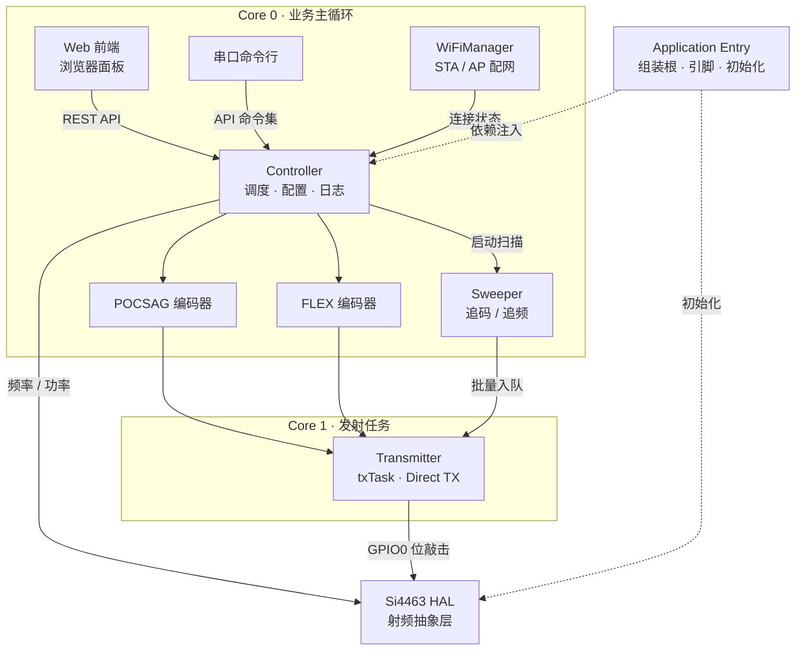

# BeeperTX — Wiki

# BeeperTX — ESP32-S3 + Si4463 POCSAG / FLEX 寻呼发射机

欢迎来到 BeeperTX 的代码库总览。

BeeperTX 是一台基于 **ESP32-S3 + Si4463** 的双协议寻呼发射机。它将文本消息编码为 **POCSAG**（512 / 1200 bps）或 **FLEX**（1600 / 2400 / 3200 bps）两种通用寻呼协议，在 119–1050 MHz 的宽频段上以 2FSK 直接调制发射。消息支持中英文任意混排：UTF-8 输入自动转换为 GB2312，借助 `\x0E`(SO) / `\x0F`(SI) 控制字符在两种字符模式间切换。

如果你刚接触这个项目，这个页面会帮你回答三个问题：**它是什么、代码怎么组织、一条消息怎么发出去**。

## 核心特性

- **三种交互入口，一套命令协议** — Web 控制面板、串口命令行、WiFi 配网共享同一组 `api_*` 命令集，无论从哪个入口操作，行为完全一致。
- **双协议编码** — POCSAG（512 / 1200 bps）与 FLEX（1600 / 2400 / 3200 bps），发射时按配置自动路由到对应编码器，支持数字、字母与中文消息。
- **中英文混排** — UTF-8 → GB2312 自动转换 + SO/SI 控制字符，单条消息内中英文任意混排。
- **单配置跑双协议** — POCSAG 与 FLEX 共用同一份 Si4463 配置（`radio_config.h`，±4.5 kHz 2FSK）。切换频率走 EZ 频率编程，切换码率走 GPIO0 位敲击定时，均即时生效、无需重载芯片配置。
- **异步发射架构** — Core 0 预编码 → FreeRTOS 队列 → Core 1 的 txTask 位敲击，发射期间 Web / 串口保持响应。
- **追码 / 追频** — Spweeper 状态机驱动地址扫描与频率扫描，POCSAG 支持单前导码批量模式。

## 系统架构

先看整体图——10 个节点，半分钟建立全局认识：



按分层理解：

**组装层** — [Application Entry](application-entry.md)（`src/main.cpp`）不承载业务逻辑，只负责定义引脚映射、创建全局组件（`Transmitter`、`WiFiManager`、`Sweeper`、`SerialConsole`、`WebServer`）、注入依赖并启动双核任务布局。Si4463 初始化失败时会进入后台自动重试的降级模式。

**控制面（Core 0）** — [Controller Services & Interfaces](controller-services-and-interfaces.md) 是系统“控制面”核心：统一命令协议、`CommandDispatcher` 调度、参数校验、NVS 配置持久化（`ConfigStore`）、发射日志环形缓冲（`LogRingBuffer`）、异步请求队列（`TxQueue`）。设计上刻意取消模块级单例，组件依赖全部通过构造注入。交互入口方面，[Web Frontend](web-frontend.md) 是运行在浏览器中的控制面板；[WiFi Manager](wifi-manager.md) 负责 STA 自动连接、断线自愈与 AP 配网（热点名 `BeeperTX`，DNS 劫持实现 Captive Portal），是代码库中完全自包含的组件。

**编码层（Core 0）** — [POCSAG Encoding](pocsag-encoding.md) 与 [FLEX Encoding](flex-encoding.md) 分别实现两种协议的基带编码。协议本身的介绍（传输结构、码字格式、差错控制、消息编码）见 [POCSAG 协议文档](../POCSAG_PROTOCOL.md) 与 [FLEX 协议文档](../FLEX_PROTOCOL.md)。中文消息先经 [Character Set Conversion](character-set-conversion.md) 的 `U2GB` 类从 UTF-8 映射到 GB2312，再插入 SO/SI 控制字符。POCSAG 侧输出 32-bit 码字序列（含 576-bit 前导码、地址/功能码字与 BCH 校验）；FLEX 侧完成 BCH 校验、位序反转、块交织与帧/同步头组装。

**发射层（Core 0 调度 / Core 1 执行）** — [Sweep & Transmission](sweep-and-transmission.md) 包含 `Sweeper`（追码/追频状态机，跑在 Core 0 业务主循环）与 `Transmitter`（统一发射控制器，txTask 独占 Core 1）。编码后的基带数据经 FreeRTOS 队列到达 txTask，由 txTask 在 GPIO0 上精确位敲击，直接对 Si4463 做 FSK 调制（不经过 FIFO）。

**射频抽象层** — [Radio Hardware Abstraction](radio-hardware-abstraction.md) 封装 Si4463 的 SPI 事务、EZ 频率编程与属性读写。由于 ESP32 双核可能并发访问同一颗芯片，所有 SPI 事务由递归互斥锁保护；ISR 只置标志，实际 SPI 读取在 Core 1 上轮询完成。

几个关键设计取舍：

- **Direct TX 而非 FIFO**：位时序完全由软件掌控，配合独立的 txTask 保证发射精度，码率切换只需修改 `bitTimeUs()`。
- **单配置双协议**：固定 ±4.5 kHz 2FSK 后，协议差异全部收敛到软件层（编码器 + 位时序），避免芯片配置重载带来的延迟与毛刺。
- **双核分工**：发射是硬实时任务，控制面又是长尾事件；让 txTask 独占 Core 1，Core 0 负责编码与调度，互不阻塞。

## 端到端流程

### 一条中文寻呼消息的旅程

1. 用户在 Web 面板输入 UTF-8 中文消息，前端通过 REST API 提交；
2. `CommandDispatcher` 校验参数，将发射请求放入 `TxQueue`；
3. Core 0 上的编码路径调用字符集转换，再交给 `PocsagEncoder`（或 FLEX 编码器）生成基带码字；
4. 基带数据经 FreeRTOS 队列送达 Core 1 的 txTask；
5. txTask 按 `bitTimeUs()` 时序在 GPIO0 上位敲击，Si4463 以 ±4.5 kHz 2FSK 直接调制发射；
6. 发射日志写入 `LogRingBuffer`，前端增量拉取——整个发射过程控制面保持响应。

### 频率与码率切换

- **频率**：`Si446x_setFrequencyKHz()` 走 EZ 频率编程，内部频段表自动选择 OUTDIV / CLKGEN_BAND，即时生效；
- **码率**：修改 GPIO0 位敲击的 `bitTimeUs()` 定时参数即可；
- 两者都不需要重载 `radio_config.h`——这正是 POCSAG / FLEX 共用单配置的基础。

## 快速上手

- **硬件**：ESP32-S3 + Si4463 模块，引脚映射集中在 `main.cpp` 头部宏（如 `PIN_CS` → GPIO10），详见 [Application Entry](application-entry.md)。
- **构建**：项目基于 Arduino 框架，采用标准 `src/` + `lib/` 布局，在仓库根目录用 PlatformIO 即可编译烧录：

    ```bash
    # 在仓库根目录构建并烧录（选择对应的 ESP32-S3 环境）
    pio run -t upload
    ```

- **首次启动**：设备无已保存 WiFi 凭据时，开放名为 `BeeperTX` 的 AP 热点，浏览器访问配网页完成 STA 配网；之后即可通过 Web 面板或串口命令行发射消息。

更深入的协议参考资料、硬件连线说明与宿主机工具，见 [Other](other.md) 模块。