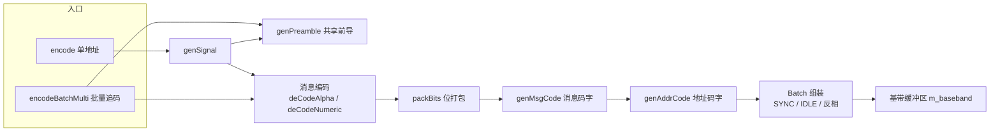

# POCSAG Encoding

> 本文从**实现**角度介绍本项目的 POCSAG 编码模块。协议本身的介绍见
> [docs/POCSAG_PROTOCOL.md](../POCSAG_PROTOCOL.md)。

## 模块概述

`PocsagEncoder` 是 POCSAG（Post Office Code Standardisation Advisory Group）寻呼协议的软件编码器。它负责把文本消息、寻呼地址和功能码转换为符合 POCSAG 物理层格式的 32-bit 基带码字序列，供后续 FSK 调制发射。

模块针对中文寻呼机场景做了专门适配：

- 标准 POCSAG 数字寻呼（4-bit BCD）
- CCITT No.5 字母寻呼（7-bit LSB-first 传输）
- GB2312 中文寻呼（7-bit 位反转编码 + Shift Out/Shift In 控制字符切换）
- 单地址呼叫与批量"追码"两条编码路径

对外暴露两个编码入口：

- `encode()` — 单地址编码，面向单条呼叫
- `encodeBatchMulti()` — 批量追码，单前导码贯穿连续多个 Batch

编码结果通过 `getBaseband()` / `getBasebandLength()` 供发射层消费。

## POCSAG 基带格式回顾

POCSAG 发射序列的组织方式：

1. **前导码（Preamble）**：576 bit 交替 1/0 模式，帮助接收机恢复位同步。本模块用 18 个 `0xAAAAAAAA` 码字表示。
2. **批（Batch）**：`SYNC` 码字 + 16 个帧槽。本模块中每个 Batch = 1 个 `POCSAG_SYNC` + 16 个槽位，共 17 个码字。
3. **码字（Codeword）**：32 bit。bit31 为 0 表示地址码字，为 1 表示消息码字；每个码字含 10-bit BCH 校验和 1-bit 偶校验。

地址到槽位的映射关系为：帧号 `frame = addr & 0x07`，地址码字放在该 Batch 内的槽 `frame * 2`（即每个帧的前半个槽）。

## 架构概览



公共 API 与内部方法的分工：

| 层级 | 函数 | 职责 |
|---|---|---|
| 公共入口 | `encode()` | 单地址编码，包装 `genSignal` |
| 公共入口 | `encodeBatchMulti()` | 批量追码，单前导多 Batch 贪心调度 |
| 基带组装 | `genSignal()` | 单地址完整基带：前导 + Batch + 尾填充 + 反相 |
| 消息编码 | `deCodeAlpha()` | 字母/中文消息 → 消息码字表 |
| 消息编码 | `deCodeNumeric()` | 数字消息 → 消息码字表 |
| 码字构造 | `genAddrCode()` / `genMsgCode()` | 生成 32-bit 地址/消息码字 |
| 校验 | `calcCRC()` / `evenCheck()` | BCH(31,21) 校验与偶校验 |
| 文件内静态辅助 | `flip7bitOrder()` / `flip4bitOrder()` / `packBits()` / `numericToBcd()` | 位反转、位打包、字符到 BCD 映射 |

## 消息编码

### 数字消息：deCodeNumeric

数字模式使用标准 POCSAG 4-bit BCD 编码。`numericToBcd()` 负责字符映射：

| 输入字符 | BCD 值 | 说明 |
|---|---|---|
| `'0'` – `'9'` | `0x0` – `0x9` | 数字 |
| `' '` | `0xA` | SPACE |
| `'U'` | `0xB` | 保留扩展 |
| `'-'` | `0xD` | 连字符 |
| `']'` | `0xE` | 寻呼机显示为 `)` |
| `'['` | `0xF` | 寻呼机显示为 `(` |
| 其他未知字符 | `0xA` | 统一映射为 SPACE |

每个 BCD nibble 先经 `flip4bitOrder()` 做 4-bit 反转（LSB-first 传输），再由 `packBits()` 以 4-bit 粒度打包进 20-bit 消息负载。

最后一个不完整的 20-bit 字用 `0xA`（SPACE）填充——POCSAG 标准规定尾随填充必须用 SPACE，不能补零。

### 字母/中文消息：deCodeAlpha

中文寻呼机的编码约定：

- 消息默认处于 GB2312 中文模式（`inGB` 初始为 `true`）
- 字节 `>= 0x80` 视为 GB2312 双字节中文字符
- 字节 `< 0x80` 视为 ASCII 字符
- 模式切换通过 CCITT No.5 控制字符完成：
  - `0x0E`（Shift Out）→ 切换到 GB2312 中文模式
  - `0x0F`（Shift In）→ 切换到 ASCII 英文模式
- `0x04`（EOT）作为消息结束符追加在消息尾部
- 所有字节（含 GB2312 双字节）统一使用 7-bit 位反转编码，每字符占 7 bit

切换逻辑：遍历消息时，遇到 `>= 0x80` 且当前不在中文模式，先发 `0x0E`；遇到 `< 0x80` 且当前在中文模式，先发 `0x0F`。这样中英文混排消息会在正确位置插入切换指令，寻呼机收到后按指令切换字符集。

> 文件头部注释中的 `0x70→GB2312`、`0xF0→ASCII` 是显示器侧的字符集切换码约定；编码器实际发送的是 `0x0E` / `0x0F` 控制字符经 7-bit 反转后的码流。

### 位打包：packBits

`packBits()` 是两类消息编码共用的核心辅助函数。无论 7-bit 字符还是 4-bit BCD nibble，都通过它逐位移入 `msgBin` 累积器；累积满 20 bit 即生成一个消息字，存入 `codeList` 并重置累积器。跨字符边界时该函数正确处理了位拼接，调用方无需关心 20 与 7/4 不整除的问题。

## 码字构造与校验

### 地址码字：genAddrCode

```
bit31       = 0                    (地址码字标志)
bit30..13   = addr >> 3             (18-bit 地址)
bit12..11   = function & 0x03       (2-bit 功能码)
bit10..1    = BCH(31,21) 校验位
bit0        = 偶校验位
```

功能码由调用方显式指定，模块不会自动覆盖。在 WebUI 场景中对应 Tone 设置：A=0、B=1、C=2、D=3。

### 消息码字：genMsgCode

```
bit31       = 1                    (消息码字标志)
bit30..11   = 20-bit 消息负载
bit10..1    = BCH(31,21) 校验位
bit0        = 偶校验位
```

### BCH(31,21)：calcCRC

生成多项式：`G(x) = x^10 + x^9 + x^8 + x^6 + x^5 + x^3 + 1 = 0x769`

实现采用移位异或除法：数据左移 10 位后，从最高位开始用 `0x76900000` 逐位下移做模 2 除，余数即为 10-bit 校验值，由调用方放入码字的 bit10..1。

### 偶校验：evenCheck

统计码字 bit31..bit1 中 1 的个数，将 bit0 置为使整个码字 1 的总数为偶数。

## 基带组装

### 单地址路径：genSignal

1. 生成 18 个前导码字（`genPreamble`）
2. 按 `mode` 调用 `deCodeAlpha` / `deCodeNumeric`，得到消息码字表 `m_msgCode`
3. 计算地址槽位：`addrSlot = (addr & 0x07) * 2`
4. 从 `bandPtr = 18`（跳过前导码）开始逐 Batch 组装：
   - 每个 Batch 先写 `POCSAG_SYNC`
   - 再写 16 个槽位：地址码字放在 `addrSlot`；其后连续放置消息码字；空槽填 `POCSAG_IDLE`
5. 尾部补 16 个 `POCSAG_IDLE`
6. 若 `invert` 为真，对 `bandPtr` 范围内的全部码字按位取反

一个值得注意的细节：模块刻意不"清零残留码字"。当地址为 1–7 且 function=0 时，`addr >> 3 = 0` 会产生合法的全零地址码字 `0x00000000`；若把零值误判为空槽改写为 `POCSAG_IDLE` 会丢失地址。因此组装循环保证 `bandPtr` 范围内每个槽都被显式写入（SYNC/地址/消息/IDLE），不存在未初始化的残留。

### 批量追码路径：encodeBatchMulti

批量追码场景下，如果对每个地址都发送完整的前导码 + Batch，空中开销非常大。`encodeBatchMulti` 采用单前导码 + 连续多 Batch 的布局：

- 整个发射序列共用一个前导码（18 个码字）
- 地址按顺序贪心放置：对每个地址寻找可用的 Batch，要求地址槽 `(addr & 0x07) * 2` 空闲，且消息码字能从地址槽后连续占 `msgWords` 个槽
- 消息码字允许跨过 SYNC 边界延续到下一个 Batch（ITU-R M.584 §2.2），跨入的 Batch 头部槽自动避让，不再放地址
- 每条消息的内容为地址的十进制字符串（如地址 1234567 的消息就是 `"1234567"`），与逐地址发射行为一致
- Batch 上限 24 个（`MAX_BATCH`），每个 Batch 占 17 个码字；无法放置的地址记入 `skipped` 输出数组
- 返回值为基带总码字数；若无任何地址可编码则返回 0

该路径解决了旧实现中 frame 7 长消息被跳过、字母消息降级逐地址补发的问题，所有地址一次性进入批量，显著减少了前导码重复开销。

### 布局预算与常量

| 常量 | 值 | 说明 |
|---|---|---|
| `POCSAG_SYNC` | `0x7CD215D8` | Batch 同步码字 |
| `POCSAG_IDLE` | `0x7A89C197` | 空闲码字 |
| `POCSAG_PREAMBLE` | `0xAAAAAAAA` | 前导码字 |
| `MAX_CODEMORDS` | 512 | 消息码字表容量 |
| `MAX_BASEBAND` | 1024 | 基带码字缓冲区容量 |
| `MAX_MESSAGE_LEN` | 1024 | 输入消息最大字节数 |

最坏布局估算：18 前导 + 24 Batch × 17 + 16 尾 = 442 码字，远小于 `MAX_BASEBAND`（1024），留有充足余量。

## 使用示例

```cpp
PocsagEncoder encoder;

// 单地址呼叫：地址 1234567，功能码 2（Tone C），中英文消息
const char *text = "hello 中文";
encoder.encode(1234567UL, 2, (const uint8_t *)text, strlen(text),
               MODE_ALPHANUMERIC, false);

// 读取基带结果，送入 FSK 调制器
const unsigned long *bb = encoder.getBaseband();
int len = encoder.getBasebandLength();
```

```cpp
// 批量追码：一次呼叫多个地址
uint32_t addrs[] = { 1000001UL, 1000002UL, 1000003UL };
int encoded = 0;
bool skipped[3] = { false, false, false };

int len = encoder.encodeBatchMulti(addrs, 3, 0, MODE_NUMERIC,
                                   false, &encoded, skipped);
// encoded 为成功编码的地址数；skipped[i] 标记未放入基带的地址
```

## 与代码库其他部分的衔接

- `encode()` 面向单条呼叫：上层传入寻呼地址、Tone 功能码和消息文本，编码结果供 FSK 调制发射。
- `encodeBatchMulti()` 面向追码批量呼叫：上层传入地址数组，一次生成覆盖全部地址的连续基带流，并通过 `addrEncoded` / `skipped` 输出参数获知编码结果。
- `getBaseband()` 返回内部码字数组指针（`unsigned long`，每元素 32 bit），`getBasebandLength()` 返回有效码字数，发射层直接消费这两个接口即可。
- `DisplayMode` 枚举（`MODE_NUMERIC` / `MODE_ALPHANUMERIC`）是上层与编码器之间关于消息编码方式的约定，与地址码字中的功能码位共同决定寻呼机的显示行为。