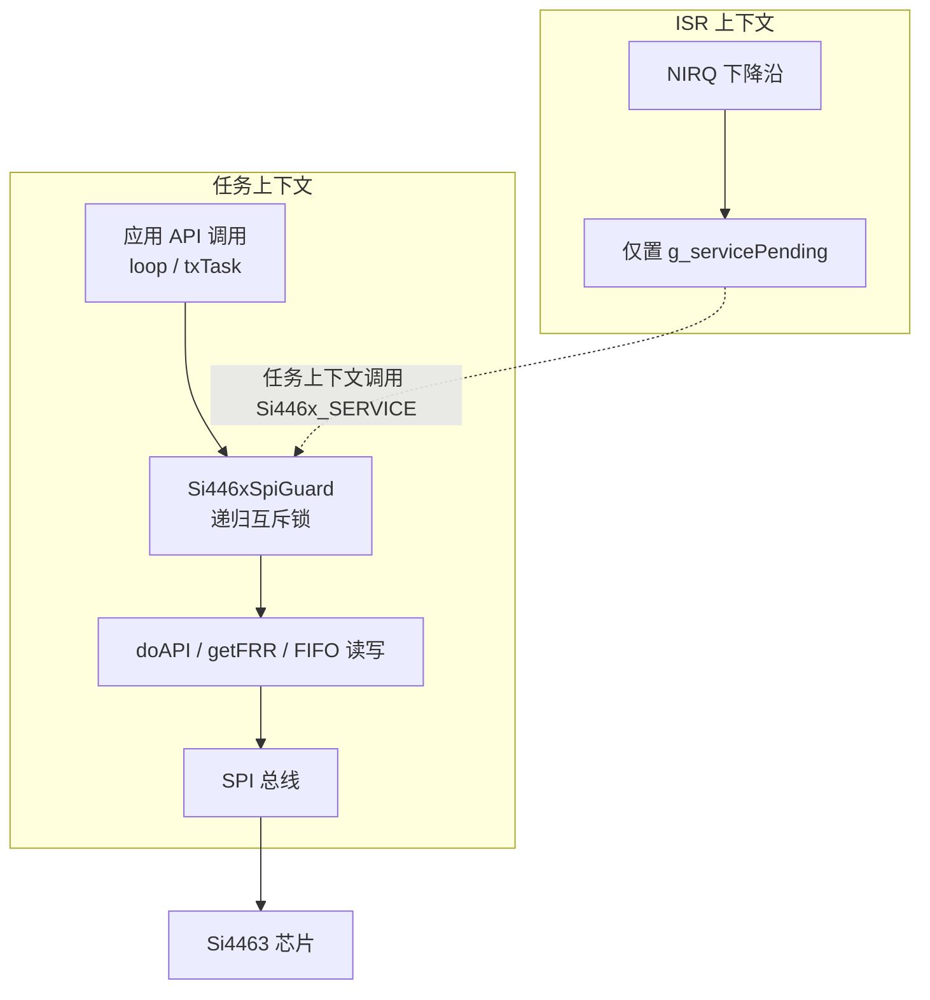

# Radio Hardware Abstraction

# Radio Hardware Abstraction

## 1. 模块概述

本模块是 Si4463 射频收发芯片在 ESP32 平台上的硬件抽象层（HAL），源码位于 `lib/si4463/`，核心实现为 `Si446x.cpp` / `Si446x.h`，辅以 WDS 生成的 `radio_config.h` 启动配置。

模块源自 Zak Kemble 的 AVR/Arduino 版 Si446x 库，针对 ESP32 移植时做了以下关键改造：

- **运行时引脚配置**：SPI/GPIO 引脚不再编译期固定，由应用在初始化前通过 `Si446x_setPins()` 传入。
- **跨核 SPI 互斥**：ESP32 双核可能并发访问同一颗 Si4463，所有 SPI 事务由递归互斥锁保护，避免 "Interrupt wdt timeout" 死锁。
- **Direct TX 位敲击**：按 `radio_config.h` 中的符号率用 GPIO 直接驱动 TX 数据脚，实现 UART 式起始位/数据位/停止位输出。
- **频率控制增强**：内置频段表支持以 kHz 为单位设置载波频率，并可从实时寄存器回读当前频率。
- **事件分发重构**：ISR 上下文只置标志，实际 SPI 读取与回调分发在任务上下文完成。

对外接口分为两类：**命令式 API**（`Si446x_TX`、`Si446x_RX`、`Si446x_setFrequencyKHz` 等）和**事件回调**（`SI446X_CB_*` 弱符号）。

## 2. 架构与并发模型



模块的并发设计围绕两个不可违背的原则：

1. **所有 SPI 事务持递归互斥锁**。`doAPI()`、`getFRR()`、FIFO 读写等内部函数各自通过 RAII 守卫 `Si446xSpiGuard` 加锁；递归语义保证嵌套调用（如 `Si446x_TX()` → `doAPI()`）不会自死锁。任务上下文阻塞等待锁时可被调度，不会长时间关中断。
2. **ISR 上下文绝不执行 SPI**。`Si446x_SERVICE()` 若在中断中被调用（`xPortInIsrContext()` 为真），仅设置 `g_servicePending` 标志后立即返回；实际的事件读取与回调分发必须发生在任务上下文中。

与中断相关的还有一个易混淆点：模块维护两套独立的"关中断"计数器，**不可混用**：

| 机制 | 变量 | 用途 |
|------|------|------|
| 射频 GPIO 中断 | `isrState` | 记录 `detachInterrupt` 嵌套深度，供 `Si446x_irq_off()` / `Si446x_irq_on()` 使用 |
| 全局中断 | `spiIntrState` | 记录 `noInterrupts()` 嵌套深度，供 `interrupt_off()` / `interrupt_on()` 使用 |

代码注释中记录了一个历史 bug：原实现将两个计数器共用，导致 `doAPI()` 返回后全局中断被永久禁用，进而使 `esp_timer` 冻结、Direct TX 位敲击忙等卡死、最终触发 WDT 复位。移植时已将二者彻底分离——后续修改务必保持独立。

## 3. 引脚配置

板级引脚信息由应用通过 `Si446x_setPins()` 在运行时提供，库内部以静态变量保存，初始值均为 -1（未设置）。

| 参数 | 内部变量 | 说明 |
|------|---------|------|
| `csn` | `_pin_csn` | SPI 片选（低有效），必填 |
| `sdn` | `_pin_sdn` | 关机/复位脚（高=复位），必填 |
| `irq` | `_pin_irq` | NIRQ 中断脚；传 -1 进入轮询模式 |
| `txData` | `_pin_txData` | Direct TX 数据脚（接 Si4463 GPIO0），必填 |
| `sclk` | `_pin_sclk` | SPI 时钟，必填 |
| `mosi` | `_pin_mosi` | SPI MOSI（接 SDI），必填 |
| `miso` | `_pin_miso` | SPI MISO（接 SDO），必填 |

`Si446x_setPins()` 对每个参数采用"传 -1 保持当前值"的语义。`Si446x_init()` 启动时会校验上述 6 个必填引脚，缺失则打印错误并中止，避免对 -1 引脚执行 GPIO 操作。

SPI 总线通过 `SPI.begin(_pin_sclk, _pin_miso, _pin_mosi, -1)` 启动——不在此处指定 CS，片选由 `spiSelect()` / `spiDeselect()` 在每次事务中动态控制：

```cpp
#define CHIPSELECT() for (uint8_t _cs = cselect(); _cs; _cs = cdeselect())
```

`CHIPSELECT()` 利用 for 循环保证"先选中、循环体结束必释放"的配对语义，任何 `return` 路径都不会遗留片选拉低状态。`SI446X_ATOMIC()` 宏同理，用于保证全局中断开关的配对。

## 4. SPI 通信层

### 4.1 CTS 握手机制

Si4463 使用 CTS（Clear To Send）握手：主机下发命令后，必须通过 `READ_CMD_BUFF`（0x44）轮询，直到读回 0xFF 才表示芯片就绪，可以下发下一条命令或读取响应。

- `getResponse(buff, len)`：发送 0x44，读取 CTS 字节；若就绪则继续读取响应数据。
- `waitForResponse(out, outLen, useTimeout)`：循环轮询 CTS 直至就绪。
  - 每约 1ms 调用一次 `esp_task_wdt_reset()` 喂 Task WDT——尤其对无超时的 IRCAL 校准路径，忙等可能持续数秒，不喂狗会触发看门狗复位。
  - `useTimeout=1` 时约 400ms 超时，超时触发 `SI446X_CB_CMDTIMEOUT()` 回调并返回 0。
  - `useTimeout=0` 时无限等待（用于 `IRCAL` 命令，校准耗时可能超过常规超时窗口）。

### 4.2 doAPI 命令封装

`doAPI(data, len, out, outLen)` 是所有 Si4463 命令的公共入口：

```cpp
Si446xSpiGuard _lock;            // 跨核 SPI 互斥
uint8_t irq = Si446x_irq_off();  // 通信期间禁用射频 GPIO 中断
waitForResponse(NULL, 0, 1);     // 等待上一条命令完成
// SI446X_ATOMIC + CHIPSELECT 窗口内发送命令字节
// IRCAL 无超时等待; 其余命令若有响应则等待并读取
Si446x_irq_on(irq);
```

注意 `Si446xSpiGuard`（跨核互斥）与 `Si446x_irq_off()`（射频中断）是两个独立层次：前者解决多核并发，后者避免通信过程中被射频事件打断。二者不可互相替代。

属性读写在此基础上封装：

- `setProperty` / `setProperties` → `SET_PROPERTY`（0x11）命令；
- `getProperty` / `getProperties` → `GET_PROPERTY`（0x12）命令；
- `getFRR(reg)`：在单个 SPI 周期内直接读取快速响应寄存器（FRR），不经过 CTS 握手，用于高频查询芯片状态与 RSSI（`getState()`、`getLatchedRSSI()`）。

## 5. 初始化流程

`Si446x_init()` 的执行序列：

1. 校验必填引脚已设置，否则打印错误并返回。
2. 初始化 CS / SDN 引脚电平（SPI 未选中、芯片不在复位态）；IRQ 若启用则配置为 `INPUT_PULLUP`。
3. `SPI.begin()` 启动 SPI 总线。
4. `resetDevice()`：SDN 拉高 50ms → 拉低 50ms，硬件复位芯片。
5. `applyStartupConfig()`：逐条回放 WDS 生成的 `RADIO_CONFIGURATION_DATA_ARRAY`。该数组格式为 `[长度][命令字节...]` 序列，第一个字节即本条命令的总长度。
6. `interrupt(NULL)` 清空中断状态。
7. `Si446x_sleep()` 进入休眠。
8. 设置默认使能中断：`PACKET_RX_PEND | CRC_ERROR_PEND`。
9. 若配置了 IRQ 引脚，`Si446x_irq_on(1)` 挂接下降沿中断。

GPIO 引脚方向本身也包含在 WDS 启动配置中（`RF_GPIO_PIN_CFG`）。若 WDS 配置的 GPIO 与板级 RF 天线开关不匹配，应用应在 `init` 后调用 `Si446x_configRFswitch()` 覆盖——本工程 `initSi4463()` 正是这样做的。该函数将 GPIO2 配置为 `TX_STATE`、GPIO3 配置为 `RX_STATE`（均带内部上拉），用于单天线半双工切换。

## 6. 数据发送

模块支持两种发送模式。

### 6.1 FIFO 包模式

`Si446x_TX(packet, len, channel, onTxFinish)` 用于常规数据包发送：

1. 若芯片已处于 TX 状态，直接返回 0（忙）。
2. 切到 IDLE、清空 FIFO、清除中断 pending（`interrupt2(NULL, 0, 0, 0xFF)`）。
3. 在原子区内写入 TX FIFO：变长模式（`SI446X_FIXED_LENGTH == 0`）先写长度字节再写负载；定长模式只写 `SI446X_FIXED_LENGTH` 字节负载，不写长度字节。
4. 变长模式下同步设置 `PKT_FIELD_2_LENGTH_LOW` 为本次包长，发送完成后恢复为 `SI446X_MAX_PACKET_LEN`。
5. 下发 `START_TX` 命令，`onTxFinish` 指定发送结束后芯片自动进入的状态。

### 6.2 Direct TX 模式

`Si446x_startDirectTX(channel, async)` 将调制数据源切换到 Direct 模式：

- **同步**（`async=0`）：芯片在 GPIO1 输出位时钟，GPIO0 上的数据在时钟下降沿被采样。
- **异步**（`async=1`）：MCU 自行控制数据速率，无需位时钟。

实现上通过读写 `MODEM_MOD_TYPE` 属性切换 bit7（`SI446X_MODEM_MOD_TYPE_MASK_ASYNC` / `_MASK_SYNC`）。Direct 模式下 `START_TX` 的 FIFO/长度字段被芯片忽略，因此全部填 0。

`Si446x_txDirectWrite(data, len)` 按 UART 式帧格式逐位敲击 TX 数据脚：

```
起始位(低) → 8 数据位(LSB first) → 停止位(高)
```

位周期由 `RADIO_CONFIGURATION_DATA_RSYMB_SPS` 推导：

```cpp
const uint32_t BIT_PERIOD_US = 1000000UL / RADIO_CONFIGURATION_DATA_RSYMB_SPS;
```

默认 1200 sps 时位周期约 833µs，即约 6.7ms/字节。**该函数是阻塞的**：发送 100 字节约需 670ms，调用前需评估对任务调度的影响。发送完成后调用 `Si446x_stopTX()` 回到 IDLE（对 Direct 与 FIFO 模式均适用）。

## 7. 接收与事件分发

### 7.1 Si446x_SERVICE 双上下文入口

`Si446x_SERVICE()` 是唯一的事件处理入口，可被 GPIO 中断或 `loop()` 轮询调用：

- **ISR 上下文**：仅置 `g_servicePending = true` 后返回。ISR 无法获取递归互斥锁，因此绝不做 SPI。
- **任务上下文**：清标志、持互斥锁，执行完整事件分发。内部 `doAPI()` 的递归加锁不会造成死锁。

### 7.2 事件分发流程

任务上下文中的处理步骤：

1. `GET_INT_STATUS` 读取 8 字节中断状态。
2. 与 `enabledInterrupts[IRQ_PACKET]` / `[IRQ_MODEM]` / `[IRQ_CHIP]` 掩码求与。
3. 按 pending 位分发到弱符号回调：

| pending 位 | 回调 | 说明 |
|-----------|------|------|
| `SYNC_DETECT_PEND`（MODEM） | `SI446X_CB_RXBEGIN(rssi)` | 检测到同步字，附带锁存 RSSI |
| `PACKET_RX_PEND`（PH） | `SI446X_CB_RXCOMPLETE(len, rssi)` | 收到完整包；变长模式先从 RX FIFO 读 1 字节长度，**负载数据需在回调中通过 `Si446x_read()` 取走** |
| `CRC_ERROR_PEND`（PH） | `SI446X_CB_RXINVALID(rssi)` | CRC 校验失败；若空闲态为 READY 且芯片处于 SPI_ACTIVE，先恢复 IDLE |
| `PACKET_SENT_PEND`（PH） | `SI446X_CB_SENT()` | FIFO 包发送完成 |
| `WUT_PEND`（CHIP） | `SI446X_CB_WUT()` | 唤醒定时器到期 |
| `LOW_BATT_PEND`（CHIP） | `SI446X_CB_LOWBATT()` | 低电压告警 |

所有回调均以弱符号定义（`__attribute__((weak))`），应用定义同名函数即可覆盖，未定义时得到空实现。事件使能通过 `Si446x_setupCallback(callbacks, state)` 管理，调用后会同步更新 `enabledInterrupts` 掩码。

## 8. 频率控制

### 8.1 频段表

PLL 需要将 VCO 频率经 OUTDIV 分频后落在有效范围，同时 `MODEM_CLKGEN_BAND` 属性要与分频比匹配。模块内置频段表（基于 30MHz 晶振设计，换晶振需重算）：

| 频率范围 (MHz) | OUTDIV | CLKGEN_BAND |
|---------------|--------|-------------|
| 119 – 220 | 12 | 0x0D |
| 220 – 295 | 8 | 0x0C |
| 295 – 390 | 6 | 0x0B |
| 390 – 520 | 4 | 0x0A |
| 520 – 700 | 3 | 0x09 |
| 700 – 1050 | 2 | 0x08 |

### 8.2 设置频率

`Si446x_setFrequencyKHz(freqKHz)` 是应用层入口：

1. 查询频段表，越界返回 0。
2. 计算定点化分频比（`fXO` 取自 `radio_config.h` 的 `RADIO_CONFIGURATION_DATA_RADIO_XO_FREQ`）：

```
N_fxp = (freqKHz × OUTDIV × 2^19) / fXO_kHz
```

3. 按芯片约定拆分寄存器值：
   - `FC_INTE = floor(N) - 1`
   - `FC_FRAC = 小数部分 | (1 << 19)`（bit19 恒置 1，重新居中）
   - `CHANNEL_STEP_SIZE` 按 2kHz 信道步进换算
4. 调用 `Si446x_setFrequency(inte, frac, step, band)` 下发寄存器，随后执行 `IRCAL` 图像抑制校准。

`Si446x_setFrequency()` 在改频前先 `Si446x_irq_off()` 并切回 READY 状态，避免在发射态修改合成器寄存器；IRCAL 使用无超时等待（`waitForResponse(NULL, 0, 0)`），因为校准耗时可能超过常规 CTS 超时。

### 8.3 回读频率

`Si446x_getFrequencyKHz()` 从实时寄存器反推载波频率：

```
fRF(kHz) = 30000 × (FC_INTE + 1 + (FC_FRAC & 0x7FFFF) / 2^19) / OUTDIV
```

其中 OUTDIV 由 `CLKGEN_BAND` 经 `outdivFromBand()` 反查频段表得到，未知频段返回 0。注意此处晶振频率按 30MHz 硬编码——与默认配置一致，但换晶振时需同步修改。

## 9. 辅助功能

- **休眠**：`Si446x_sleep()` 在 TX 状态下拒绝休眠（返回 0），否则通过 `CHANGE_STATE` 进入 SLEEP。
- **功率控制**：`Si446x_setTxPower()` / `Si446x_getTxPower()` 读写 `PA_PWR_LVL` 属性（0–127）。
- **唤醒定时器（WUT）**：`Si446x_setupWUT(r, m, ldc, config_flags)` 支持三种事件源——`SI446X_WUT_RUN`（周期唤醒）、`SI446X_WUT_BATT`（低电压唤醒）、`SI446X_WUT_RX`（接收周期唤醒）。内部会切换 32kHz RC 时钟、装配 WUT 分频/计数寄存器并设置 CHIP 组中断使能；`Si446x_disableWUT()` 清零相关属性。
- **低电压阈值**：`Si446x_setLowBatt(voltage)` 将 mV 值编码为 `(voltage/50) - 30` 写入 `GLOBAL_LOW_BATT_THRESH`。
- **ADC**：`Si446x_adc_gpio()` / `Si446x_adc_battery()` / `Si446x_adc_temperature()` 分别读取 GPIO 输入、电源电压（mV）与片内温度（°C）。
- **GPIO 读写**：`Si446x_writeGPIO()` 配置单个引脚模式；`Si446x_readGPIO()` 返回 4 个 GPIO 的输入状态位。
- **属性转储**：`Si446x_dump(buff, group)` 按属性组批量读取；`buff == NULL` 时返回该组长度，便于调用方分配缓冲区。
- **芯片信息**：`Si446x_getInfo()` 通过 `PART_INFO` / `FUNC_INFO` 读取版本、Part ID、ROM ID 等。`romId` 可用于区分硬件版本（3 = B1B，6 = C2A）。
- **RSSI 与状态**：`Si446x_getRSSI()` 读 `GET_MODEM_STATUS`；`Si446x_getState()` 通过 FRR_B 快读芯片状态机。RSSI 换算公式为 `rssi_dBm(raw) = raw/2 - 134`。

## 10. 与工程其他模块的集成

| 调用方 | 使用的 API |
|--------|-----------|
| `src/main.cpp` — `initSi4463()` | `Si446x_setPins()`、`Si446x_init()`、`Si446x_getInfo()`、`Si446x_configRFswitch()` |
| `src/main.cpp` — `loop()` | `Si446x_SERVICE()`（事件轮询） |
| `src/main.cpp` — `printSi4463Info()` | `Si446x_getInfo()`、`Si446x_getTxPower()`、`Si446x_getRSSI()`、`Si446x_getState()`、`Si446x_getFrequencyKHz()` |
| `src/Controller/API.cpp` | `Si446x_setFrequencyKHz()`、`Si446x_setTxPower()`、`Si446x_getInfo()`、`Si446x_getRSSI()`、`Si446x_getState()`、`Si446x_getFrequencyKHz()`、`Si446x_getTxPower()` |
| `src/Controller/Transmitter.cpp` | `Si446x_startDirectTX()`、`Si446x_stopTX()` |
| `src/Controller/Sweeper.cpp` | `Si446x_setFrequencyKHz()`（扫频循环与单次发射） |

典型使用序列：

```cpp
// 1. 板级引脚配置（必须在 init 之前）
Si446x_setPins(PIN_CS, PIN_SDN, PIN_IRQ, PIN_TX_DATA, PIN_SCLK, PIN_MOSI, PIN_MISO);

// 2. 初始化 + 用 RF 天线开关配置覆盖 WDS 默认 GPIO
Si446x_init();
Si446x_configRFswitch();

// 3. 设置频率与功率
Si446x_setFrequencyKHz(156000);   // 156 MHz
Si446x_setTxPower(127);

// 4. Direct TX 发送
Si446x_startDirectTX(0, 1);       // 异步模式
Si446x_txDirectWrite(payload, len);
Si446x_stopTX();

// 5. 事件轮询（若未使用 GPIO 中断）
Si446x_SERVICE();
```

## 11. 使用与移植注意事项

1. **`radio_config.h` 是 WDS 生成物**：包含启动配置数组 `RADIO_CONFIGURATION_DATA_ARRAY`，不要手工修改。更换调制参数（码率、频偏、滤波带宽等）时用 WDS 重新生成并整体替换。`radio_config/` 目录下提供了 B1 版本的多个现成配置（POCSAG 512/1200 sps、Flex 1600 sps）。
2. **`RADIO_CONFIGURATION_DATA_RSYMB_SPS` 必须与 WDS 的 Rsymb 一致**：该宏不在 WDS 生成物中，需在 `radio_config.h` 的 "USER DEFINED PARAMETERS" 区手动维护。缺失时驱动回退 1200 sps 并产生编译警告，Direct TX 的位敲击速率会与接收端失配。
3. **硬件版本区分**：B1（ROM 3）与 C2（ROM 6）的 WDS 配置不通用。替换 `radio_config.h` 时须配套选择 `radio_config/Si4463b1/` 或 `radio_config/Si4463c2/`；当前工程为 B1。
4. **晶振频率假设**：频段表与 `Si446x_getFrequencyKHz()` 均按 30MHz 晶振设计，换晶振需同步修改 `FREQ_BANDS` 表与回读函数中的硬编码。
5. **IRQ 可省略**：`_pin_irq = -1` 时所有 `Si446x_irq_off/on` 变为空操作，事件处理完全依赖应用在 `loop()` 中轮询 `Si446x_SERVICE()`。
6. **回调不在 ISR 中触发**：GPIO 中断模式下，`Si446x_SERVICE()` 的 ISR 分支只置标志，事件回调和 payload 读取（`Si446x_read()`）都发生在任务上下文，不要依赖中断内同步回调。