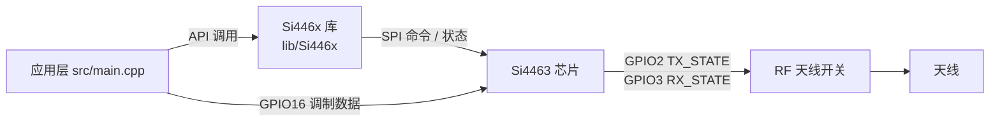

# si4463

# Si4463 RF Transceiver Module

## 1. 模块概述

`lib/Si446x` 是面向 **Silicon Labs Si4463** Sub-GHz 射频收发器的 ESP32-S3 驱动库，基于 Zak Kemble 的 Si446x AVR/Arduino 库移植，并在其基础上增加了 BeeperTX 工程所需的增强功能。模块以 Arduino 框架运行于 ESP32-S3，通过 SPI 与芯片通信，同时利用 GPIO 直连实现 Direct TX 调制数据注入和 RF 天线开关控制。

**芯片能力**

| 参数 | 规格 |
|------|------|
| 频率范围 | 119 – 1050 MHz（6 个频段） |
| 调制方式 | (G)FSK、4(G)FSK、(G)MSK、OOK |
| 数据速率 | 0.1 bps – 1 Mbps |
| TX 功率 | 最高 +20 dBm（100 mW） |
| 灵敏度 | 典型 -124 dBm @ 1.2 kbps |
| 接口 | SPI（命令/状态）+ GPIO 直连 |

**本移植库增加的增强能力**

- **Direct TX 模式**：调制数据经 GPIO0 引脚直接进入调制器，不占用 SPI FIFO，适合发送自定义连续码流。
- **RF 天线开关控制**：通过芯片 GPIO2/GPIO3 输出 TX_STATE / RX_STATE 信号驱动外部 RF 开关，半双工单天线设计无需额外 MCU 引脚。
- **运行时频率控制**：`Si446x_setFrequencyKHz()` / `Si446x_getFrequencyKHz()` 实现 kHz 级频率设置与回读，内部使用 64 位整数运算，无浮点误差。
- **双硬件版本支持**：同时维护 Si4463 Rev B1（B1B）与 Rev C2（C2A）的 WDS 原始配置库。

## 2. 架构与集成方式

### 2.1 在工程中的位置

模块位于 BeeperTX 工程的 `lib/Si446x/` 目录，由应用层 `src/main.cpp` 直接包含使用。整个数据路径如下：



### 2.2 文件结构

```
lib/Si446x/
├── Si446x.h               # 公共 API、SPI 行为配置、命令/属性定义
│                          # （原 Si446x_config.h / Si446x_defs.h 已合并于此）
├── Si446x.cpp             # 库实现
├── radio_config.h         # WDS 生成的当前配置（B1，勿手改）
└── radio_config/          # WDS 原始配置库
    ├── Si4463b1/          # Rev B1 配置
    └── Si4463c2/          # Rev C2 配置
```

### 2.3 引脚不内置，由应用方注入

这是一个关键设计决策：**GPIO 引脚属于板级硬件信息，库头文件不再内置默认引脚宏**。应用方必须在 `Si446x_init()` 之前调用 `Si446x_setPins()` 传入引脚编号：

```c
// main.cpp
#define PIN_CS       10   // nSEL (SPI 片选)
#define PIN_SDN       5   // SDN (关断复位)
#define PIN_TX_DATA  16   // → Si4463 GPIO0 (TX 调制数据)
#define PIN_SCLK     12   // SPI SCK
#define PIN_MISO     13   // SPI MISO (SDO)
#define PIN_MOSI     11   // SPI MOSI (SDI)
#define PIN_NIRQ     -1   // 中断 (-1 = 轮询)

Si446x_setPins(PIN_CS, PIN_SDN, PIN_NIRQ, PIN_TX_DATA,
               PIN_SCLK, PIN_MOSI, PIN_MISO);
```

`Si446x_setPins(csn, sdn, irq, txData, sclk, mosi, miso)` 中除 `irq` 外的 6 个引脚必须设置，否则 `Si446x_init()` 会打印错误并中止。传 `-1` 表示保持当前值。

> **⚠️ IRQ = -1 的说明**：ESP32 上建议使用轮询模式。原 AVR 库的中断处理逻辑依赖 `detachInterrupt()` / `attachInterrupt()`，在 ESP32 的 ISR 中调用这些函数会导致 Watchdog 崩溃。将 `irq` 设为 `-1` 可完全禁用中断路径，改为在 `loop()` 中周期调用 `Si446x_SERVICE()` 轮询事件。

## 3. 硬件接口

### 3.1 MCU 引脚映射

| Si4463 引脚 | ESP32-S3 | 功能 |
|-------------|----------|------|
| SDN | GPIO5 | 关机复位（高电平有效） |
| nSEL/CS | GPIO10 | SPI 片选（低有效） |
| SCLK | GPIO12 | SPI 时钟 |
| SDI/MOSI | GPIO11 | SPI 主出从入 |
| SDO/MISO | GPIO13 | SPI 主入从出 |
| nIRQ | 可选 | 中断输出（低有效），轮询模式下可不接 |
| GPIO0 | GPIO16 | Direct TX 数据输入 |
| VDD | 3V3 | 电源（3.3V） |
| GND | GND | 共地 |

### 3.2 芯片侧 GPIO 与 RF 天线开关

通过 WDS 配置 + `Si446x_configRFswitch()`，芯片侧 GPIO 的完整分配为：

| Si4463 引脚 | 模式 | 用途 |
|-------------|------|------|
| GPIO0 | INPUT | Direct TX 数据输入（bit-bang 调制） |
| GPIO1 | TX_DATA_CLK | 数据时钟输出（外部数据源同步，通常不用） |
| GPIO2 | TX_STATE | RF 开关：发射时 HIGH |
| GPIO3 | RX_STATE | RF 开关：接收时 HIGH |

RF 开关真值表（`TX_STATE` / `RX_STATE` 由芯片直接驱动，不占用 MCU 引脚）：

| TX_STATE | RX_STATE | 状态 |
|----------|----------|------|
| 1 | 0 | TX → 天线连接 PA 输出 |
| 0 | 1 | RX → 天线连接 LNA 输入 |
| 0 | 0 | 空闲 → 天线悬空（或默认 RX） |

> **🚨 安全隐患**：若同时为 HIGH（1+1），PA 输出直连 LNA 输入，可能烧毁 LNA。Si4463 保证 TX_STATE 和 RX_STATE 不会同时为 HIGH，但硬件设计上仍应避免外部逻辑造成该状态。

未使用 RF 开关时，GPIO1/2/3 可全部悬空，不影响功能。

## 4. 初始化流程

### 4.1 初始化时序

```mermaid
flowchart TD
    A["Si446x_setPins(...node[")"]"] --> B["Si446x_init()"]
    B --> C["校验引脚已设置"]
    C --> D["SPI.begin(sclk, miso, mosi)"]
    D --> E["SDN 硬件复位 (50ms)"]
    E --> F["加载 radio_config.h (applyStartupConfig)"]
    F --> G["清除中断 + SLEEP → READY"]
```

典型调用序列：

```c
Si446x_setPins(10, 5, -1, 16, 12, 11, 13);
Si446x_init();           // 初始化芯片，加载 WDS 配置
Si446x_setTxPower(0x7F); // 最大功率 (0-127)
Si446x_configRFswitch(); // 配置 RF 开关 (GPIO2/3)
Si446x_setFrequencyKHz(152675); // 可选，覆盖 WDS 默认频率
```

`Si446x_init()` 内部执行：

1. 校验 6 个必填引脚是否已设置（未设置 → 打印错误并中止）。
2. `SPI.begin(sclk, miso, mosi, -1)` 初始化 SPI 总线。
3. SDN 拉高 → 延时 50 ms → 拉低，完成硬件复位。
4. `applyStartupConfig()` 将 `radio_config.h` 中的 WDS 配置写入芯片。
5. `interrupt(NULL)` 清除所有待处理中断。
6. `Si446x_sleep()` 进入 SLEEP，再回到 READY 状态。

### 4.2 radio_config.h 与硬件版本

Si4463 存在两个主要硬件版本，射频参数（校准、patch 等）不同，**必须使用对应版本的 WDS 配置**：

| 版本 | PART_INFO romId | WDS 配置来源 | 备注 |
|------|----------------|--------------|------|
| B1 (B1B) | 3 | `radio_config/Si4463b1/` | 当前工程硬件 |
| C2 (C2A) | 6 | `radio_config/Si4463c2/` | 需加载 `si4463_c2_patch.h` |

- `radio_config/` 是 WDS 生成的原始配置库，按硬件版本分子目录存放，**不要手动修改**。
- 当前使用的 `radio_config.h` 是从 `radio_config/Si4463b1/` 复制的配置（153.00 MHz / 1200 bps / 2FSK / Direct TX，WDS 3.2.11 生成），射频寄存器部分不要手改。
- 更换 C2 芯片时，应从 `radio_config/Si4463c2/` 选择对应配置整体替换 `radio_config.h`，并按 WDS 要求加载 C2 patch。

换配置后需检查文件顶部 `USER DEFINED PARAMETERS` 段的两处用户参数：

1. **`RADIO_CONFIGURATION_DATA_RSYMB_SPS`** — 必须等于新配置的 WDS `Rsymb`（512/1200/1600 sps）。驱动据此推导 `Si446x_txDirectWrite()` 的位敲击码率；缺失时回退 1200 sps 并给出编译警告。
2. **`RADIO_CONFIGURATION_DATA_RADIO_XO_FREQ`** — 晶振频率（当前 30 MHz）。`Si446x_setFrequencyKHz()` 运行时读取该值做频率计算，换晶振只需修改此处，无需改代码。

芯片版本可通过 `Si446x_getInfo()` 的 `romId` 字段确认（3 = B1B，6 = C2A）。

### 4.3 WDS 配置的两个必要修正

**修正一：GPIO 内部上拉必须去掉**

WDS 默认会在所有 GPIO 上启用内部上拉（`0x40`），这在 ESP32 上会导致初始化卡死——SDO 有上拉时，MISO 在芯片准备好前读到 0xFF，被误认为 CTS 就绪：

```c
// ❌ WDS 默认 — SDO 有上拉，MISO 读到 0xFF 伪装 CTS 就绪
0x13, 0x44, 0x50, 0x60, 0x61, 0x40, 0x40, 0x00

// ✅ 修复 — 去掉所有上拉位
0x13, 0x04, 0x10, 0x20, 0x21, 0x00, 0x00, 0x00
```

**修正二：FRR_B 必须指向 CHIP_STATE**

WDS 可能将 FRR_B 配置为 `0x07`（GPIO_STATE），导致 `Si446x_getState()` 返回错误状态。需在 `RF_FRR_CTL_A_MODE_4` 中将 FRR_B_MODE 改为 `0x00`（CHIP_STATE）：

```c
// 改前: 0x11, 0x02, 0x04, 0x00, 0x01, 0x07, 0x05, 0x09
//                                    ^^^^^^^^ FRR_B = GPIO_STATE
// 改后: 0x11, 0x02, 0x04, 0x00, 0x01, 0x00, 0x05, 0x09
//                                    ^^^^^^^^ FRR_B = CHIP_STATE
```

## 5. 工作模式与核心机制

### 5.1 Direct TX 模式（GPIO 直通发射）

Direct TX 模式下，数据不经过 SPI FIFO，而是由 MCU 在 `PIN_TX_DATA`（→ Si4463 GPIO0）上按位敲击电平，Si4463 内部 PLL 以配置的数据速率产生位时钟，GPIO0 电平被直接调制到载波上：

```
MCU (GPIO16) ──→ Si4463 GPIO0 ──→ (FSK 调制) ──→ PA ──→ 天线
```

前置条件是 WDS 配置中 `D_source = 1`（Direct Sync 模式），调制数据来源于 GPIO0 而非 SPI FIFO。若 `D_source = 0`，则必须使用 FIFO 模式的 `Si446x_TX()` 发送数据。

数据按 **UART 式异步串行** 格式输出：1 字节 = 1 起始位（低）+ 8 数据位（LSB first）+ 1 停止位（高）。位时序由宏 `BIT_PERIOD_US = 1_000_000 / dataRate(bps)` 决定：

| 数据速率 | BIT_PERIOD_US | 1 字节耗时 |
|----------|---------------|------------|
| 1.2 kbps | 833 µs/bit | 约 8.33 ms |
| 10 kbps | 100 µs/bit | 约 1 ms |
| 100 kbps | 10 µs/bit | 约 0.1 ms |

使用步骤：

```c
Si446x_startDirectTX(0);   // 进入 TX 状态 (channel 0)
delay(10);                 // 等待 PLL 锁定（10ms 足够）

Si446x_txDirectWrite(data, len); // 逐位发送（阻塞）

Si446x_stopTX();           // 停止发射，回到 READY
```

**接收端**需配置与发送端完全一致的参数：调制方式 2FSK、数据速率 1200 bps、频偏 4500 Hz、RX 带宽 ≥ 150 kHz。可用 RTL-SDR / HackRF 等 SDR 配合 `gqrx` / `sdrangel` 观察信号，解码 FSK 时需匹配波特率、频偏和中心频率。

### 5.2 FIFO 收发模式（传统数据包）

当 WDS 配置 `D_source = 0` 时，数据通过 SPI FIFO 传输。

发送：

```c
uint8_t data[] = "Hello Si4463!";
Si446x_TX(data, sizeof(data), 0, SI446X_STATE_READY);
// channel: 频率信道（基于 CHANNEL_STEP_SIZE 偏移）
// onTxFinish: TX 完成后进入的状态（READY / SLEEP / RX）
```

接收：

```c
Si446x_RX(0);  // 启动接收

// 回调为弱符号 (weak) 定义，在应用代码中定义同名函数即覆盖默认空实现
void SI446X_CB_RXCOMPLETE(uint8_t length, int16_t rssi)
{
    uint8_t buf[64];
    Si446x_read(buf, length);
    Serial.printf("RX %d B, RSSI %d dBm\n", length, rssi);
}

void SI446X_CB_RXINVALID(int16_t rssi)
{
    Serial.printf("CRC err, RSSI %d dBm\n", rssi);
}

void SI446X_CB_RXBEGIN(int16_t rssi)
{
    Serial.printf("Sync detect, RSSI %d dBm\n", rssi);
}
```

FIFO 模式的完整回调列表：

| 回调函数 | 触发条件 |
|----------|----------|
| `SI446X_CB_RXBEGIN(rssi)` | 检测到同步字 |
| `SI446X_CB_RXCOMPLETE(len, rssi)` | 成功接收完整数据包 |
| `SI446X_CB_RXINVALID(rssi)` | CRC 校验失败 |
| `SI446X_CB_SENT()` | 数据包发送完成 |
| `SI446X_CB_WUT()` | 唤醒定时器触发 |
| `SI446X_CB_LOWBATT()` | 低电压检测触发 |
| `SI446X_CB_CMDTIMEOUT()` | SPI 命令超时 |

### 5.3 频率控制

Si4463 使用 Fractional-N PLL 合成载波频率：

```
fRF = fXO / OUTDIV × (FC_INTE + 1 + FC_FRAC / 2^19)
```

其中 `fXO` 由 `RADIO_CONFIGURATION_DATA_RADIO_XO_FREQ` 提供（当前 30 MHz），`OUTDIV` 根据频段自动选择：

| 频率范围 (MHz) | OUTDIV | CLKGEN_BAND |
|----------------|--------|-------------|
| 119 – 220 | 12 | 0x0D |
| 220 – 295 | 8 | 0x0C |
| 295 – 390 | 6 | 0x0B |
| 390 – 520 | 4 | 0x0A |
| 520 – 700 | 3 | 0x09 |
| 700 – 1050 | 2 | 0x08 |

以 152.675 MHz 为例（OUTDIV=12，fXO=30 MHz）：

```
N      = 152.675 × 12 / 30 = 61.07
FC_INTE = floor(61.07) - 1 = 60 = 0x3C
FC_FRAC = (0.07 + 1) × 2^19 = 560988 ≈ 0x88F5C
```

> **⚠️ 关键细节**：`FC_FRAC` 的 bit 19（最高位）必须始终为 1。有效分数部分 = `FC_FRAC & 0x7FFFF`。库内部使用 64 位整数运算，无浮点误差，实测精度在 ±500 Hz 以内（取决于晶振精度和温度）。

调用 `Si446x_setFrequencyKHz(freqKHz)` 后的自动流程：

1. 查找频段表，选择 OUTDIV 与 CLKGEN_BAND；
2. 写入 `MODEM_CLKGEN_BAND`；
3. 写入 `CHANNEL_STEP_SIZE`；
4. 写入 `FREQ_CONTROL_INTE` 和 `FREQ_CONTROL_FRAC`；
5. 触发 IRCAL（图像抑制校准），约需 10–20 ms。

> 建议在芯片处于 READY 状态时切换频率（不要在 TX/RX 中切换）。

### 5.4 状态模型

`Si446x_getState()` 返回 `si446x_state_t` 枚举，库对芯片 RAW 状态做了归一化映射：

| 库状态 | 原始值 | 说明 |
|--------|--------|------|
| `SI446X_STATE_NOCHANGE` | 0x00 | FRR_B 在 SLEEP 模式下返回 0（不是 0x01） |
| `SI446X_STATE_SLEEP` | 0x01 | 睡眠 |
| `SI446X_STATE_SPI_ACTIVE` | 0x02 | SPI 活跃 |
| `SI446X_STATE_READY` | 0x03 / 0x04 | READY2 (0x04) 被映射为 READY |
| `SI446X_STATE_TX` | 0x07 / 0x05 | TX_TUNE (0x05) 被映射为 TX |
| `SI446X_STATE_RX` | 0x08 / 0x06 | RX_TUNE (0x06) 被映射为 RX |

> **重要**：FRR_B 寄存器返回的 SLEEP 值是 `0x00` 而不是 `0x01`，因为 Si4463 在 SLEEP 模式下 FRR 返回 NOCHANGE(0)。`getState()` 已正确处理此映射；应用层自行实现状态字符串时不要遗漏 `SI446X_STATE_NOCHANGE` 分支。

状态快速读取依赖 Fast Response Registers（FRR），无需发送 SPI 命令，一次 SPI 读操作即可取得：

| 寄存器 | 命令字节 | 默认内容 | 可配置为 |
|--------|----------|----------|---------|
| FRR_A | 0x50 | RSSI | 晶振状态 / GPIO 状态 / … |
| FRR_B | 0x51 | 芯片状态 | 晶振状态 / GPIO 状态 / … |
| FRR_C | 0x53 | INT_PEND | 晶振状态 / GPIO 状态 / … |
| FRR_D | 0x57 | INT_PEND | 晶振状态 / GPIO 状态 / … |

本库默认配置：FRR_A = RSSI (0x01)、FRR_B = CHIP_STATE (0x00)、FRR_C = 0x05、FRR_D = 0x09。

## 6. API 参考

### 6.1 初始化与配置

| 函数 | 说明 |
|------|------|
| `Si446x_setPins(csn, sdn, irq, txData, sclk, mosi, miso)` | 指定引脚，init 前调用；IRQ 可传 -1 |
| `Si446x_init()` | 初始化芯片，须先 setPins |
| `Si446x_configGPIO(gpio0..sdo, genConfig)` | 自定义 GPIO 配置 |
| `Si446x_configRFswitch()` | 快捷配置 GPIO2=TX_STATE、GPIO3=RX_STATE |
| `Si446x_getInfo(&info)` | 读取芯片版本信息（part / romId / 固件版本） |

### 6.2 Direct TX

| 函数 | 说明 |
|------|------|
| `Si446x_startDirectTX(channel)` | 进入 Direct TX 状态 |
| `Si446x_txDirectWrite(data, len)` | 逐位发送数据（阻塞） |
| `Si446x_stopTX()` | 停止发射，回到 IDLE |

### 6.3 FIFO 收发

| 函数 | 说明 |
|------|------|
| `Si446x_TX(packet, len, channel, onTxFinish)` | 发送 FIFO 数据包 |
| `Si446x_RX(channel)` | 进入接收模式 |
| `Si446x_read(buff, len)` | 读取 RX FIFO |
| `Si446x_SERVICE()` | 轮询处理事件（loop 中周期调用） |
| `Si446x_setupCallback(callbacks, state)` | 启用/禁用回调中断 |

### 6.4 频率与功率

| 函数 | 说明 |
|------|------|
| `Si446x_setFrequencyKHz(freqKHz)` | 设置频率（119000–1050000 kHz） |
| `Si446x_setFrequency(inte, frac, step, band)` | 直接写入寄存器值 |
| `Si446x_getFrequencyKHz()` | 读取当前频率（kHz） |
| `Si446x_setTxPower(pwr)` | 设置 TX 功率 0–127 |
| `Si446x_getTxPower()` | 读取当前功率值 |

### 6.5 状态与 ADC

| 函数 | 说明 |
|------|------|
| `Si446x_getState()` | 获取芯片状态（READY/TX/RX/SLEEP…） |
| `Si446x_getRSSI()` | 读取当前 RSSI（dBm） |
| `Si446x_adc_gpio(pin)` | 读取 GPIO 引脚 ADC |
| `Si446x_adc_battery()` | 读取供电电压（mV） |
| `Si446x_adc_temperature()` | 读取芯片温度（°C） |

### 6.6 睡眠与高级

| 函数 | 说明 |
|------|------|
| `Si446x_sleep()` | 进入 SLEEP 模式 |
| `Si446x_setupWUT(r, m, ldc, config)` | 配置唤醒定时器 |
| `Si446x_disableWUT()` | 禁用唤醒定时器 |
| `Si446x_writeGPIO(pin, value)` | 设置单个 GPIO 模式 |
| `Si446x_readGPIO()` | 读取 GPIO 电平状态 |
| `Si446x_dump(buff, group)` | 读取某组所有属性寄存器 |
| `Si446x_irq_off()` / `Si446x_irq_on()` | 手动开关中断 |

## 7. 常见问题与排错

### 7.1 `Si446x_init()` 卡死无输出

**原因**：WDS 配置中 SDO 引脚的内部上拉（`0x40`）导致 MISO 在芯片准备好前读到 0xFF，被误认为 CTS 就绪。**解决**：在 `radio_config.h` 的 `RF_GPIO_PIN_CFG` 中把第 6、7 字节的 `0x40` 改为 `0x00`，或在 WDS 中取消 GPIO Pull-up 后重新生成。

### 7.2 ESP32 中断崩溃（Guru Meditation / ISR WDT）

**原因**：AVR 库在 ISR 中调用了 `detachInterrupt()` / `attachInterrupt()`，ESP32 架构禁止在 ISR 中操作中断注册。**解决**：`Si446x_setPins()` 第 3 个参数传 `-1`，在 `loop()` 中周期调用 `Si446x_SERVICE()` 轮询。

### 7.3 频率不准（SDR 显示偏差一半）

**原因**：`setFrequencyKHz()` 中 FC_FRAC 计算错误，右移导致分数贡献减半。**正确写法**：

```c
// ❌ 错误 — 右移导致分数贡献减半
const uint32_t frac = (N_frac >> 1) + (1 << 19);

// ✅ 正确 — bit 19 置位，分数部分完整保留
const uint32_t frac = N_frac | (1 << 19);
```

### 7.4 状态显示 "?"

**原因**：FRR_B 返回 `0x00`（SLEEP），但枚举 `SI446X_STATE_SLEEP = 0x01`，`SI446X_STATE_NOCHANGE = 0x00` 未被状态字符串函数覆盖。**解决**：增加 `case SI446X_STATE_NOCHANGE: return "SLEEP";`。

### 7.5 PA 功率参数参考

| PA_PWR_LVL 值 | 典型输出功率 |
|---------------|------------|
| 0x00 – 0x07 | ~0 dBm（1 mW） |
| 0x08 – 0x16 | ~+10 dBm（10 mW） |
| 0x17 – 0x28 | ~+15 dBm（30 mW） |
| 0x29 – 0x7F | ~+20 dBm（100 mW） |

实际功率取决于 PCB 设计、匹配网络和供电电压，以上仅供参考。

### 7.6 NIRQ 浮空问题

不使用 nIRQ（IRQ = -1）时，引脚浮空可能导致不稳定。可在 WDS GPIO 配置中将 NIRQ 模式设为 `0x00`（DONOTHING），或在硬件上增加 10kΩ 上拉电阻到 VCC。

## 8. 与工程其他部分的连接

### 8.1 BeeperTX 应用示例

`src/main.cpp` 使用本库的完整模式：

```c
#include <Arduino.h>
#include "Si446x.h"

void setup()
{
    Serial.begin(9600);

    Si446x_setPins(10, 5, -1, 16, 12, 11, 13);
    Si446x_init();
    Si446x_setTxPower(0x7F);
    Si446x_configRFswitch();
    Si446x_setFrequencyKHz(152675);   // 152.675 MHz

    Serial.println("Ready");
}

void loop()
{
    Si446x_SERVICE();  // 轮询事件（必须周期调用）

    Si446x_startDirectTX(0);           // 进入 TX 模式
    delay(1000);                       // 等待 PLL 稳定

    const uint8_t data[] = "Hello RF!";
    Si446x_txDirectWrite(data, sizeof(data));

    Si446x_stopTX();                   // 回到 READY
    delay(5000);
}
```

### 8.2 模块依赖关系

本模块在本次分析中的调用图与执行流数据均为空（无内部调用边），说明它是一个**叶子驱动库**：不依赖工程内其他模块，仅依赖 Arduino 框架（SPI、GPIO、串口）与 WDS 生成的 `radio_config.h` 配置数据。工程内唯一使用方是 `src/main.cpp`，通过公共头文件 `Si446x.h` 接入。回调机制采用弱符号（weak symbol）定义，应用代码定义同名函数即可挂接接收/发送完成事件，无需修改库代码。

## 9. 附录：命令与寄存器速查

### 9.1 常用芯片命令

| 命令 (十六进制) | 功能 |
|----------------|------|
| 0x00 (NOP) | 空操作、CTS 轮询 |
| 0x02 (POWER_UP) | 上电 |
| 0x11 (SET_PROPERTY) | 写属性寄存器 |
| 0x12 (GET_PROPERTY) | 读属性寄存器 |
| 0x13 (GPIO_PIN_CFG) | GPIO 配置 |
| 0x17 (IRCAL) | 图像抑制校准 |
| 0x31 (START_TX) | 开始发射 |
| 0x32 (START_RX) | 开始接收 |
| 0x34 (CHANGE_STATE) | 状态切换 |
| 0x44 (READ_CMD_BUFF) | 读取命令缓冲区（CTS） |
| 0x50 – 0x57 (FRR A–D) | 快速读寄存器 |

### 9.2 关键属性寄存器

| 属性寄存器 | 地址 | 大小 | 功能 |
|-----------|------|------|------|
| GLOBAL_XO_TUNE | `0x0000` | 1 | 晶振匹配电容调谐 |
| GLOBAL_CONFIG | `0x0003` | 1 | 高频/低频模式 |
| INT_CTL_ENABLE | `0x0100` | 1 | 中断组全局使能 |
| FRR_CTL_A_MODE | `0x0200` | 1 | FRR_A 内容选择 |
| FRR_CTL_B_MODE | `0x0201` | 1 | FRR_B 内容选择 |
| MODEM_MOD_TYPE | `0x2000` | 1 | 调制类型 + 数据源 |
| MODEM_DATA_RATE | `0x2003` | 3 | 数据速率 (24-bit) |
| MODEM_FREQ_DEV | `0x200A` | 2 | 频偏 (17-bit) |
| MODEM_CLKGEN_BAND | `0x2051` | 1 | PLL 输出分频比 |
| PA_MODE | `0x2200` | 1 | PA 模式 (Class E/B) |
| PA_PWR_LVL | `0x2201` | 1 | PA 输出功率级 |
| FREQ_CONTROL_INTE | `0x4000` | 1 | PLL 整数分频 |
| FREQ_CONTROL_FRAC | `0x4001` | 3 | PLL 小数分频 (20-bit) |
| FREQ_CONTROL_CHANNEL_STEP_SIZE | `0x4004` | 2 | 信道步长 |

### 9.3 参考资料

- **Si4463/62/61/60 数据手册（AN633）**：Silicon Labs 官网
- **WDS（Wireless Development Suite）**：Silicon Labs 官方配置工具
- **Zak Kemble 原版库**：http://blog.zakkemble.co.uk/si4463-radio-library-avr-arduino/
- **Si4463 寄存器说明**：AN685 — Si446x EZRadioPRO Register Description
- **频率计算**：AN634 — EZRadioPRO Frequency Programming Guide