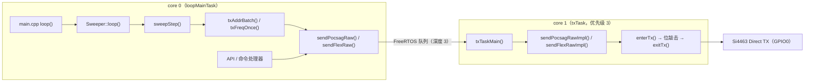

# Sweep & Transmission

本模块负责寻呼发射链路的两大部分：`Transmitter` 统一发射控制器（封装 Si4463 Direct TX 位敲击与双核异步发射）和 `Sweeper` 追码/追频扫描状态机。同属 Controller 层的 `TxQueue` 异步请求队列与本模块配合，避免命令处理器在回调上下文中执行阻塞操作。

## 架构总览



所有发射路径都分两个阶段：

1. **预编码阶段（core 0）**：`Transmitter::send()` 或 `Sweeper` 的批量编码器在调用方上下文生成基带码字数组，封装为 `Job` 提交到 FreeRTOS 队列。
2. **位敲击阶段（core 1）**：`txTask` 从队列取出 `Job`，执行 `Si446x_startDirectTX` → 逐位翻转 GPIO0 → `Si446x_stopTX`。

`Sweeper` 的批量扫描与单条消息走同一条队列、同一个后台任务，天然互斥，不存在 SPI / Direct TX 冲突。

## Transmitter — 统一发射控制器

### 职责

`Transmitter` 是最底层的发射抽象，不关心消息语义。它负责三件事：

- 将编码后的 POCSAG 码字数组 / FLEX 字节数组按波特率在 GPIO0 上逐位输出；
- 管理 Si4463 Direct TX 模式的进入与退出（含 `TX_SETTLE_MS=2` 进入延时与 `SI446X_TX_RECOVER_MS=20` 恢复延时）；
- 通过队列 + 后台任务，把位敲击的忙等待从 core 0 主循环与网络任务中移出。

### 双核异步发射模型

首次 `enqueue()` 时由 `ensureTask()` 惰性创建发射任务：

```
xTaskCreatePinnedToCore(txTaskEntry, "txTask", 8192, this, 3, &m_task, 1)
```

任务固定 core 1，优先级 3，栈 8KB，循环阻塞在 `xQueueReceive(m_queue, &job, portMAX_DELAY)` 上。队列深度为 3，`Job` 内部为联合体：

| 类型 | 载荷 | 说明 |
|---|---|---|
| `RAW_POCSAG` | `unsigned long words[1024]` + `wordCount` | 预编码 POCSAG 基带码字（单次 + Sweeper 批量共用） |
| `RAW_FLEX` | `uint8_t data[2048]` + `len` | 预编码 FLEX 基带字节（单次 + Sweeper 批量共用） |

`isBusy()` 定义为 `uxQueueMessagesWaiting(m_queue) > 0 || m_txActive`，其中 `m_txActive` 在 `txTaskMain()` 处理 Job 期间置位。这个调用同时被 `Sweeper::loop()` 用作门控信号。

### 统一发送入口 `send()`

`Transmitter::send(const Config&)` 是单条消息的入口，流程：

1. `clearAbort()`，清除上次 `abortTx()` 遗留的中断标志；
2. 按 `cfg.encoding` 分支预编码：
   - **FLEX**：数值消息按 `NUMERIC` 编码；字母消息先把中英混排文本转成含 `0x0E`（切中文）/ `0x0F`（切 ASCII）控制字符的混合字节流再按 `ALPHA` 编码。超长（`FlexEncoder::MAX_ALPHA_CHARS`）直接拒绝——截断点可能落在 GB2312 双字节对中间造成乱码。
   - **POCSAG**：字母消息经 `Charset::GB.get()` 转 GB2312 后按 `MODE_ALPHANUMERIC` 编码；数值消息按 `MODE_NUMERIC` 编码。超长（`MAX_MESSAGE_LEN = 1024`）拒绝。
3. 编码成功即调用 `sendPocsagRaw` / `sendFlexRaw` 入队；编码失败返回 `false` 并记录 `m_lastEncodeReason`（`INVALID_ADDR` / `MSG_TOO_LONG` / `OTHER`）。编码错误是确定性错误，调用方不应重试。

相位约定（POCSAG 与 FLEX 一致）：`invert = (cfg.phase == PhaseType::NORMAL)`。以寻呼机为参照系，NORMAL 相位下内部对位流取反，补偿本板 Si4463 Direct TX 模式固有的链路反相。

### Direct TX 位敲击

txTask 侧的发送流程：

```
enterTx()   → Si446x_startDirectTX(0, 1) + delay(2ms)
sendCodewords() / sendBytes()
exitTx()    → Si446x_stopTX() + delay(20ms)
```

- `sendCodewords`（POCSAG）从 MSB 到 LSB 输出 32 位码字；`sendBytes`（FLEX）从 MSB 到 LSB 输出 8 位字节，支持整体取反。
- 每位时刻基于 `esp_timer_get_time()` 绝对时间累加，保证波特率精确。
- `busyWaitUntil()` 忙等到目标时刻，期间检查 `m_abort`，实现下一个位边界即响应的停发；若中断被意外禁用，通过 `esp_cpu_get_ccount()` 周期计数（超过 2400000 周期）重新使能中断自救。
- 每 500 位调用一次 `esp_task_wdt_reset()`，防止长时间位敲击触发任务看门狗。

`sendCodewords` 内部有一处关键约束：**不能以 `word == 0` 作为码字流终止哨兵**。POCSAG 地址 1–7（function 0）的地址码字是合法的全零值（`0x00000000`），以零哨兵截断会丢地址并连带截掉后续整批。长度必须严格使用编码器返回的 `count`。

### 中止与忙状态

- `abortTx()`：置 `m_abort = true` 并 `xQueueReset` 清空队列。正在发射的 Job 在下一个位边界检测到 `m_abort` 提前退出；队列中未开始的 Job 被直接丢弃。
- `clearAbort()`：清除中断标志。`send()` 入口自动调用，`Sweeper::start()` 也会调用一次，确保上次 STOP 遗留的标志不影响新扫描。

## Sweeper — 追码 / 追频扫描状态机

### 模式与职责

| 模式 | 枚举值 | 行为 |
|---|---|---|
| `IDLE` | 0 | 空闲 |
| `ADDR_SWEEP` | 1 | 地址步进 +1，POCSAG / FLEX 各按 55 地址/批批量发射 |
| `FREQ_SWEEP` | 2 | 频率步进 `freqStepKHz`，每个频点完整发射一次 |

状态机完全非阻塞：`loop()` 只做检查与调度，位敲击全部发生在 core 1 的 `txTask`。

### 生命周期

`start(const Config&)` 的校验规则：

- 未注入 `Transmitter` 或参数非法 → 返回 -2；
- 已在运行（`m_mode != IDLE`）→ 返回 -1；
- `ADDR_SWEEP`：`addrStart` ≥ 1（地址 0 无寻呼机配 0）、`addrStart` ≤ `addrEnd`、`addrEnd` ≤ `0x1FFFFF`（POCSAG 21-bit 上限）；
- `FREQ_SWEEP`：`freqStartKHz` ≥ 119000（硬件下限）、`freqStartKHz` ≤ `freqMaxKHz`。

启动时设置 `m_current` 为起始地址/频率，由 `calcTotalSteps()` 计算总步数：

```
ADDR: total = addrEnd - addrStart + 1
FREQ: total = (freqMax - freqStart) / freqStep + 1
```

`stop()` 是**非阻塞停止**，只做三件事：快照频率恢复信息、置 `IDLE`、调用 `m_tx->abortTx()`。实际频率恢复延迟到 `loop()` 中执行，原因：

- `stop()` 可能在 AsyncTCP 回调（Web UI 停止）上下文中被调用，若在此处忙等 `txTask` 退出会阻塞整个服务任务；
- 若在 `stop()` 里直接 `setFrequency`，位敲击可能仍在进行——Si4463 处于 Direct TX 模式时不响应 `setFrequency`（CTS 忙等最长 400ms），且会造成帧中途跳频。

`loop()` 中的恢复逻辑等待 `m_tx->isBusy() == false`（意味着 `txTask` 已完全退出 Direct TX 并度过 20ms 恢复延时），再执行 `Si446x_setFrequencyKHz(m_restoreFreqKHz)`。

### 主循环调度

`Sweeper::loop()` 每次调用依次执行：

1. **恢复挂起**：`m_restorePending` 为真时，等 `isBusy() == false` 后恢复频率并打印日志；
2. **空闲即返回**；
3. **完成自动停止**：`m_done >= m_total` 时 `stop()` 并打印完成日志；
4. **异步门控**：`m_tx->isBusy()` 为真时返回——保证追频的 `setFrequency` 不会与 Direct TX 冲突，且 STOP 后队列残余最多 1–2 批；
5. **节拍调度**：`millis() >= m_nextTxMs` 时执行 `sweepStep()`。

`sweepStep()` 按模式分发到 `txAddrBatch()` / `txFreqOnce()`，随后计算下一批时刻：`m_nextTxMs = millis() + max(intervalMs, BATCH_GAP_MS)`。`BATCH_GAP_MS = 50` 是批次间隔下限，保证 WiFi / 串口有处理机会且 Si4463 状态有恢复时间。

### POCSAG 追码批量

每批 `POCSAG_BATCH_SIZE = 55` 个地址，流程：

1. `m_batchLeft == 0` 时从 `m_current` 构建新批：`m_batchBase = m_current`，统计到 `addrEnd` 为止的地址数（≤ 55，`m_batchSize`）；
2. 用实例成员 `m_batchEncoder` 调用 `encodeBatchMulti()`，将整批编码为一条连续基带流——单前导码、消息码字跨 SYNC 延续（ITU-R M.584）；
3. `sendPocsagRaw()` 整批一次入队（55 ≤ 编码器 `MAX_BATCH`，恒可编码）；
4. 入队成功后才推进 `m_done += addrEncoded`、`m_current = m_batchBase + m_batchSize`；队列满则直接返回，`m_batchLeft` 未推进，下一帧重试。

消息内容为地址十进制串，编码模式由 `cfg.msgType` 决定：POCSAG 寻呼机按功能码解码消息，字母功能码（A/B/C）收到 BCD 数字消息会解出控制字符进而显示空消息，因此消息格式必须与功能码匹配。

### FLEX 追码批量

FLEX 路径同样 55 地址/批，但编码结构不同：一次 ERS + 连续多帧（frame=0），帧内多地址多消息。v1 仅支持短地址（capcode ≤ 1933312，7 位内）。

关键点：

- **消息前缀 `\x0F`（SI）**：FLEX ALPHA 消息在地址十进制串前加 SI 控制字符，把中文寻呼机从默认 GB2312 模式切到 ASCII 模式，否则地址数字被误解码成乱码（实测"撤背"一类乱码的根因）。消息缓冲为 `m_flexMsgText[n][16]`：SI + ≤7 位数字 + NUL。
- **连续短地址子批**：从 `m_current` 起连续收集短地址，遇非短地址或超上限即停；收集结果写入 `m_flexBatch` 数组。
- **编码与入队**：`encodeBatch()` 一次编码整批，`sendFlexRaw()` 一次入队；队列满则返回重试，`m_current` 不推进。
- **退化路径**：`n == 0`（当前地址非短地址）时退化为逐地址编码发射，避免卡死。

性能对比（源码注释数据）：55 地址 ALPHA 批 ≈ ERS 420B + 4 帧×375B ≈ 1920B 一次入队，对比旧版逐地址发射（每地址 ERS + 1 帧 ≈ 4.0s）提速约 23 倍。

### 追频

`txFreqOnce()` 是单频点完整发射，不批量：

1. `isFreqMax()` 超限则完成停止；
2. `Si446x_setFrequencyKHz(m_current)`——此时 `txTask` 空闲（`loop()` 的 `isBusy` 门控保证），无发射冲突；
3. `delay(1)` 等待 PLL 锁定（Si4463 锁定时序约 200µs，1ms 有足够余量）；
4. 构建 `Transmitter::Config`，`message` 为频率值十进制串（如 `"152675"`），`address` 为配置的固定地址；
5. `m_tx->send(cfg)` 入队；队列满则返回重试，`m_current` 不推进；
6. 入队成功后 `m_done++`、`m_current += freqStepKHz`。

扫描结束或 `stop()` 后，`loop()` 会把频率恢复为 `m_origFreqKHz`（追频起始频率），恢复值在 `stop()` 时刻快照，防止 `stop()` 后立即 `start()` 覆盖 `m_cfg`。

### 状态查询

`getStatus()` 返回 `Status`：`running`、`mode`、`current`（下一批起点地址/频率）、`total`、`done`，以及 `batchStart` / `batchEnd`（当前批次区间，供 UI 显示）。批量进行中显示实际批次区间；否则单点区间等于 `current`。

## TxQueue — 异步请求队列

`TxQueue` 承载三类由主循环 `api_loop` 执行的延迟动作：

| 请求 | 置位 | 消费 | 说明 |
|---|---|---|---|
| 待发射 | `setPendingTx()` | `consumePendingTx()` | 缓存一条待发射消息（1024B），由主循环实际发射 |
| WiFi 扫描 | `triggerScan()` | `consumeScan()` | 触发后台扫描，结果存固定缓冲 |
| 设置 WiFi 凭据 | `setPendingWifi()` | `consumeWifi()` | 排队一组 SSID（33B）/ 密码（65B） |

并发模型为单消费者（`api_loop`，core 0 prio 1）+ 双生产者（Web AsyncTCP 回调 core 0 prio 3、串口回调与消费者同任务）。两个生产者可能在同一任务切换窗口内先后执行 `setXxx`，若无保护后到者会静默覆盖先到者。因此 pending 标志 + 数据的 check-then-act 由 `portMUX_TYPE` 临界区保护（操作均为短 `strncpy`，无阻塞调用）。

扫描结果缓存使用固定 `char[4096]` 缓冲而非 `String`：`String` 重分配会释放旧指针，其他任务持指针读取即 use-after-free。

## 与代码库其他部分的连接

- **Si446x**（`lib/si4463/Si446x.h`）：`Transmitter` 通过 `Si446x_startDirectTX` / `Si446x_stopTX` 控制射频；`Sweeper` 追频路径通过 `Si446x_setFrequencyKHz` 跳频与恢复。
- **Pocsag / FlexEncoder**（`src/Controller/`）：编码器只在 core 0 被调用，且均作为实例成员（`m_pocsagEncoder`、`m_flexEncoder`、`m_batchEncoder`）而非函数内 `static`——避免大对象栈分配，同时消除非重入状态。
- **API**（`src/Controller/API.h`）：`api_log` 输出扫描进度；`TxQueue` 由 API 命令处理器置位、`api_loop` 消费。
- **main.cpp**：`Sweeper::loop()` 由主循环每帧驱动；`Transmitter::txTask` 在 core 1 独立运行。

## 设计要点与踩坑记录

1. **不要在 `stop()` 中恢复频率**——AsyncTCP 回调上下文忙等会阻塞整个服务任务；Direct TX 模式下 `setFrequency` 不响应。恢复必须延迟到 `loop()` 且等 `isBusy() == false`。
2. **不要用 0 作为 POCSAG 码字流哨兵**——地址 1–7 function 0 的地址码字全零，以零截断会丢地址并连带截掉后续整批。
3. **FLEX 消息超长直接拒绝而非截断**——截断点可能落在 GB2312 双字节对中间导致乱码。
4. **区分队列满与编码失败**——`send()` 返回 `false` 时用 `lastEncodeReason()` 判断是否为确定性编码错误（不可重试）；原始发送接口返回 `false` 则可能是队列满（`Sweeper` 下帧重试，状态不推进）。
5. **POCSAG 消息格式必须与功能码匹配**——追码消息为地址十进制串，字母功能码收到 BCD 数字消息会得到空消息。
6. **FLEX 批量消息须加 `\x0F` 前缀**——否则中文寻呼机默认 GB2312 模式会把地址数字显示成乱码。