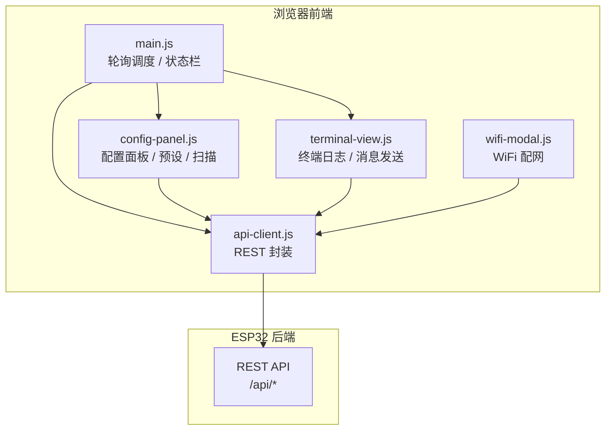

# Web Frontend

# Web 前端模块文档

## 模块概述

Web 前端是 BeeperTX POCSAG/FLEX 寻呼发射机的浏览器控制面板。它运行在 ESP32 静态文件服务上，通过 REST API 与后端交互，提供以下能力：

- **实时状态监控**：连接状态、WiFi IP、发射计数
- **发射参数配置**：协议（POCSAG/FLEX）、相位、铃音、消息类型、频率、码率、功率、地址
- **消息发送**：通过终端视图输入并发射消息
- **扫频/追码**：地址扫描与频率扫描的启动、停止和进度显示
- **预设管理**：配置的本地保存、加载、删除（localStorage）
- **WiFi 配网**：扫描附近网络、提交凭据并触发重启
- **日志查看**：终端风格的环形日志渲染，支持增量拉取

前端由 5 个 JavaScript 文件组成，均采用 IIFE 模式并通过全局对象暴露接口（兼容 ESP32 静态文件服务，无模块打包）：

| 文件 | 全局暴露 | 职责 |
|------|---------|------|
| `api-client.js` | `window.API` | REST 请求封装 |
| `config-panel.js` | `window.ConfigPanel` | 配置面板、预设、扫描控制 |
| `terminal-view.js` | `window.Terminal` | 终端日志渲染、消息发送 |
| `wifi-modal.js` | — | WiFi 配网弹窗 |
| `main.js` | `window.__setSweepActive` | 轮询调度、状态栏、整体协调 |

## 架构总览



前端各模块之间通过全局对象解耦：`main.js` 依赖 `ConfigPanel` 和 `Terminal`；`config-panel.js` 持有 `window.API` 和 `window.Terminal` 引用；`main.js` 通过 `window.__setSweepActive` 回调接收扫描状态变化。所有后端通信统一经由 `api-client.js`。

## 核心组件

### API 客户端（api-client.js）

封装所有 REST 调用。内部 `_fetch(method, path, body)` 统一处理 JSON 序列化与响应解析：若响应体不是合法 JSON，则返回 `{ code: -1, detail: text, raw: text }`，保证调用方只需检查 `resp.code` 即可判断成败。

暴露的接口与后端端点一一对应：

| 方法 | 端点 | 说明 |
|------|------|------|
| `ping()` | `GET /api/ping` | 健康检查 |
| `getStatus()` | `GET /api/status` | 设备状态（txCount 等） |
| `getConfig()` | `GET /api/config` | 完整发射配置 |
| `setConfig(cfg)` | `POST /api/config` | 部分或全部更新配置 |
| `transmit(msg?)` | `POST /api/transmit` | 发射消息，可选覆盖消息内容 |
| `reset()` | `POST /api/reset` | 重启设备 |
| `wifiStatus()` | `GET /api/wifi/status` | WiFi 状态（含 IP） |
| `wifiScan()` | `GET /api/wifi/scan` | 扫描 WiFi 网络 |
| `wifiSet(ssid, password)` | `POST /api/wifi` | 保存 WiFi 凭据 |
| `getLog()` | `GET /api/log` | 全量日志（首次拉取） |
| `getLogAfter(seq)` | `GET /api/log?after=seq` | 增量日志，返回 `seq`/`wrapped`/`lines` |
| `sweepStart(mode)` | `POST /api/sweep/start` | 启动扫描，`mode` 为 `'addr'` 或 `'freq'` |
| `sweepStop()` | `POST /api/sweep/stop` | 停止扫描 |
| `sweepStatus()` | `GET /api/sweep/status` | 扫描状态（`running`/`mode`/`current`/`batchStart`/`batchEnd`） |

### 配置面板（config-panel.js）

`config-panel.js` 是前端最复杂的模块，管理 DOM 事件绑定、配置下发、预设存储和扫描控制。

#### 按钮组与输入框

- 按钮组使用 `data-field` 属性标识字段名，点击后通过 `updateField(field, val)` 调用 `API.setConfig` 增量更新。
- `encoding` 按钮组有特殊处理：不直接提交，而是触发 `applyEncodingDefaults(enc)` 做 **原子提交**（编码 + 默认值一次请求）。
- 输入框映射：`inp-freq` 提交时 MHz→kHz（`Math.round(val * 1000)`），`inp-power` 映射到 `txPower`，`inp-addr` 映射到 `address`。
- `inp-mail-drop` 复选框映射到 `mailDrop` 字段（仅 FLEX 有意义）。

#### 协议切换逻辑

码率选项随协议动态重建（`rebuildBaudGroup`）：

| 协议 | 码率选项 | 默认 |
|------|---------|------|
| POCSAG | 512, 1200 | 1200 |
| FLEX | 1600, 2400, 3200 | 1600 |

切换编码时执行 `applyEncodingDefaults(enc)`：

- **POCSAG**：`phase` 恢复 `'normal'`，`baudRate` 设为 1200；`tone` 保留用户上次的选择。
- **FLEX**：`baudRate` 设为 1600；无极性概念，`phase` 隐藏并强制为 `'inverted'`（后端直发）；`tone` 不适用但保留值，切回 POCSAG 时恢复。

`updateEncodingUI(enc)` 控制字段显隐：FLEX 时隐藏 Phase 和 Tone 组，显示 Mail Drop 组；POCSAG 反之。

#### 控件锁定

扫描运行期间调用 `setConfigEnabled(false)` 禁用全部配置控件（按钮组、输入框、Mail Drop、Send 按钮、预设按钮与下拉）。注意 `controlsLocked` 标志：`rebuildBaudGroup` 在 10 秒周期刷新时重建按钮，需继承锁定态，否则扫描期间码率选项会意外变为可点击。

#### 预设管理

预设存储在 `localStorage` 的 `beeper_tx_presets` 键下，结构为 `{ [name]: TxConfig }`。

- **保存**：下拉未选中时以 `prompt` 新建；已选中则覆盖（均需确认）。保存内容来自 `collectFormConfig()`，直接读取表单状态，不依赖后端往返。
- **加载**：下拉 `change` 即触发 `handleLoadPreset()`，先 `API.setConfig` 全量下发，再 `refreshPanel()` 回读校准。
- **删除**：从 localStorage 移除对应键。

#### 扫描控制

扫描模块维护 4 个状态变量：`sweepRunning`（UI 层运行态）、`sweepPolling`（是否轮询 `/api/sweep/status`）、`sweepMode`（当前模式）、`sweepWasRunning`（上一轮轮询的 running 沿检测）。

- **启动**（`handleSweepStart`）：确认后调用 `sweepStart(mode)`，成功后开启 sweep 轮询、通过 `__setSweepActive(true)` 暂停 status 轮询，并切换 UI 为 STOP 状态。
- **停止**（`handleSweepStop`）：重试机制——至多 3 次，每次发送 `sweepStop()` 后立即查询 `sweepStatus()` 确认真实停止；若未停则等待 400ms 重试。结束后强制 `sweepWasRunning = true` 走停止沿处理，保证 UI 与设备端状态一致。
- **状态轮询**（`updateSweepUI`）：带 `sweepUiSyncing` 并发保护。依据 `running` 沿驱动逻辑：开始运行 → 开启 sweep 轮询、暂停 status 轮询；停止 → 关闭 sweep 轮询、恢复 status 轮询。
- **进度显示**：mode=1（Addr）时显示批次区间（如 `990-1005`），mode=2（Freq）时显示 `xxx.xxx MHz`。

### 终端视图（terminal-view.js)

终端视图提供日志渲染与消息发送能力，通过 `window.Terminal = { log, clear }` 暴露给其他模块。

- **日志行**：`log(text, cls)` 创建带时间戳的 `<div>`，按类别着色（tx 蓝、rx 绿、error 红、warn 黄、info 紫、system 灰），最多保留 200 行。
- **自动滚动**：监听滚动事件，滚动位置距底部 30px 以内时启用自动跟随。
- **消息发送**（`handleSend`）：发送前禁用按钮并显示 "Sending..."，成功后展示后端返回的完整发射参数（编码、相位、类型、铃音、地址、频率、码率），失败则显示错误。发送后 **不清空** 消息输入框，按钮在 2.5 秒后恢复（对应主循环异步发射耗时）。
- **清空**：`Clear` 按钮清空日志，`Clear`（消息区）按钮清空输入框；输入框支持 Enter 键发送。

### 主控制逻辑（main.js）

`main.js` 是轮询调度中枢，通过 `setInterval` 驱动多个周期任务：

| 周期 | 任务 | 说明 |
|------|------|------|
| 3s | `pollStatus` | 拉取设备状态、更新状态栏；扫描运行期间暂停以减少 AsyncTCP 回调负载 |
| 1.5s | `ConfigPanel.updateSweepUI` | 仅当 `isSweepPolling()` 为真时调用，避免空闲期无效请求 |
| 2s | `pollLog` | 增量拉取日志 |
| 10s | `ConfigPanel.refresh` | 定期从后端校准配置面板 |

扫描状态通过 `window.__setSweepActive(active)` 回调在模块间传递。`updateStatusBar` 依据 `wifiStatus().state === 3`（AP 模式）将状态点切换为黄色。

`pollLog` 采用 **序号增量拉取** 策略：

- 首次调用 `getLog()` 全量拉取，记录 `lastLogSeq`。
- 后续调用 `getLogAfter(lastLogSeq)`，只取序号更大的新行，避免每次传输整个环形缓冲。
- `wrapped === true` 表示客户端序号已滚出后端环形窗口，需要清屏全量重绘。

日志行的颜色分类在后端未提供类别字段的情况下通过内容匹配：包含 `TX>` 记 tx、`ERR` 记 error、`SWEEP` 记 info、`OK` 记 rx，其余为 system。此外，`pollLog` 还承担 **扫描兜底检测**：从新增日志中发现 `SWEEP START` 且本页未主动启动时，自动开启 sweep 轮询。

### WiFi 配网弹窗（wifi-modal.js)

配网弹窗由 `btn-wifi-config` 触发，打开时自动触发一次扫描。`handleScan` 的流程：

1. 调用 `wifiScan()` 触发后端后台扫描（首次返回可能是缓存）。
2. 每 500ms 轮询一次，最多 12 次（6 秒），等待扫描完成。
3. 兼容三种响应形态：JSON 数组、JSON 字符串、`{ scanResult: "[]" }` 包装。
4. 结果按 RSSI 降序渲染到下拉框，并显示信号图标。

`handleConnect` 校验 SSID 非空后调用 `wifiSet`，成功后禁用连接按钮并提示设备即将重启、需重新连接新 IP。

## 关键执行流程

### 初始化流程

所有 JS 文件在 `DOMContentLoaded` 时（或文档已就绪时立即）执行各自的 `init`。初始化顺序不强制跨模块依赖——`api-client.js` 最先加载，随后是 `config-panel.js`、`terminal-view.js`、`wifi-modal.js`，最后 `main.js` 启动轮询。`config-panel.js` 的 `init` 在初始化末尾执行一次 `updateSweepUI()`，以对齐设备端真实状态（如页面刷新时设备已在扫描中，避免误报空闲）。

### 编码切换的原子提交

POCSAG/FLEX 切换不是简单的单字段发送，而是将编码与协议默认值打包成一次请求：

```
用户点击 FLEX → 立即视觉高亮 → 100ms 后:
applyEncodingDefaults('flex')
  → patch = { encoding: 'flex', baudRate: 1600 }
  → API.setConfig(patch)
  → 成功后: rebuildBaudGroup('flex')
             updateEncodingUI('flex')
             setBtnGroup('phase', 'inverted')  // 隐藏但保持
             setBtnGroup('baudRate', '1600')
```

100ms 延迟是为了确保编码按钮的高亮反馈先呈现，再等待后端确认后更新派生字段。

### 扫描停止的重试与状态同步

扫描停止流程对网络抖动做了针对性处理：

```
handleSweepStop()
  for attempt in 1..3:
    API.sweepStop()
    s = API.sweepStatus()
    if s 且 s.running != true: stopped = true; break
    else 等待 400ms 重试
  无论结果:
    sweepWasRunning = true
    updateSweepUI()   // 走停止沿: 关闭 sweep 轮询、恢复 status 轮询、恢复控件
```

这样设计的原因：发射期间网络可能抖动导致 stop 请求丢失，必须有重试；而最终 UI 状态一律以设备端 `sweepStatus` 为准，避免本地状态与设备实际状态不一致。

## 与后端接口契约

前端与后端共享以下隐式约定（响应均为 JSON）：

- **成功标准**：响应中 `code` 为 0 或不存在（如 `getConfig` 直接返回配置对象）。
- **错误格式**：`{ code: 非0, detail: 错误描述 }`。
- **频率单位**：UI 层使用 MHz，后端存储与传输使用 kHz。所有前端入站（`setConfig`、`collectFormConfig`）做 ×1000 转换，出站显示（`applyConfig`）做 ÷1000 转换。
- **日志序号**：`getLog` 响应含 `seq`（当前最大序号）、`wrapped`（环形缓冲是否回绕）、`lines`（字符串数组）。
- **扫描模式**：`sweepStart` 接收 `'addr'`/`'freq'` 字符串；`sweepStatus` 返回的 `mode` 为数字（1=地址扫描，2=频率扫描），`batchStart`/`batchEnd` 为地址扫描的当前批次区间，`current` 为当前频点（kHz）。

## 开发注意事项

- **无模块打包环境**：所有 JS 文件通过 `<script>` 标签加载，依赖 IIFE + 全局对象模式。新增模块需自行挂载全局符号，避免使用 ES module 语法。
- **轮询负载控制**：`/api/status` 在扫描期间必须暂停（发射时序敏感），sweep 轮询只在运行时开启，日志轮询依赖增量拉取避免全量传输。
- **动态重建与锁定态**：`rebuildBaudGroup` 周期性重建按钮组时，必须继承 `controlsLocked` 状态，否则扫描锁定会被冲掉。
- **状态回传**：`main.js` 与 `config-panel.js` 通过 `window.__setSweepActive` 回调协作；新增扫描相关的 UI 逻辑时应遵循该回调约定。
- **预设兼容**：预设存储格式与后端 `TxConfig` 一致（频率存 kHz），不要在前端改动映射关系后忘记同步 `collectFormConfig` 与 `applyConfig` 的转换逻辑。