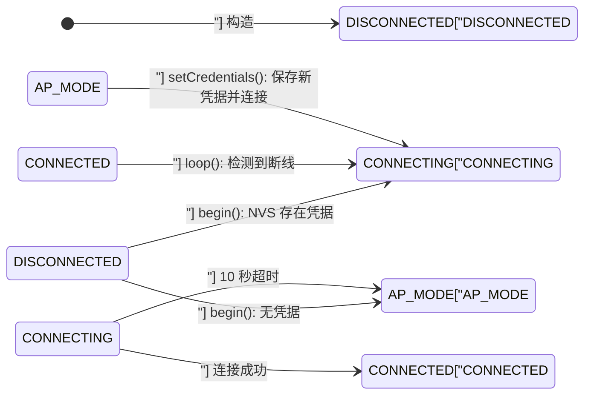

# WiFi Manager

# WiFiManager Module

## 模块概述

`WiFiManager` 是 ESP32 固件中的 WiFi 连接管理模块，为上层应用屏蔽了 STA 连接、断线重连、AP 配网和凭据持久化等底层细节。

模块承担四项职责：

- **自动连网**：启动时从 NVS 读取已保存的 WiFi 凭据，以 STA 模式连接上次使用的网络。
- **断线自愈**：`loop()` 每 10 秒巡检一次连接状态，断线自动重连，重连超时回退到 AP 配网模式。
- **AP 配网**：无凭据或连接失败时，开放名为 `BeeperTX` 的无线热点，并通过 DNS 劫持实现 Captive Portal，用户可在浏览器中完成配网。
- **凭据与扫描**：提供 NVS 凭据的读写/清除接口，以及 JSON 格式的 WiFi 扫描结果。

模块代码位于 `src/WiFiManager/` 目录，包含头文件 `WiFiManager.h`（接口声明）与实现文件 `WiFiManager.cpp`。它仅依赖 ESP32 Arduino 核心库（`WiFi`、`DNSServer`、`Preferences`）。调用图分析显示，本模块与代码库其它模块之间没有静态调用关系，属于自包含组件。

## 状态机

模块的核心是一个四状态状态机，枚举类型 `WiFiManager::State` 定义了所有状态：

| 状态 | 值 | 说明 |
|---|---|---|
| `DISCONNECTED` | 0 | 初始状态（构造函数完成后的状态） |
| `CONNECTING` | 1 | 正在尝试连接 STA 网络，10 秒超时 |
| `CONNECTED` | 2 | STA 连接成功，持有有效 IP |
| `AP_MODE` | 3 | AP 配网模式，开放热点 `BeeperTX` |



两条关键说明：

- `begin()` 内部的 `DISCONNECTED → CONNECTING → CONNECTED / AP_MODE` 是阻塞式完成的；而 `CONNECTED → CONNECTING → AP_MODE` 的转移由 `loop()` 的周期性巡检驱动。
- `setCredentials()` 是 AP 配网模式返回 STA 模式的唯一运行时入口。

## 公共 API 参考

| 方法 | 签名 | 说明 |
|---|---|---|
| `begin` | `void begin()` | 阻塞式启动入口。根据 NVS 中是否有凭据，自动决定走 STA 连接还是 AP 配网 |
| `loop` | `void loop()` | 主循环维护，每帧调用。处理 DNS 请求、巡检连接状态、执行重连或回退 |
| `state` | `State state() const` | 返回当前状态机状态 |
| `isConnected` | `bool isConnected() const` | 等价于 `state() == CONNECTED` |
| `ipAddress` | `const char* ipAddress() const` | 当前 IP 地址字符串。AP 模式下为 `192.168.4.1` |
| `ssid` | `const char* ssid() const` | 当前 SSID。STA 模式下是路由器 SSID，AP 模式下是 `"BeeperTX"` |
| `dnsServer` | `DNSServer& dnsServer()` | 内部 DNS 服务器引用，仅 AP 模式下有效 |
| `setCredentials` | `void setCredentials(const char* ssid, const char* password)` | 保存凭据到 NVS 并立即发起 STA 连接 |
| `clearCredentials` | `void clearCredentials()` | 清除 NVS 中保存的 WiFi 凭据 |
| `scanNetworks` | `String scanNetworks()` | 同步扫描周围 WiFi 网络，返回 JSON 数组字符串 |

## 启动流程

`begin()` 是阻塞式启动入口，应在系统初始化阶段调用一次。完整流程如下：

1. 调用 `loadCredentials()` 从 NVS 命名空间 `"wifi"` 读取 `ssid` 与 `pass`。
2. 若读取到非空 SSID：
   - 切换为 STA 模式（`WiFi.mode(WIFI_STA)`），设置主机名为 `BeeperTX`。
   - 调用 `WiFi.begin(ssid, pass)` 发起连接。
   - 状态置为 `CONNECTING`，然后以 500ms 为间隔轮询 `WiFi.status()`，最长等待约 10 秒。
   - 连接成功 → 更新 `m_ssid` 与 `m_ip`，状态置为 `CONNECTED`，`begin()` 返回。
   - 超时失败 → 进入步骤 3。
3. 未读取到凭据，或连接失败 → 调用 `startAP()` 进入 AP 配网模式。

`startAP()` 的初始化动作：

- `WiFi.mode(WIFI_AP_STA)` —— 使用"AP + STA"双模式而非纯 AP 模式，目的是在配网期间保留 STA 接口，以便 `scanNetworks()` 仍能扫描周围网络。
- `WiFi.softAP("BeeperTX")` —— 开放无密码热点。
- 状态置为 `AP_MODE`，IP 记录为 `192.168.4.1`。
- `m_dns.start(53, "*", WiFi.softAPIP())` —— 启动 DNS 劫持。所有域名的 DNS 查询都被解析到 ESP32 自身 IP，配合设备上的 HTTP 服务实现 Captive Portal。

## 主循环维护

`loop()` 应在主循环的每一帧调用，它执行两类工作：

**1. DNS 劫持响应（每帧）**

当状态为 `AP_MODE` 时，调用 `m_dns.processNextRequest()` 实时响应客户端的 DNS 查询。

**2. 连接状态巡检（每 10 秒）**

以 `m_lastCheck` 为时间戳做节流，每次巡检的行为取决于当前状态：

| 当前状态 | 巡检条件 | 动作 |
|---|---|---|
| `CONNECTED` | `WiFi.status() != WL_CONNECTED` | 重新读取 NVS 凭据确认其存在，调用 `WiFi.reconnect()`，状态置为 `CONNECTING`，记录 `m_connectStart` |
| `CONNECTING` | `WiFi.status() == WL_CONNECTED` | 更新 `m_ip`，状态置为 `CONNECTED` |
| `CONNECTING` | `millis() - m_connectStart > 10000` | 调用 `startAP()` 回退到 AP 配网模式 |

需要注意，状态转移最多会延迟一个巡检周期（10 秒）。例如 `setCredentials()` 发起连接后，即使链路已经建立，`isConnected()` 也要等到下一个 10 秒节流窗口才会返回 `true`。

## 配网与凭据管理

### NVS 存储布局

凭据保存在 Preferences 命名空间 `"wifi"`（常量 `NVS_NS`）下：

| 键 | 类型 | 说明 |
|---|---|---|
| `ssid` | String | WiFi 网络名称 |
| `pass` | String | WiFi 密码 |

相关私有方法：

- `loadCredentials()` —— 以只读方式打开 NVS，读取两个字符串。`ssid` 为空时返回 `false`。
- `saveCredentials()` —— 以读写方式打开 NVS，写入两个字符串。
- `clearCredentials()` —— 调用 `prefs.clear()` 清空整个命名空间。

### setCredentials() 配网入口

`setCredentials(ssid, password)` 是配网流程的核心方法，供上层代码（HTTP 表单处理、BLE 配置回调等）调用：

1. 调用 `saveCredentials()` 将新凭据持久化到 NVS。
2. 切换 STA 模式，设置主机名，调用 `WiFi.begin(ssid, password)` 立即发起连接。
3. 同步更新 `m_ssid`，状态置为 `CONNECTING`。

连接结果由 `loop()` 接管维护：成功进入 `CONNECTED`，10 秒超时回退 `AP_MODE`。整个过程无需重启设备。

值得注意的是，`setCredentials()` 是"先保存、后连接"：即使新凭据是错误的，也会被写入 NVS。下次启动时，`begin()` 会先尝试连接该错误网络（最长约 10 秒），失败后才回退 AP 模式。

### Captive Portal 配网时序

1. 设备进入 `AP_MODE`，开放热点 `BeeperTX`。
2. DNS 劫持生效，用户连接热点后访问任意域名都会到达 `192.168.4.1`。
3. 设备上的 HTTP 服务（本模块之外的组件）向用户展示配网页。
4. 用户选择网络并输入密码后，上层调用 `setCredentials()`。
5. 模块保存凭据、切换 STA 模式并连接，配网完成。

## WiFi 扫描

`scanNetworks()` 同步执行扫描，返回 JSON 数组格式的字符串：

```json
[
  {"ssid":"MyWiFi","rssi":-45,"secure":true},
  {"ssid":"Office_5G","rssi":-62,"secure":false}
]
```

字段说明：

- `ssid`：网络名称。
- `rssi`：信号强度（dBm，负数，值越大信号越强）。
- `secure`：是否需要密码。加密方式为 `WIFI_AUTH_OPEN` 时为 `false`。

实现细节：

- 通过 `WiFi.scanNetworks()` 执行同步扫描，扫描完成后调用 `WiFi.scanDelete()` 释放结果内存。
- 扫描结果直接拼接 SSID 字符串，未做 JSON 转义（见"已知注意事项"）。
- `startAP()` 使用 `WIFI_AP_STA` 双模式，因此 AP 配网状态下可以正常扫描。若在 `CONNECTED` 状态下调用，扫描过程会切换信道，可能短暂影响正在进行的连接，建议仅在配网阶段使用。

## 与代码库的集成

调用图分析显示，本模块没有任何对外调用，也没有外部模块调用本模块——它不依赖项目中的其它组件，只依赖 ESP32 Arduino 核心库。上层代码通过公开 API 使用它即可：

```cpp
#include "WiFiManager.h"

WiFiManager wifi;

void setup() {
  wifi.begin(); // 阻塞式启动；返回后设备已连接，或处于 AP 配网模式
}

void loop() {
  wifi.loop(); // 每帧调用：DNS 劫持响应 + 连接状态巡检

  if (wifi.isConnected()) {
    // 已连接：启动 MQTT、HTTP 客户端等业务逻辑
  } else if (wifi.state() == WiFiManager::AP_MODE) {
    // 配网模式：由外部 HTTP 服务处理配网页请求（伪代码示例）：
    //   GET  /api/wifi/scan   → 返回 wifi.scanNetworks()
    //   POST /api/wifi/config → 调用 wifi.setCredentials(ssid, pass)
  }
}
```

典型使用场景：设备首次上电无凭据 → 进入 AP 模式 → 用户手机连接 `BeeperTX` 热点 → 浏览器被 Captive Portal 引导到配网页 → 用户提交网络信息 → `setCredentials()` 保存并连接 → 设备成功入网。全程无需串口或烧录工具。

## 内部实现结构

### 数据成员

| 成员 | 类型 | 说明 |
|---|---|---|
| `m_state` | `State` | 当前状态机状态 |
| `m_ip` | `char[16]` | IP 地址字符串缓存（IPv4 最多 15 字符 + 结束符） |
| `m_ssid` | `char[33]` | SSID 字符串缓存（SSID 最长 32 字节 + 结束符） |
| `m_lastCheck` | `unsigned long` | 上次巡检时刻的 `millis()` 值，用于 10 秒节流 |
| `m_connectStart` | `unsigned long` | 最近一次进入 `CONNECTING` 的时刻，用于 10 秒超时判定 |
| `m_dns` | `DNSServer` | 内置 DNS 服务器实例，仅 AP 模式启动 |
| `NVS_NS` | `static const char*` | NVS 命名空间常量，值为 `"wifi"` |

### 私有方法

| 方法 | 说明 |
|---|---|
| `startAP()` | 切换到 AP 配网模式，启动热点与 DNS 劫持 |
| `loadCredentials()` | 从 NVS 读取凭据 |
| `saveCredentials()` | 写入凭据到 NVS |
| `connectSTA()` | **仅声明，未实现**（见下方注意事项） |

## 已知注意事项

以下事项对维护和扩展本模块的开发者有价值：

1. **`connectSTA()` 声明未定义**：头文件私有区声明了 `bool connectSTA()`，但源文件中没有对应实现——STA 连接逻辑实际内联在 `begin()` 中。当前不影响编译和运行，因为无人调用它，但重构时应删除声明或补全实现。

2. **`setCredentials()` 未初始化超时基准**：`setCredentials()` 将状态置为 `CONNECTING`，但没有设置 `m_connectStart`；构造函数也没有初始化该成员。因此 `loop()` 在执行 `millis() - m_connectStart > 10000` 超时判定时，可能会基于一个不确定的初值，导致回退 AP 的时机不可预期。建议在 `setCredentials()` 中同步执行 `m_connectStart = millis()`。

3. **`begin()` 阻塞约 10 秒**：当 NVS 中保存了凭据、但网络不可达或认证失败时，`begin()` 会阻塞调用者约 10 秒。若系统启动流程对时延敏感，应在调用 `begin()` 之前完成其它关键初始化。

4. **扫描 JSON 未做转义**：`scanNetworks()` 直接拼接 SSID 字符串。如果附近存在名称含英文双引号（`"`）或反斜杠（`\`）的热点，生成的 JSON 将非法。若调用方需要严格 JSON，应补充字符串转义逻辑。

5. **`esp_wifi.h` 为冗余包含**：`WiFiManager.cpp` 中 `#include <esp_wifi.h>` 未被使用，可以移除。